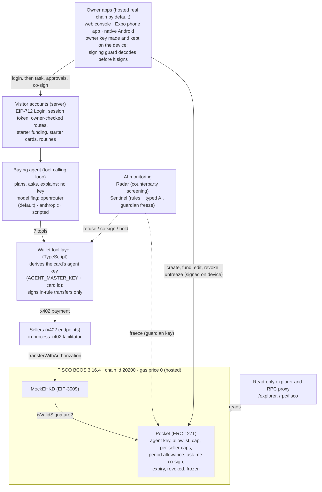

# 01. Overview and architecture

ChainBrain (链AI脑) is a consumer wallet in which the owner opens a separately funded *pocket* for an AI agent. Each pocket is its own smart contract on FISCO BCOS, holding Mock e-HKD and the owner's rules. The agent pays sellers by itself over x402, and the pocket contract approves each payment only if it fits those rules. The design assumes the agent can be fooled: the model never holds a key, every payment passes layers that do not depend on the model, and the AI monitoring (Radar and the Sentinel) can only make the rules stricter. FinTechathon 2026, International AI Track, Topic F (Agent Wallet). The owner apps call a pocket a "card"; the code calls it a pocket. Both apps open on the hosted real FISCO BCOS chain by default: the owner key is made on the device, a visitor account is opened with one signed login, and each card gets its own agent key on the server. The offline built-in network is now opt-in (Settings).

## 1. Core ideas

| Idea | What it means in the code |
| --- | --- |
| Give the AI a pocket, not the wallet | The agent can only spend from one pocket contract, never the owner's main wallet (`contracts/src/Pocket.sol`). |
| Budget = balance | Funding a pocket sets its budget; the token cannot move more than the balance, so no spend counter is needed ([02](02-smart-contracts.md)). |
| The contract is the hard limit | At settlement the token asks the pocket `isValidSignature`; the pocket refuses any seller, amount, signer or state outside its rules ([02](02-smart-contracts.md)). |
| Limits over time, on-chain | A period allowance (per day, week or month, Hong Kong calendar) and per-seller caps live in the pocket; beyond the allowance a payment needs the owner's co-signature (`OVER_PERIOD`) ([02](02-smart-contracts.md)). |
| Verify without trusting us | `verify/verify_pocket.py` reads a pocket's rules from the chain with its own code (Python standard library only, read-only), checks that the pocket came from the ChainBrain factory, and diffs its rules against what the owner approved ([08](08-chain-and-deployment.md)). |
| The model never holds a key | The LLM has seven tools; the tool layer holds the agent key and signs only token transfers it built itself ([03](03-wallet-server.md), [04](04-agent-and-ai-brain.md)). |
| The owner key stays on the device | The phone (Keychain / Keystore) and the web console (browser key, optionally wrapped by a passkey) make and keep the owner key; the server never sees it. The device signs only what the signing guard can decode and allows (`shared/chain/guard.ts`; [06](06-frontends.md)). |
| One agent key per card | The server derives each card's agent key from `AGENT_MASTER_KEY` and the card id, never stores it, and signs only for a card whose owner is the visitor who was given that agent (`server/src/agentKeys.ts`; [03](03-wallet-server.md)). |
| Visitors sign in with their key | One EIP-712 Login over a single-use nonce opens an account, funds the new key and returns a session token; routes that act for a card check that the token's owner owns it on-chain (`server/src/visitors.ts`; [03](03-wallet-server.md)). |
| One switch for the model | `LLM_PROVIDER` picks `openrouter` (default, Claude Haiku 5.5), `anthropic` or `scripted` for every model call (`server/src/llm.ts`; [04](04-agent-and-ai-brain.md)). |
| Seller text is data | Seller content reaches the model only inside `<untrusted_content>`; data and signature requests are refused ([05](05-security-and-monitoring.md)). |
| AI only tightens | Radar, the Sentinel, memory and rule parsing can add a refusal, a co-sign or a freeze; none can loosen a rule ([04](04-agent-and-ai-brain.md), [05](05-security-and-monitoring.md)). |
| The owner signs every rule change | Only the owner key can edit, revoke, unfreeze or withdraw; the Sentinel's guardian key can only freeze ([02](02-smart-contracts.md)). |

## 2. System architecture

## 3. One payment, end to end

0. Once per account: the owner's device signs a Login, the server opens the visitor account and funds the new key; each new card's agent address comes from `POST /v1/cards/agent`, and the owner key signs `factory.create` and the funding transfer itself ([03](03-wallet-server.md), [08](08-chain-and-deployment.md)).
1. The owner states a task; the agent drafts an intent from a fixed template and the owner confirms it ([03 §7](03-wallet-server.md)).
2. The agent searches sellers and asks for a quote; the seller answers HTTP 402 with a price ([03 §6](03-wallet-server.md)).
3. Radar screens the seller's payment address on-chain and may refuse it or require the owner ([05 §7](05-security-and-monitoring.md)).
4. The tool layer checks the quote against the intent and against the pocket's `canPay` on-chain ([03 §5](03-wallet-server.md)).
5. Above the ask-me threshold, the owner co-signs the exact payment on their device ([03 §8](03-wallet-server.md)).
6. Pre-flight predicts the outcome with `eth_call` ([05 §8](05-security-and-monitoring.md)).
7. The tool layer derives the card's own agent key and signs an EIP-3009 authorisation from the pocket; the seller's facilitator submits it; the token asks the pocket `isValidSignature`, and the pocket rebuilds the digest and checks every rule ([02 §3](02-smart-contracts.md)).
8. Every step is published on the event bus and shown live in the owner apps (every hash opens in the server's explorer) ([03 §3](03-wallet-server.md), [06](06-frontends.md)). The Sentinel watches the same stream and can freeze the pocket on-chain ([05 §9](05-security-and-monitoring.md)).

## 4. Repository map

| Path | What | Document |
| --- | --- | --- |
| `contracts/` | Pocket, PocketFactory, MockEHKD, Clock; Foundry tests and deploy script | [02](02-smart-contracts.md) |
| `server/` | Wallet API (:8787), agent loop, tool layer, Radar, Sentinel, memory, test sellers (:4021), explorer, faucet, scripts | [03](03-wallet-server.md), [04](04-agent-and-ai-brain.md), [05](05-security-and-monitoring.md) |
| `server/src/llm.ts` | The one model switch (`LLM_PROVIDER`, per-role model ids, OpenRouter presets) | [04](04-agent-and-ai-brain.md), [10](10-configuration.md) |
| `server/src/visitors.ts`, `agentKeys.ts` | Visitor accounts (EIP-712 login, session tokens, `guard`) and per-card derived agent keys | [03](03-wallet-server.md) |
| `server/src/ledger.ts`, `store.ts`, `limits.ts` | Every server transaction (nonce handling, reverts), JSON-file persistence (`DATA_DIR`), rate and sign-up windows | [03](03-wallet-server.md), [08](08-chain-and-deployment.md) |
| `server/src/routines.ts`, `starter.ts`, `arena.ts` | Routines run by the server, a new account's starter cards, the fooled-agent attack on the real chain | [03](03-wallet-server.md), [05](05-security-and-monitoring.md) |
| `server/src/explorer.ts`, `rpcProxy.ts` | Read-only explorer (`/explorer`) and read-only JSON-RPC proxy (`/rpc/fisco`) | [03](03-wallet-server.md), [08](08-chain-and-deployment.md) |
| `shared/chain/` | What apps and server share on the real chain: the EIP-712 Login (`login.ts`) and the signing guard (`guard.ts`) | [03](03-wallet-server.md), [06](06-frontends.md) |
| `shared/sim/` | The built-in (demo) network: wallet API, tool layer and pocket rules on a virtual chain; both apps use it only when the owner turns it on in Settings | [07](07-built-in-network.md) |
| `web/` | Network console for judges and the presenter; owner wallet in the browser (`web/src/owner/`) | [06](06-frontends.md) |
| `mobile/` | Expo owner app (iOS and Android, Expo Go); owner key in secure storage, visitor login, signing guard | [06](06-frontends.md) |
| `android/` | Native Kotlin owner app | [06](06-frontends.md) |
| `scripts/fisco/`, `deploy/` | Local FISCO BCOS node; hosted node, RPC gateway and server images | [08](08-chain-and-deployment.md) |
| `verify/` | Independent pocket verifier (Python, standard library only) | [08](08-chain-and-deployment.md) |
| `devstack/` | Real server and contracts on the FISCO node with a scripted agent, for demos and tests without an API key | [08](08-chain-and-deployment.md) |

## 5. Technology

| Layer | Stack (versions from the lockfiles) |
| --- | --- |
| Contracts | Solidity 0.8.24, Foundry, OpenZeppelin (ECDSA) |
| Chain | FISCO BCOS 3.16.4, web3 JSON-RPC, chain id 20200, gas price 0, Mock e-HKD (6 decimals) |
| Server | Node 24, TypeScript, Hono 4.13.13, viem 2.57.4, `@x402/*` 2.28.0, `@anthropic-ai/sdk` 0.133.0 (also the client for OpenRouter's Anthropic-compatible endpoint), zod 4.6.7 |
| AI | One flag, `LLM_PROVIDER`: `openrouter` (default; Claude Haiku 5.5, only the listed presets allowed), `anthropic` (per-role ids, agent `claude-opus-5-5`) or `scripted` (no model). Sentinel AI layer via TypeSafe Jev when its key is set, else the configured model with typed answers |
| Web console | React 19, Vite 8, Tailwind 4; owner key in the browser, optional WebAuthn passkey wrap |
| Expo app | Expo SDK 57, React Native 0.86, viem, `expo-secure-store` (owner key) |
| Native Android | Kotlin, Jetpack Compose, web3j crypto/abi 4.12.3, OkHttp, Android Keystore |

## 6. Running modes

| Mode | What runs | Use |
| --- | --- | --- |
| Hosted real chain (default) | Both apps talk to the hosted ChainBrain server (`EXPO_PUBLIC_API_URL` / `VITE_API_URL` pick another) on the real FISCO BCOS chain; owner key on the device, visitor login, per-card agent keys, model per `LLM_PROVIDER` | Normal use, judges, on-chain evidence ([08](08-chain-and-deployment.md)) |
| Built-in (demo) network | Everything in the app, on a virtual chain; no server, keys or internet. Opt-in: Settings, Demo network. If the server cannot be reached the apps offer it, never fall back silently | Offline demos ([07](07-built-in-network.md)) |
| Dev stack | Real server and contracts on the local FISCO node; scripted agent; visitor login on, in-memory data | End-to-end tests without an API key ([08 §7](08-chain-and-deployment.md)) |
| Own server | The same server run locally or elsewhere, pointed at a local or hosted FISCO node | Development, evidence scripts ([08](08-chain-and-deployment.md)) |

## 7. Document map

| # | Document | Covers |
| --- | --- | --- |
| 01 | This document | Concepts, architecture, payment flow, repository, stack, running modes |
| 02 | [Smart contracts](02-smart-contracts.md) | Every contract, function, rule and test |
| 03 | [Wallet server](03-wallet-server.md) | Routes, events, tools, reason codes, x402, intents, approvals, sellers |
| 04 | [Agent and AI brain](04-agent-and-ai-brain.md) | Agent loop, prompt rules, memory, connected agents, models |
| 05 | [Security and monitoring](05-security-and-monitoring.md) | Every protection layer, Radar, Sentinel, attack → layer table, limits |
| 06 | [Frontends](06-frontends.md) | Web console, Expo app, native Android app |
| 07 | [Built-in network](07-built-in-network.md) | The offline simulator and every demo scene |
| 08 | [Chain and deployment](08-chain-and-deployment.md) | FISCO BCOS, funding, facilitator, hosting, dev stack, evidence, independent verifier |
| 09 | [Testing](09-testing.md) | Every suite, results on `main`, gaps |
| 10 | [Configuration](10-configuration.md) | Every environment variable and build property |
