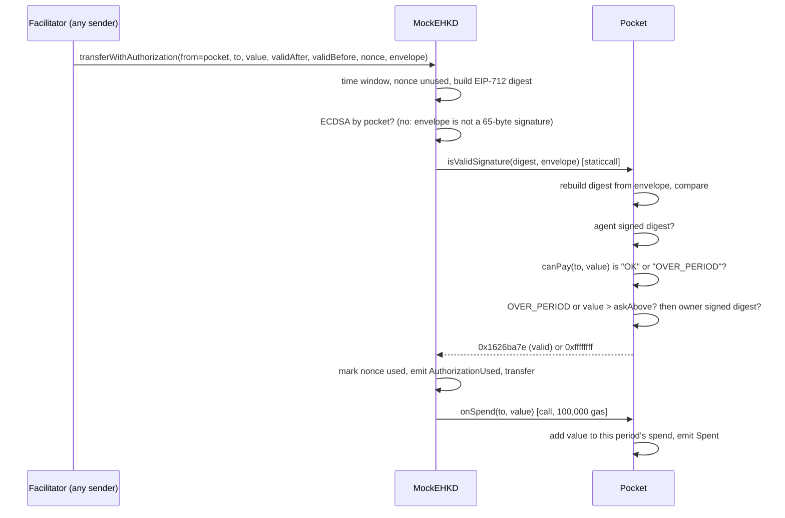

# 02 Smart Contracts: Pocket, PocketFactory, MockEHKD

ChainBrain has four Solidity sources in `contracts/src`: `Pocket` (an ERC-1271 contract wallet that approves token transfers only inside the owner's rules), `PocketFactory` (deploys pockets), `MockEHKD` (a demo ERC-20 with EIP-3009, the payment token) and `Clock` (a library that turns FISCO BCOS's millisecond timestamps into seconds). A pocket never sends a transaction to pay. The token asks it "is this signature valid?" at settlement, and the pocket answers only for an in-rule transfer out of itself. After the transfer the token reports the spend back to the pocket, which is how the pocket counts its period allowance. This document lists every contract's state, functions, access rules, events and reason codes, the signature envelope and its check order, the period allowance and per-seller caps, the guardian freeze, the design limits, the deploy script, the deployment record and the tests. The owner-facing apps call a pocket a "card"; the code and this document say "pocket".

## 1. Overview

| File | Lines | Role |
| --- | --- | --- |
| `contracts/src/Pocket.sol` | 216 | Per-agent wallet; ERC-1271 `isValidSignature`; rules; period allowance; per-seller caps; guardian freeze |
| `contracts/src/PocketFactory.sol` | 27 | Deploys pockets; sets the caller as owner; fixes the guardian |
| `contracts/src/MockEHKD.sol` | 102 | Mock e-HKD (`eHKD`, 6 decimals); EIP-3009 with ERC-1271 payers; spend hook to contract payers |
| `contracts/src/Clock.sol` | 11 | `nowSec()`: block time in seconds on FISCO and on Ethereum |

Toolchain (`contracts/foundry.toml`, `contracts/foundry.lock`):

| Setting | Value |
| --- | --- |
| Compiler | solc 0.8.24, optimizer on, 200 runs |
| Library | OpenZeppelin Contracts v5.4.0 (submodule `lib/openzeppelin-contracts`), remapped as `@openzeppelin/contracts/` |
| Test library | forge-std (`lib/forge-std`) |
| File access | read-write on `./deployments` only (the deploy script writes there) |
| Fuzz and invariant settings | None in `foundry.toml`, so Foundry's defaults apply |

How a payment flows through the contracts:



## 2. Clock

`Clock.nowSec()` returns `block.timestamp / 1000` when `block.timestamp > 1e11`, else `block.timestamp` (`contracts/src/Clock.sol:8-10`).

- FISCO BCOS 3.x gives contracts `block.timestamp` in milliseconds, while its web3 RPC reports seconds (`contracts/src/Clock.sol:4`).
- A seconds value passes `1e11` only in the year 5138, so on Ethereum-style chains the function is a no-op (`contracts/src/Clock.sol:5-6`).
- `Pocket` uses it for expiry (`Pocket.sol:80`) and for the current allowance period (`Pocket.sol:102`, `:146`).
- `MockEHKD` uses it for the EIP-3009 time window (`MockEHKD.sol:61-62`).
- Every expiry, every period boundary and every signed authorization is therefore in seconds on every chain.

## 3. Pocket

### 3.1 Purpose

A pocket is an isolated eHKD balance for one agent key (`Pocket.sol:12-15`). It approves EIP-3009 transfers out of itself through ERC-1271 only when the owner's rules allow them. It has no function that moves money on the agent's behalf. The only outgoing transfer it makes itself is `returnFunds`, to the owner.

### 3.2 State

| Variable | Type | Mutable | Set by | Meaning |
| --- | --- | --- | --- | --- |
| `token` | `address` | immutable | constructor | The payment token (MockEHKD) (`Pocket.sol:23`) |
| `owner` | `address` | immutable | constructor | The person; the only rule editor (`Pocket.sol:24`) |
| `agent` | `address` | immutable | constructor | The agent key that signs payments (`Pocket.sol:25`) |
| `guardian` | `address` | immutable | constructor | The Sentinel's freeze-only key; `address(0)` = none (`Pocket.sol:26-27`) |
| `perPaymentCap` | `uint256` | yes | `setCap` | Largest single payment, unless the seller has its own cap (`Pocket.sol:29`) |
| `askAbove` | `uint256` | yes | `setAskAbove` | Payments above this also need the owner's signature (`Pocket.sol:30`) |
| `expiresAt` | `uint64` | yes | `setExpiresAt` | Unix seconds; payments stop at and after it (`Pocket.sol:31`) |
| `revoked` | `bool` | one way | `revoke` | Permanent stop; there is no un-revoke (`Pocket.sol:32`) |
| `frozen` | `bool` | yes | `freeze` / `unfreeze` | Temporary stop (`Pocket.sol:33`) |
| `sellerAllowed` | `mapping(address => bool)` | yes | constructor, `setSeller` | Seller allowlist (`Pocket.sol:34`) |
| `sellerCap` | `mapping(address => uint256)` | yes | `setSellerCap` | A seller's own per-payment cap; `0` = the pocket's cap applies (`Pocket.sol:35-36`) |
| `periodKind` | `uint8` | yes | `setPeriodLimit` | `0` none, `1` day, `2` week, `3` month (`Pocket.sol:38-41`) |
| `periodLimit` | `uint256` | yes | `setPeriodLimit` | Most the agent may spend alone per period (`Pocket.sol:42`) |
| `_spent` | `uint256` | internal | `onSpend`, `setPeriodLimit` | Spent in period `_spentIn` (`Pocket.sol:43`) |
| `_spentIn` | `uint256` | internal | `onSpend`, `setPeriodLimit` | The period number `_spent` belongs to (`Pocket.sol:44`) |

There is no budget variable. The budget is the pocket's eHKD balance (`Pocket.sol:14`).

Constants: `MAGIC = 0x1626ba7e` (the ERC-1271 success value), `INVALID = 0xffffffff`, and `TRANSFER_TYPEHASH`, the EIP-3009 `TransferWithAuthorization` type hash (`Pocket.sol:17-21`).

### 3.3 Constructor

`constructor(token_, owner_, agent_, guardian_, cap, askAbove_, expiresAt_, sellers[])` (`Pocket.sol:60-74`).

- It stores every argument.
- For each seller in the list it sets `sellerAllowed[s] = true` and emits `SellerSet(s, true)` (`Pocket.sol:70-73`).
- It sets no period allowance and no seller caps; both start at zero (off).
- It validates nothing: zero addresses, a zero cap or a past expiry are accepted.
- Pockets are normally created through `PocketFactory.create`, which passes `msg.sender` as the owner (`PocketFactory.sol:23`).

### 3.4 External functions

| Function | Kind | Who may call | Checks | Effect | Event |
| --- | --- | --- | --- | --- | --- |
| `canPay(to, value)` | view | anyone | none | Returns a reason code (section 3.5) (`Pocket.sol:77-87`) | none |
| `periodOf(t)` | view | anyone | none | The period number of unix second `t` for the current `periodKind`; `0` when off (`Pocket.sol:90-99`) | none |
| `spentThisPeriod()` | view | anyone | none | `_spent` if the allowance is on and `_spentIn` is the current period, else `0` (`Pocket.sol:101-103`) | none |
| `needsOwner(value)` | view | anyone | none | Returns `value > askAbove` (`Pocket.sol:117-119`) | none |
| `isValidSignature(hash, signature)` | view | anyone (the token, in practice) | Section 3.6 | Returns `MAGIC` or `INVALID` (`Pocket.sol:124-139`) | none |
| `onSpend(to, value)` | write | the token only | `NOT_TOKEN` otherwise (`Pocket.sol:144`) | Adds `value` to the current period's spend; does nothing when the allowance is off (`Pocket.sol:143-150`) | `Spent(to, value, spentThisPeriod)` |
| `freeze(reason)` | write | owner, or guardian if non-zero | `NOT_GUARDIAN` otherwise | `frozen = true` (`Pocket.sol:159-163`) | `Frozen(msg.sender, reason)` |
| `unfreeze()` | write | owner | `NOT_OWNER` | `frozen = false` (`Pocket.sol:167-170`) | `Unfrozen()` |
| `revoke()` | write | owner | `NOT_OWNER` | `revoked = true`, permanent (`Pocket.sol:172-175`) | `Revoked()` |
| `returnFunds()` | write | owner | `NOT_OWNER`; token transfer must return true (`TRANSFER_FAILED`) | Sends the whole eHKD balance to the owner (`Pocket.sol:177-179`) | none from the pocket; the token emits `Transfer` |
| `setSeller(seller, ok)` | write | owner | `NOT_OWNER` | Adds or removes a seller (`Pocket.sol:181-185`) | `SellerSet(seller, ok)`, `RulesChanged()` |
| `setSellerCap(seller, cap)` | write | owner | `NOT_OWNER` | Sets that seller's own cap; `0` clears it (`Pocket.sol:187-191`) | `SellerCapSet(seller, cap)`, `RulesChanged()` |
| `setPeriodLimit(kind, limit)` | write | owner | `NOT_OWNER`; `kind <= 3` (`BAD_PERIOD`) | Sets `periodKind` and `periodLimit`; resets the count when `kind` changes (`Pocket.sol:194-200`) | `RulesChanged()` |
| `setCap(cap)` | write | owner | `NOT_OWNER` | Sets `perPaymentCap` (`Pocket.sol:202-205`) | `RulesChanged()` |
| `setAskAbove(x)` | write | owner | `NOT_OWNER` | Sets `askAbove` (`Pocket.sol:207-210`) | `RulesChanged()` |
| `setExpiresAt(t)` | write | owner | `NOT_OWNER` | Sets `expiresAt` (`Pocket.sol:212-215`) | `RulesChanged()` |
| Public getters | view | anyone | none | `token`, `owner`, `agent`, `guardian`, `perPaymentCap`, `askAbove`, `expiresAt`, `revoked`, `frozen`, `sellerAllowed(addr)`, `sellerCap(addr)`, `periodKind`, `periodLimit` | none |

Notes from the code:

- Owner-only access is the `onlyOwner` modifier, which reverts with `NOT_OWNER` (`Pocket.sol:55-58`).
- No owner function checks `revoked` or `frozen`. The owner can still edit rules and call `returnFunds` on a revoked or frozen pocket.
- `freeze` does not check whether the pocket is already frozen; a second call emits a second `Frozen`.
- `RulesChanged` carries no arguments. A reader must re-read the getters to see what changed.
- `SellerSet` and `SellerCapSet` carry the seller and the new value, so the allowlist and seller caps can be rebuilt from logs alone (`Pocket.sol:51-53`).
- `askAbove = 0` asks the owner for every payment above zero. `askAbove = type(uint256).max` never asks (`Pocket.sol:30`).

### 3.5 Reason codes (`canPay`)

`canPay` returns a `bytes32` string. It checks in this fixed order and returns the first failure (`Pocket.sol:77-87`).

| Order | Code | Condition |
| --- | --- | --- |
| 1 | `POCKET_REVOKED` | `revoked` |
| 2 | `POCKET_FROZEN` | `frozen` |
| 3 | `POCKET_EXPIRED` | `Clock.nowSec() >= expiresAt` |
| 4 | `SELLER_NOT_ALLOWED` | `!sellerAllowed[to]` |
| 5 | `OVER_CAP` | `value > sellerCap[to]` if that is non-zero, else `value > perPaymentCap` (`Pocket.sol:82-83`) |
| 6 | `OVER_BUDGET` | `value > token.balanceOf(pocket)` |
| 7 | `OVER_PERIOD` | `periodKind != 0` and `spentThisPeriod() + value > periodLimit` (`Pocket.sol:85`) |
| 8 | `OK` | none of the above |

- `OVER_PERIOD` is reached only when every earlier check passes.
- `OVER_PERIOD` is the only code the owner's co-signature can lift (section 3.6).

The same strings exist in the tool layer's reason table, so a refusal from the chain reaches the model with a plain-English meaning (`server/src/wallet/reasons.ts:3-8`, `:26`). The `OVER_PERIOD` text tells the model to call `ask_owner` (`server/src/wallet/reasons.ts:6`). The tool layer calls `canPay` and `needsOwner` before it signs (`server/src/wallet/pay.ts:59-63`). It treats `OVER_PERIOD` as payable only with an owner signature (`server/src/wallet/pay.ts:60-62`).

### 3.6 The ERC-1271 signature envelope and check order

The `signature` argument of `isValidSignature` is not a signature. It is an ABI-encoded envelope (`Pocket.sol:121`):

```
abi.encode(address to, uint256 value, uint256 validAfter, uint256 validBefore, bytes32 nonce, bytes agentSig, bytes ownerSig)
```

The server builds it in `server/src/wallet/scheme.ts:40-44`. `ownerSig` is empty (`0x`) when no co-signature is needed (`server/src/wallet/pay.ts:68`).

Check order inside `isValidSignature` (`Pocket.sol:124-139`):

| Step | Check | On failure |
| --- | --- | --- |
| 1 | Decode the envelope (`Pocket.sol:125-126`) | Revert (malformed bytes) |
| 2 | Rebuild the EIP-712 digest: `"\x19\x01"`, `token.DOMAIN_SEPARATOR()`, and `TransferWithAuthorization(from = this pocket, to, value, validAfter, validBefore, nonce)`; require it to equal `hash` (`Pocket.sol:127-131`) | `INVALID` |
| 3 | `agentSig` recovers to `agent` over that digest (`Pocket.sol:132`) | `INVALID` |
| 4 | `canPay(to, value)` is `OK` or `OVER_PERIOD` (`Pocket.sol:133`, `:136`) | `INVALID` |
| 5 | If the code is `OVER_PERIOD` or `value > askAbove`, `ownerSig` recovers to `owner` over the same digest (`Pocket.sol:135`, `:137`) | `INVALID` |
| 6 | All passed | `MAGIC` (`0x1626ba7e`) (`Pocket.sol:138`) |

Signature recovery uses OpenZeppelin `ECDSA.tryRecover` and requires `NoError` and an exact signer match (`Pocket.sol:152-155`). `tryRecover` rejects malleable high-s signatures and malformed lengths without reverting.

What step 2 guarantees:

- The pocket approves only a token transfer **from itself**, with exactly the `to` and `value` it then checks.
- A permit, a Permit2 message, a cancel authorization or any other digest fails step 2 (`Pocket.sol:122-123`).
- The owner's co-signature is over the same digest, so it is bound to one recipient, one amount, one nonce and one time window. It cannot be reused for another payment (test `test_owner_cosign_for_other_payment_reverts`).
- The domain is read from the token at call time, so the pocket follows whatever domain the token reports (`Pocket.sol:128`).

What the owner's co-signature can and cannot lift:

| Refusal | Owner co-sign lifts it? |
| --- | --- |
| `value > askAbove` | Yes (that is its purpose) |
| `OVER_PERIOD` | Yes (the "cheque") (`Pocket.sol:134-135`) |
| `POCKET_REVOKED`, `POCKET_FROZEN`, `POCKET_EXPIRED`, `SELLER_NOT_ALLOWED`, `OVER_CAP`, `OVER_BUDGET` | No (`Pocket.sol:136`) |

What the pocket does not check, and who does:

| Property | Checked by |
| --- | --- |
| `validAfter < now < validBefore` | MockEHKD (`MockEHKD.sol:61-62`) |
| Nonce not used or cancelled | MockEHKD (`MockEHKD.sol:63`, `:68`) |
| Amount actually available | MockEHKD's ERC-20 `_transfer`, and `canPay` step 6 |

### 3.7 Period allowance

The allowance limits what the agent key can spend alone per calendar period. The count lives on-chain, in the pocket.

| Item | Detail |
| --- | --- |
| Kinds | `1` day from 00:00, `2` week from Monday 00:00, `3` month from the 1st (`Pocket.sol:38-40`) |
| Time zone | Hong Kong, UTC+8, no daylight saving: `day = (t + 8 hours) / 1 days` (`Pocket.sol:91`) |
| Week number | `(day + 3) / 7`; 1970-01-01 was a Thursday, so `+3` starts weeks on Monday (`Pocket.sol:93`) |
| Month number | `year * 12 + month`, from Howard Hinnant's civil-date algorithm (`Pocket.sol:94-97`, `:106-115`) |
| Carry-over | None; only spend in the current period counts (`Pocket.sol:40`, `:102`) |
| Who counts | The token, through `onSpend` after each authorized transfer out of the pocket (`Pocket.sol:14-15`, `MockEHKD.sol:74-78`) |
| Who may count | Only the token: `require(msg.sender == token, "NOT_TOKEN")` (`Pocket.sol:144`) |
| Period roll-over | `onSpend` resets `_spent` to zero when the current period differs from `_spentIn` (`Pocket.sol:146-147`) |
| Over the limit | `canPay` returns `OVER_PERIOD`; the payment settles only with the owner's co-signature (`Pocket.sol:85`, `:135`) |
| Co-signed spend | Still counted: `onSpend` adds every authorized transfer, so `_spent` can exceed `periodLimit` (`Pocket.sol:148`) |
| Turning it off | `setPeriodLimit(0, …)`; `onSpend` then returns without counting (`Pocket.sol:145`) |
| Changing the kind | Resets the count to zero (`Pocket.sol:196`) |
| Changing only the limit | Keeps the count (`Pocket.sol:196-198`) |
| Spend before the allowance was on | Not counted, because `onSpend` ignored it (`Pocket.sol:145`) |

The token's side of the hook is in section 5.4.

### 3.8 Per-seller caps

| Item | Detail |
| --- | --- |
| Storage | `sellerCap[seller]` (`Pocket.sol:36`) |
| Effect | Replaces `perPaymentCap` for that seller, higher or lower (`Pocket.sol:82-83`) |
| Zero | The pocket's `perPaymentCap` applies (`Pocket.sol:35`) |
| Allowlist | Independent: a seller cap does not allow a seller; `sellerAllowed` still must be true (`Pocket.sol:81`) |
| Ask threshold | Independent: a payment above `askAbove` still needs the owner even under the seller's cap (test `test_seller_cap_overrides_the_pocket_cap`) |
| Override, not minimum | Lowering the pocket cap with `setCap` does not restrict a seller that has its own cap; that seller keeps its cap. To stop it, the owner changes or clears (`0`) that seller's cap, removes the seller, or freezes the pocket (test `test_lowering_the_pocket_cap_does_not_restrict_a_seller_with_its_own_cap`, `PocketCases.sol:414-429`) |
| Server use | The x402 client's `maxAmountPerPayment` is the seller's cap, or the pocket's cap if the seller has none (`server/src/wallet/pay.ts:70`, `server/src/wallet/chain.ts:51-52`) |

### 3.9 Design limits

| Limit | Cause | Consequence |
| --- | --- | --- |
| The signature check is view-only | ERC-1271 `isValidSignature` is `view` and receives only a hash (`Pocket.sol:124`) | The pocket cannot count spend during the check; the token counts it afterwards through `onSpend` (`Pocket.sol:14-15`) |
| The allowance needs the token's hook | Only `MockEHKD` calls `onSpend` (`MockEHKD.sol:74-78`) | A token without the hook leaves `spentThisPeriod` at zero, so the allowance never refuses; a real e-HKD would need the same hook (`Pocket.sol:15`) |
| Budget = balance | No budget variable (`Pocket.sol:14`) | Funding the pocket sets the budget; anyone can raise it by sending eHKD to the pocket; there is no deposit function |
| Recipient and amount come from the envelope | The hash alone hides them | Step 2 ties them back to the hash, so the envelope cannot lie |
| No rate limit or payment count on-chain | Only a per-period value total is kept | Intent totals and item counts are enforced off-chain by the tool layer (`server/src/wallet/reasons.ts:9-12`) |
| A seller's own cap outlives a lower pocket cap | `sellerCap[to]`, when set, replaces `perPaymentCap` (`Pocket.sol:82-83`) | An emergency `setCap` does not tighten that seller; the owner must also clear its cap or freeze (section 3.8) |
| Without an allowance, per-payment cap only | `periodKind = 0` skips step 7 (`Pocket.sol:85`) | Several in-cap payments can drain the whole balance |
| `revoke` is permanent | No setter clears `revoked` (`Pocket.sol:172-175`) | A revoked pocket can only return funds |
| Immutable keys | `owner`, `agent`, `guardian`, `token` are immutable (`Pocket.sol:23-27`) | Rotating any key means a new pocket |
| Pockets cannot cancel authorizations | `cancelAuthorization`'s digest fails step 2 | A signed authorization stays valid until used or `validBefore`; the server uses a 600-second window (`server/src/wallet/scheme.ts:24`) |
| `returnFunds` is not gated by state | No `revoked`/`frozen` check | The owner can always withdraw |
| `returnFunds` is not counted | It is a plain ERC-20 `transfer`, not an authorized transfer (`Pocket.sol:178`) | Withdrawing does not use up the allowance |

### 3.10 Guardian and freeze

| Actor | `freeze` | `unfreeze` | Rule setters | `revoke` | `returnFunds` | Sign payments | `onSpend` |
| --- | --- | --- | --- | --- | --- | --- | --- |
| Owner | yes | yes | yes | yes | yes | co-signs above `askAbove` or over the allowance | no (`NOT_TOKEN`) |
| Guardian (Sentinel) | yes, if non-zero | no (`NOT_OWNER`) | no (`NOT_OWNER`) | no | no | no | no |
| Agent | no (`NOT_GUARDIAN`) | no | no | no | no | yes, always required | no |
| Token | no | no | no | no | no | no | yes |
| Anyone else | no (`NOT_GUARDIAN`) | no | no | no | no | no | no |

- `freeze` requires `msg.sender == owner || (guardian != address(0) && msg.sender == guardian)` (`Pocket.sol:160`). The zero-address guard stops a call from `address(0)` from passing when there is no guardian.
- A frozen pocket returns `POCKET_FROZEN` from `canPay`, so step 4 of section 3.6 refuses every payment (`Pocket.sol:79`).
- `Frozen(by, reason)` records who froze it and a `bytes32` reason (`Pocket.sol:47`). The server's Sentinel sends the reason as `stringToHex(reason, { size: 32 })` (`server/src/sentinel/index.ts:19`).
- The guardian is fixed per factory (section 4). Without `SENTINEL_PK` the server's Sentinel does not freeze on-chain (`server/src/sentinel/index.ts:14-17`).

### 3.11 Events

| Event | Emitted by |
| --- | --- |
| `Revoked()` | `revoke` (`Pocket.sol:46`) |
| `Frozen(address indexed by, bytes32 reason)` | `freeze` (`Pocket.sol:47`) |
| `Unfrozen()` | `unfreeze` (`Pocket.sol:48`) |
| `RulesChanged()` | `setSeller`, `setSellerCap`, `setPeriodLimit`, `setCap`, `setAskAbove`, `setExpiresAt` (`Pocket.sol:49`) |
| `Spent(address indexed to, uint256 value, uint256 spentThisPeriod)` | `onSpend`, only while an allowance is on (`Pocket.sol:50`, `:149`) |
| `SellerSet(address indexed seller, bool allowed)` | constructor (once per seller) and `setSeller` (`Pocket.sol:52`, `:72`, `:183`) |
| `SellerCapSet(address indexed seller, uint256 cap)` | `setSellerCap` (`Pocket.sol:53`, `:189`) |

A payment emits `Spent` from the pocket only when an allowance is on. Every payment appears as the token's `AuthorizationUsed` and `Transfer`.

## 4. PocketFactory

| Item | Detail |
| --- | --- |
| State | `token` (immutable), `guardian` (immutable; `address(0)` = none) (`PocketFactory.sol:7-9`) |
| Constructor | `(token_, guardian_)`, no checks (`PocketFactory.sol:13-16`) |
| `create(agent, cap, askAbove, expiresAt, sellers[])` | Anyone may call. Deploys `new Pocket(token, msg.sender, agent, guardian, cap, askAbove, expiresAt, sellers)`, emits `PocketCreated`, returns the address (`PocketFactory.sol:19-26`) |
| Event | `PocketCreated(address indexed pocket, address indexed owner, address indexed agent)` (`PocketFactory.sol:11`) |

- The caller always becomes the owner. Nobody can create a pocket for someone else.
- `create` does not fund the pocket. Funding is a separate eHKD `transfer` from the owner (`PocketFactory.sol:18`; for example `devstack/src/seed.ts:37`).
- `create` takes no allowance or seller caps. The owner sets them afterwards with `setPeriodLimit` and `setSellerCap` (for example `server/scripts/allowance.ts:39`).
- Every pocket from one factory shares its guardian.

## 5. MockEHKD

### 5.1 Purpose and metadata

`MockEHKD` is a demo token, not the HKMA e-HKD and not money (`MockEHKD.sol:16`). It is an OpenZeppelin `ERC20`, `EIP712` and `Ownable` (`MockEHKD.sol:19`).

| Property | Value |
| --- | --- |
| Name / symbol | `Mock e-HKD` / `eHKD` (`MockEHKD.sol:31`) |
| Decimals | 6 (`MockEHKD.sol:33-35`) |
| EIP-712 domain | name `Mock e-HKD`, version `1`, chain id and verifying contract from OpenZeppelin `EIP712` (`MockEHKD.sol:31`) |
| Owner (issuer) | constructor argument `owner_` |
| Supply | Unlimited; the owner mints at will |

### 5.2 State, constants, interface and events

| Item | Detail |
| --- | --- |
| `ISpendHook.onSpend(to, value)` | The interface the token calls on a contract payer after paying (`MockEHKD.sol:11-14`) |
| `TRANSFER_WITH_AUTHORIZATION_TYPEHASH` | EIP-3009 type hash (`MockEHKD.sol:20-22`) |
| `CANCEL_AUTHORIZATION_TYPEHASH` | `CancelAuthorization(address authorizer,bytes32 nonce)` (`MockEHKD.sol:23`) |
| `_usedAuthorizations[authorizer][nonce]` | Used or cancelled nonces (`MockEHKD.sol:25`) |
| `SPEND_HOOK_GAS` | `100_000`, the gas given to `onSpend` (`MockEHKD.sol:26`) |
| `AuthorizationUsed(authorizer, nonce)` | On every authorized transfer (`MockEHKD.sol:28`, `:69`) |
| `AuthorizationCanceled(authorizer, nonce)` | On cancel (`MockEHKD.sol:29`, `:100`) |

### 5.3 Functions

| Function | Who may call | Checks, in order | Effect |
| --- | --- | --- | --- |
| `mint(to, amount)` | owner | OpenZeppelin `onlyOwner` (`OwnableUnauthorizedAccount`) | Mints (`MockEHKD.sol:37-39`) |
| `DOMAIN_SEPARATOR()` | anyone | none | Returns the EIP-712 domain separator (`MockEHKD.sol:41-43`) |
| `authorizationState(authorizer, nonce)` | anyone | none | True if used or cancelled (`MockEHKD.sol:45-47`) |
| `transferWithAuthorization(..., v, r, s)` | anyone | Packs `r, s, v` and calls the bytes overload (`MockEHKD.sol:49-54`) | As below |
| `transferWithAuthorization(..., bytes signature)` | anyone (no `msg.sender` check) | 1. `nowSec() > validAfter` ("authorization is not yet valid"); 2. `nowSec() < validBefore` ("authorization is expired"); 3. nonce unused ("authorization is used or canceled"); 4. EIP-712 digest; 5. `_validSignature(from, digest, signature)` ("invalid signature") (`MockEHKD.sol:57-67`) | Marks the nonce used, emits `AuthorizationUsed`, transfers `value` from `from` to `to` (`MockEHKD.sol:68-70`); then, for a contract payer, the spend hook (section 5.4) |
| `cancelAuthorization(authorizer, nonce, signature)` | anyone | Nonce unused; `_validSignature` over the cancel digest (`MockEHKD.sol:95-98`) | Marks the nonce used, emits `AuthorizationCanceled` (`MockEHKD.sol:99-100`) |
| Inherited | per OpenZeppelin | ERC-20 (`transfer`, `approve`, `transferFrom`, ...), `Ownable` (`transferOwnership`, `renounceOwnership`) | Standard |

All `require` messages are prefixed `EHKD:`. `receiveWithAuthorization` is not implemented.

### 5.4 The spend hook

After the transfer, the bytes overload tells a contract payer what it paid (`MockEHKD.sol:71-78`).

| Step | Code | Detail |
| --- | --- | --- |
| 1 | `_byContract(from, digest, signature)` (`MockEHKD.sol:81-84`) | True unless the signature is a valid ECDSA signature by `from` itself; true for every pocket payment |
| 2 | `require(gasleft() > SPEND_HOOK_GAS + SPEND_HOOK_GAS / 63 + 10_000)` (`MockEHKD.sol:75`) | Reverts the whole payment with `EHKD: out of gas for the spend hook` if too little gas is left |
| 3 | `from.call{gas: SPEND_HOOK_GAS}(onSpend(to, value))` (`MockEHKD.sol:76`) | Calls the hook with exactly 100,000 gas |
| 4 | `ok;` (`MockEHKD.sol:77`) | The hook's result is ignored |

- Step 2 stops a submitter from sending just enough gas for the transfer and too little for the count (`MockEHKD.sol:72-73`).
- Step 4 lets any other ERC-1271 wallet without the hook still be paid (`MockEHKD.sol:73`).
- An EOA payer gets no hook call, because its ECDSA signature makes step 1 false.
- `onSpend`'s worst case is measured: a monthly allowance, the first spend of a new period, every storage slot cold, stays under 80,000 of the 100,000 gas the hook gets (`test_onSpend_worst_case_gas_is_under_80k`, `PocketCases.sol:396-410`; the test logs the exact figure).
- A starved submit reverts and moves nothing; the same authorization with enough gas settles and is counted (`test_starving_the_spend_hook_reverts_the_payment`, `test_spend_hook_counts_with_enough_gas`, `PocketCases.sol:371-392`).

### 5.5 Signature check (`_validSignature`)

`_validSignature(signer, digest, signature)` (`MockEHKD.sol:89-93`):

1. Try ECDSA recovery. If it succeeds and recovers `signer`, accept.
2. Otherwise accept only if `signer.code.length > 0` and OpenZeppelin `SignatureChecker.isValidERC1271SignatureNow(signer, digest, signature)` returns true.

Why this order instead of OpenZeppelin's `SignatureChecker.isValidSignatureNow`:

- FISCO BCOS reports any account it tracks (native balance, nonce) with pseudo-code `[PRECOMPILED],…,/usr/<address>`, so a funded EOA has non-zero code size (`MockEHKD.sol:86-87`).
- OpenZeppelin's code-length switch would send that EOA down the ERC-1271 path and reject its own valid signature.
- A pocket's envelope is not a valid 65-byte ECDSA signature, so pockets still reach step 2 (`MockEHKD.sol:88`).
- `isValidERC1271SignatureNow` uses a `staticcall` and treats a revert as "not valid", so a malformed envelope ends as `EHKD: invalid signature`.

## 6. Deploy script and deployments

### 6.1 `contracts/script/DeployFisco.s.sol`

| Step | Code |
| --- | --- |
| Read `OWNER_PK` | `DeployFisco.s.sol:12-13` |
| Deploy `MockEHKD(owner)` | `DeployFisco.s.sol:15` |
| Deploy `PocketFactory(token, SENTINEL_ADDRESS or address(0))` | `DeployFisco.s.sol:16` (`vm.envOr`) |
| Mint 10,000 eHKD (`10_000e6`) to the owner | `DeployFisco.s.sol:17` |
| Write `deployments/<chainid>.json` with keys `Token` and `PocketFactory` | `DeployFisco.s.sol:19-21` |

`scripts/fisco/deploy.sh` runs it with `--broadcast --slow --legacy --with-gas-price 0` against `http://127.0.0.1:8545` (`scripts/fisco/deploy.sh:15`). The chain-side details are in [08-chain-and-deployment.md](08-chain-and-deployment.md).

A second deploy path exists for the hosted chain: `server/scripts/bootstrap-fisco.ts` deploys the same two contracts with viem and mints the same HK$10,000. It takes the guardian from `SENTINEL_PK` instead of `SENTINEL_ADDRESS` (`server/scripts/bootstrap-fisco.ts:39-42`).

### 6.2 `contracts/deployments/20200.json`

| Key | Address |
| --- | --- |
| `Token` (MockEHKD) | `0x0355c0c5Afe2A35369056FBB854903A4aF07781A` |
| `PocketFactory` | `0x03aB4C311eeE7C3295c63F910D79a07Ffa7A097A` |

- These are the OWNER key's first two deployments (nonce 0 and 1), so they are the same on every fresh chain deployed with the same key (`docs/fisco-ehkd-chain.md:21`).
- `bootstrap-fisco.ts` throws if a fresh deploy lands at different addresses (`server/scripts/bootstrap-fisco.ts:44-45`).
- The server reads this file unless `TOKEN_ADDRESS` or `FACTORY_ADDRESS` is set (`server/src/chains.ts:28`, `server/src/wallet/chain.ts:18-19`).
- The file does not record the guardian. The factory address does not depend on constructor arguments, so the file alone does not say which guardian a deployed factory has; read `PocketFactory.guardian()` on the chain.
- The address does not depend on the bytecode either. The file alone does not say whether a chain holds the contract version with the period allowance; a pocket from an older version has no `periodKind()` (`verify/README.md:36-39`).

## 7. Tests

Run: `cd contracts && forge test`. Measured on `7b48a2c` (19 Oct 2026): 79 passed, 0 failed. Foundry counts the invariant suite as one test (7 + 33 + 33 + 5 + 1); it holds 6 invariants, so 84 checks run. The repo README still reports 73 with 30 pocket cases per clock (`README.md:84`), the count before the three cases added in `2afbf1a`. `docs/technical-document.md:110` still reports the older 55.

| File | Contract(s) | Test functions | Runs |
| --- | --- | --- | --- |
| `contracts/test/MockEHKD.t.sol` | `MockEHKDTest` | 7 | 7 |
| `contracts/test/PocketCases.sol` | `PocketCases` (abstract) | 33 | 0 directly |
| `contracts/test/Pocket.ehkd.t.sol` | `PocketEhkdTest`, `PocketEhkdMsClockTest` | 0 own; inherit 33 each | 66 |
| `contracts/test/PocketInvariant.t.sol` | `PocketFuzzTest` | 5 fuzz tests | 5 |
| `contracts/test/PocketInvariant.t.sol` | `PocketInvariantTest` (with `Handler`) | 6 invariants | 6 (Foundry reports 1) |
| **Total** | | | **84 checks; Foundry reports 79** |

### 7.1 `MockEHKD.t.sol` (7)

| Test | Checks |
| --- | --- |
| `test_metadata` | Name, symbol, 6 decimals, minted balance |
| `test_only_owner_mints` | Non-owner `mint` reverts with `OwnableUnauthorizedAccount` |
| `test_eoa_authorization_bytes_and_vrs` | Both overloads move funds; nonce marked used |
| `test_eoa_with_fisco_account_pseudo_code_still_signs` | An EOA etched with `[PRECOMPILED],…` code still signs; a forged signature still fails |
| `test_replay_wrong_signer_and_expiry_revert` | Replay, wrong signer and `validBefore` each revert with their message |
| `test_contract_payer_uses_erc1271` | A contract payer (`OneDigestWallet`) is asked through ERC-1271 and approves only its digest |
| `test_cancel_authorization` | A cancelled nonce cannot be used |

`test_contract_payer_uses_erc1271` also covers the hook-less case of section 5.4: `OneDigestWallet` has no `onSpend`, and the payment still settles.

### 7.2 `PocketCases.sol` (33 cases)

Setup (`PocketCases.sol:48-60`): a factory with a `sentinel` guardian; a pocket with cap HK$2, ask above HK$1, expiry one day, sellers DataLite and DataPro; a balance of HK$5 via `deal`. No allowance is set in setup. Nonces follow the server's `keccak256(abi.encode(intentHash, seq))` (`PocketCases.sol:69`). A separate `facilitator` address submits every transfer.

| Group | Tests |
| --- | --- |
| Allowed | `test_scene2_small_payment_settles_without_owner`, `test_scene3_above_ask_settles_with_owner_cosign`, `test_payment_exactly_at_ask_needs_no_owner` |
| Refused | `test_above_ask_without_owner_reverts`, `test_above_ask_with_agent_as_owner_reverts`, `test_owner_cosign_for_other_payment_reverts`, `test_scene5_injected_recipient_reverts`, `test_scene4_not_allowlisted_seller_reverts`, `test_over_cap_reverts_even_with_owner_cosign`, `test_wrong_agent_key_reverts`, `test_scene7_revoked_reverts`, `test_expired_reverts`, `test_replay_reverts`, `test_permit_or_other_digest_rejected`, `test_garbage_signature_reverts_cleanly` |
| Rules and reasons | `test_canPay_reasons` (OK, `SELLER_NOT_ALLOWED`, `OVER_CAP`, `OVER_BUDGET`, `POCKET_REVOKED`, `needsOwner`), `test_owner_edits_take_effect`, `test_only_owner_edits`, `test_scene7_return_funds`, `test_scene8_one_purchase_preset_budget_is_exact_price` |
| Guardian | `test_guardian_freeze_stops_payments_owner_unfreezes`, `test_guardian_can_only_freeze`, `test_agent_and_strangers_cannot_freeze_owner_can`, `test_no_guardian_factory` |
| Period allowance and spend hook (`PocketCases.sol:302-410`) | See the table below |
| Per-seller caps (`PocketCases.sol:412-444`) | `test_lowering_the_pocket_cap_does_not_restrict_a_seller_with_its_own_cap`, `test_seller_cap_overrides_the_pocket_cap` |

The allowance and seller-cap cases:

| Test | Checks |
| --- | --- |
| `test_period_allowance_needs_owner_beyond_it` | Weekly HK$1; after HK$0.60, `canPay(0.50)` is `OVER_PERIOD`; the agent alone reverts; the owner's co-signature settles it; `spentThisPeriod` is HK$1.10 (`PocketCases.sol:316-327`) |
| `test_period_allowance_exact_fit_and_reset_next_week` | HK$0.60 + HK$0.40 fills the allowance exactly; one more unit is `OVER_PERIOD`; seven days later the count is 0 (`PocketCases.sol:329-338`) |
| `test_period_boundaries_are_hong_kong_calendar` | Sunday 23:59:59 HKT to Monday 00:00 HKT changes the day and the week; a week lasts 7 days; 2024-02-29 (leap day) to 2024-03-01 HKT changes the month; 2000-01-01 00:00 HKT is month `2000*12+1` (`PocketCases.sol:340-356`) |
| `test_only_the_token_counts_spend` | A stranger's `onSpend` reverts `NOT_TOKEN`; the agent's `setPeriodLimit` reverts `NOT_OWNER`; kind 4 reverts `BAD_PERIOD` (`PocketCases.sol:358-369`) |
| `test_starving_the_spend_hook_reverts_the_payment` | A submit with 120,000 gas reverts and moves nothing (`PocketCases.sol:371-378`) |
| `test_spend_hook_counts_with_enough_gas` | With 160,000 gas the payment reverts with `EHKD: out of gas for the spend hook`; the same authorization with 400,000 gas settles, and `spentThisPeriod` counts it (`PocketCases.sol:382-392`) |
| `test_onSpend_worst_case_gas_is_under_80k` | Monthly allowance, 40 days on (a new month), storage cooled with `vm.cool`; `onSpend`, called with the token as sender, uses under 80,000 gas and counts the spend (`PocketCases.sol:396-410`) |
| `test_lowering_the_pocket_cap_does_not_restrict_a_seller_with_its_own_cap` | DataPro's own cap HK$3, then the pocket cap lowered to HK$0.10: DataLite is `OVER_CAP` at HK$0.20, DataPro is `OK` at HK$2.50 and is paid with the owner's co-sign (above ask); clearing DataPro's cap brings it back under the pocket cap (`PocketCases.sol:416-429`) |
| `test_seller_cap_overrides_the_pocket_cap` | DataPro's HK$3 cap allows HK$2.50 above the pocket's HK$2; DataLite's HK$0.10 cap refuses HK$0.30; HK$2.50 to DataPro still needs the owner (above ask); the agent cannot set a seller cap (`PocketCases.sol:431-444`) |

Gaps found by reading:

- `POCKET_EXPIRED` is tested only as a reverted payment (`test_expired_reverts`), never as a string returned by `canPay`.
- `setExpiresAt` is called only as setup for the allowance and gas tests (`PocketCases.sol:312`, `:399`); no test checks that a new expiry takes effect.
- No test asserts the `Revoked`, `Frozen`, `Unfrozen`, `RulesChanged`, `PocketCreated`, `Spent`, `SellerSet` or `SellerCapSet` events.
- No test covers changing the allowance kind mid-period (the reset at `Pocket.sol:196`). The monthly allowance is exercised only by the direct `onSpend` call in the gas test, not on actual payments.
- No test covers `OVER_PERIOD` combined with a payment above `askAbove`.

### 7.3 `Pocket.ehkd.t.sol` (33 x 2)

| Contract | Clock |
| --- | --- |
| `PocketEhkdTest` | Seconds (Foundry default) (`Pocket.ehkd.t.sol:8-12`) |
| `PocketEhkdMsClockTest` | Sets `msClock = true` and warps to `1_792_000_000_000` ms, as on FISCO (`Pocket.ehkd.t.sol:15-20`) |

On the millisecond clock the cases compute expiry and windows with `_now()` and `_warpBy()`, which divide or multiply by 1000 (`PocketCases.sol:40-46`). The allowance cases add `_warpTo()`, which also multiplies by 1000 (`PocketCases.sol:304-306`). This proves `Clock.nowSec()` keeps expiry, EIP-3009 windows and allowance periods in seconds.

Two code notes: the comment at `Pocket.ehkd.t.sol:7` says "20 pocket cases" but the file inherits 33. `test_no_guardian_factory` sets expiry with `block.timestamp` instead of `_now()` (`PocketCases.sol:295`); it only tests `freeze`, so the result is unaffected.

### 7.4 `PocketInvariant.t.sol` (5 fuzz tests, 6 invariants)

Shared world (`PocketWorld`, `PocketInvariant.t.sol:11-71`):

| Setting | Value |
| --- | --- |
| Clock | Seconds, warped to `1_792_000_000` (`PocketInvariant.t.sol:32`) |
| Token | A real `MockEHKD`, minted, not `deal` (`PocketInvariant.t.sol:35`, `:44`) |
| Pocket | Cap HK$2, ask above HK$1, never expires, sellers DataLite and DataPro, guardian `sentinel` (`PocketInvariant.t.sol:15-16`, `:39-41`) |
| Allowance | Weekly HK$3 (`PocketInvariant.t.sol:17`, `:42`) |
| Funding | HK$50 (`PocketInvariant.t.sol:18`, `:44`) |
| A payment | `_pay(to, value, ownerSigns)` builds the digest, the agent signs, the owner signs if asked, and returns whether `transferWithAuthorization` settled (`PocketInvariant.t.sol:60-70`) |

Stateless fuzz tests (`PocketFuzzTest`, `PocketInvariant.t.sol:74-129`):

| Test | Fuzzed inputs | Property |
| --- | --- | --- |
| `testFuzz_no_payment_above_cap` | `value` in (HK$2, HK$50], owner signs or not | Never settles; balance unchanged |
| `testFuzz_no_payment_to_a_seller_not_allowed` | Any `to` except the two sellers, zero and the pocket; `value` in [1, HK$2]; owner signs or not | Never settles; `to` receives nothing |
| `testFuzz_above_ask_needs_the_owner` | `value` in (HK$1, HK$2] | Fails without the owner; settles with the owner |
| `testFuzz_period_cap_holds_for_the_agent_alone` | Eight values in [1, HK$1], agent alone | A refusal happens only when the sum would pass HK$3; total paid ≤ HK$3; `spentThisPeriod` equals the total |
| `testFuzz_only_the_owner_moves_funds_or_edits` | Any caller except the owner and the pocket; any `x` | `returnFunds`, `setCap`, `setSeller`, `setSellerCap`, `setPeriodLimit`, `setAskAbove` and `unfreeze` all fail; no funds move |

Stateful invariant test (`PocketInvariantTest`, `PocketInvariant.t.sol:187-224`). Foundry calls random sequences of the `Handler`'s functions (`targetContract`, `PocketInvariant.t.sol:193`):

| Handler function | What it does |
| --- | --- |
| `pay(sellerSeed, value, ownerSigns)` | Pays DataLite or DataPro, or a random address when `sellerSeed % 5 == 0`; `value` in [1, HK$6]; records what settled (`PocketInvariant.t.sol:148-163`) |
| `wait(secs)` | Advances time by 1 second to 3 days (`PocketInvariant.t.sol:165-168`) |
| `freeze()` | The guardian freezes (`PocketInvariant.t.sol:170-173`) |
| `unfreeze()` | The owner unfreezes (`PocketInvariant.t.sol:175-178`) |

The handler keeps its own week counter and resets it when `periodOf` changes (`PocketInvariant.t.sol:180-183`).

| Invariant | Asserts |
| --- | --- |
| `invariant_money_is_conserved` | Pocket balance + everything paid out = HK$50 |
| `invariant_no_payment_to_a_seller_not_allowed` | Nothing reached an address off the list |
| `invariant_no_payment_above_cap_or_ask_without_the_owner` | Nothing above HK$1 (the ask, which is below the cap) settled without the owner |
| `invariant_period_allowance_holds_for_the_agent_alone` | The agent alone never paid more than HK$3 in one week |
| `invariant_nothing_settles_while_frozen` | No payment settled while the pocket was frozen |
| `invariant_the_guardian_never_holds_funds` | The guardian's balance stays 0 |
| `afterInvariant` | Each run settled at least one payment, so the invariants are not vacuous (`PocketInvariant.t.sol:221-223`) |

- Run count and depth are Foundry's defaults, because `foundry.toml` sets neither.
- The README's "128k random calls" (`README.md:84`) matches Foundry's default of 256 runs × 500 calls; not confirmed against the Foundry version's defaults.
- The fuzz and invariant tests run on a seconds clock only, not on FISCO's millisecond clock.
