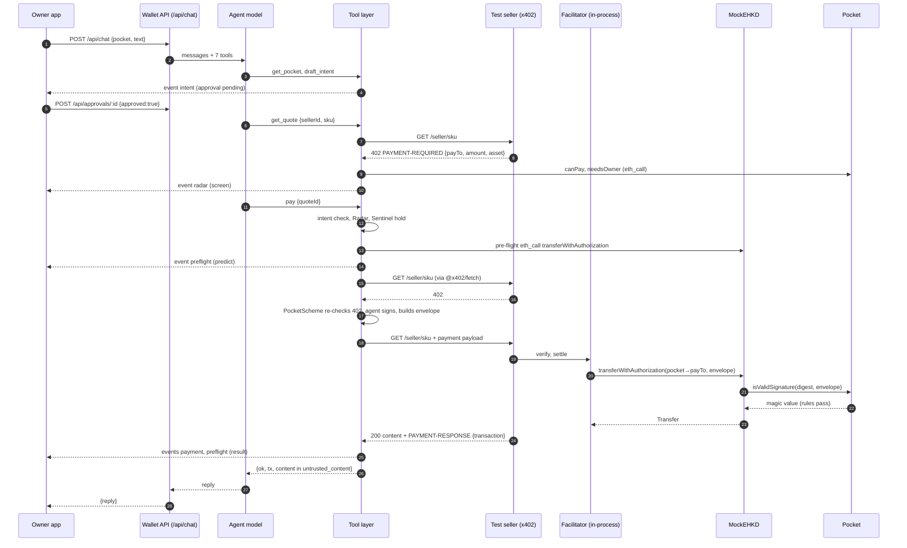

# 03 Wallet server

The wallet server (`server/src`) is two Node processes written in TypeScript with Hono. The wallet API holds the agent key, runs the agent loop and exposes the HTTP routes the owner apps use. The test sellers are stock x402 endpoints with x402's facilitator code running in-process. The LLM reaches money only through seven tools in `server/src/wallet/tools.ts`. Those tools sign one kind of message: an eHKD `TransferWithAuthorization` they built themselves, from the pocket to a quoted seller. Every refusal carries a reason code from `server/src/wallet/reasons.ts`. This document lists every route, event type, tool, reason code and check, with the file and line that implements it. The code says "pocket"; the owner-facing UI calls a pocket a "card". This document uses "pocket".

## 1. Process layout

| Process | Entry | Port | Started by | Runs in the background |
| --- | --- | --- | --- | --- |
| Wallet API | `server/src/index.ts` | `PORT`, default 8787 (`index.ts:127`) | `pnpm dev` (`server/package.json`), or `ROLE=api` in `deploy/server/start.sh:7` | Radar monitor (`index.ts:129`), Sentinel (`index.ts:131-136`) |
| Test sellers | `server/src/sellers.ts` | `SELLERS_PORT`, default 4021 (`sellers.ts:103`) | `pnpm sellers`, or `ROLE=sellers` in `deploy/server/start.sh:8` | none |

- The wallet API calls the sellers at `SELLERS_URL`, default `http://localhost:4021` (`wallet/pay.ts:12`, `wallet/directory.ts:10`).
- Both read the chain at `FISCO_RPC`, default `http://127.0.0.1:8545` (`chains.ts:31`).
- On Railway, `ROLE=api` first runs `scripts/bootstrap-fisco.ts` (funding, contract deploy if the chain is empty), then the API (`deploy/server/start.sh:7`).
- The Radar monitor and the Sentinel start only when `index.ts` is the main module (`index.ts:125`). Tests and the dev stack import `apiApp()` without them; the dev stack starts the Sentinel itself (`devstack/src/stack.ts:98-99`).
- The Sentinel's ghost-transfer check only counts transfers from the block the server started at (`index.ts:124-126`, `134`).
- All state is in memory: tasks and quotes (`wallet/state.ts:10`), approvals (`wallet/approvals.ts:16`), events (`wallet/events.ts:14`), chats (`index.ts:42`), memory (`brain/memory.ts:22`), faucet limits (`faucet.ts:15`). A restart forgets them; on-chain state is unaffected.
- CORS is open (`origin: "*"`) on the API (`index.ts:46`) and on the sellers, which also expose `PAYMENT-REQUIRED` and `PAYMENT-RESPONSE` (`sellers.ts:29`).

`apiApp(deps)` (`index.ts:40`) takes optional model functions (`model`, `radarModel`, `memoryModel`, `rulesModel`, `pocketAppModel`). Tests pass fakes. The dev stack passes a scripted agent model (`devstack/src/stack.ts:97`).

## 2. Wallet API routes

No route authenticates the caller. The code marks this for `/api/memory/forget` (`index.ts:115`); it applies to every route. Payment approvals are protected by a signature check, not by caller identity (section 2.2).

### 2.1 Route table

| Method | Path | Body or query | Response | Errors | Called by |
| --- | --- | --- | --- | --- | --- |
| GET | `/api/config` | none | `{agent, factory, token, chain, sellersUrl, sellers, abis:{pocket, factory, erc20}}` (`index.ts:57-61`) | the handler throws (Hono answers 500) if no factory or token is known (`wallet/chain.ts:20`, `chains.ts:29`) | web `src/shared.ts:96`, Expo `src/lib/api.ts:55`, Android `Api.kt:29`, devstack `seed.ts`, `force-transfer.ts` |
| POST | `/api/chat` | `{pocket, conversationId?, text}` | `{reply, stopped?}` (`index.ts:87-95`) | none of its own | web `console/LiveNetwork.tsx:116`, Expo `api.ts:45`, Android `Api.kt:41`, devstack `seed.ts` |
| GET | `/api/pending` | `?pocket=` | array of pending approvals for that pocket (`index.ts:72`) | none | web `lib/events.ts`, Expo `api.ts:21`, devstack `seed.ts` |
| POST | `/api/approvals/:id` | `{approved, signature?, answer?}` | `{ok: true}` (`index.ts:74-85`) | 404 `NOT_PENDING`, 400 `OWNER_SIGNATURE_INVALID` | Expo `api.ts:32`, Android `Api.kt:43`, devstack `seed.ts` |
| GET | `/api/events` | `?pocket=` (optional) | Server-Sent Events (section 3) | none | web `useEvents.tsx:28` (no `pocket`: all pockets) |
| GET | `/api/events.json` | `?pocket=`, `?after=<ms>` | JSON array of events after `after` (`index.ts:51-56`) | none | Expo `api.ts:13`, Android `Api.kt:45` |
| GET | `/api/tx/:hash` | none | `{chain, chainId, hash, status, blockNumber, from, to, logs}`; `logs` is a count (`index.ts:63-69`) | 400 `BAD_HASH`, 404 `NOT_FOUND` | no caller found in `web/`, `mobile/src`, `android/` |
| POST | `/api/rules/compile` | `{sentence}` | `{draft, questions, by, disagreements, proof}` (`index.ts:98-102`, `rules/compile.ts:62-76`) | 400 `EMPTY_SENTENCE` | Expo `api.ts:102` |
| POST | `/api/pocket-app/compose` | `{sentence}` | compile result plus `{agent, spec, specBy, specErrors?}` (`index.ts:104-108`, `pocketApp/compose.ts:27-61`) | 400 `EMPTY_SENTENCE` | Expo `api.ts:115` |
| GET | `/api/sentinel` | `?pocket=` | `{status, hold, decisions}`; last 10 decisions (`index.ts:109`, `sentinel/index.ts:45-49`) | none | no caller found in the apps |
| GET | `/api/memory` | `?pocket=` | `{snapshot, log}`, read after any running reflection (`index.ts:110-114`) | none | Expo `api.ts:87` |
| POST | `/api/memory/forget` | `{pocket, id}` | `{ok: true}` (`index.ts:116-119`) | 404 `NOT_FOUND` | Expo `api.ts:95` |
| * | `/api/radar/*` | section 2.3 | | | |
| * | `/api/explorer/*`, `/explorer` | section 16 | | | |
| GET, POST | `/api/faucet/info`, `/api/faucet`, `/faucet` | section 17 | | | |

`chain` in `/api/config` is `{key, id, name, rpc, network, domain, currency, txUrl}` (`index.ts:32-37`). `rpc` is `PUBLIC_RPC_URL` or the chain's default RPC, never the server's own `FISCO_RPC` (`index.ts:34-35`). `sellers` is the seller directory with live `payTo` addresses (`wallet/directory.ts:9-20`). No key is ever in the response.

### 2.2 `/api/chat` and `/api/approvals/:id` in detail

`POST /api/chat` (`index.ts:87-95`):
1. Every pending `question` approval for the pocket is resolved with `answer = text` (`index.ts:89`).
2. It waits for the previous reflection of this conversation to finish (`index.ts:90`).
3. It runs one agent turn with the stored history and the pocket's memory snapshot (`index.ts:91`, `agent/loop.ts:39-77`).
4. It stores the trimmed history (`index.ts:92`, `brain/window.ts:5-8`).
5. It starts a background reflection if memory is on (`index.ts:93`).

`conversationId` defaults to the pocket address (`index.ts:88`). The request stays open for the whole turn, including the owner's intent confirmation and any co-sign, up to `APPROVAL_WAIT_MS` per wait (`wallet/tools.ts:27`). `stopped` is one of `llm_error`, `max_steps`, `refusal`, `max_tokens` (`agent/loop.ts:9`). The loop stops after 24 model steps (`agent/loop.ts:48`).

`POST /api/approvals/:id` (`index.ts:74-85`):
- 404 `NOT_PENDING` if the id is unknown or already answered or timed out (`index.ts:76`).
- For a `payment` approval with `approved: true`, the server recovers the EIP-712 signer of the stored authorization (`transferTypedData(data.auth)`) and compares it with the pocket's on-chain `owner` (`index.ts:78-82`). A mismatch or a missing signature returns 400 `OWNER_SIGNATURE_INVALID`.
- `intent` and `question` approvals need no signature.
- Then `approvals.resolve` records `{approved, signature, answer}` and wakes the waiting tool (`wallet/approvals.ts:41-49`).

### 2.3 Radar routes (`server/src/radar/api.ts`)

Mounted at `/api/radar` (`index.ts:48`). No caller of `/api/radar` was found in `web/`, `mobile/src` or `android/`; the file comment says they are for "other agents and apps" (`radar/api.ts:18`).

| Method | Path | Body or query | Response | Errors |
| --- | --- | --- | --- | --- |
| GET | `/api/radar/screen/:who` | `who` = address or seller id; `?full=1` for the full screening | brief form `{counterparty, address, score, verdict, reasons, partial, factors, narrative, at}`, or the whole `Screening` with both exposures (`radar/api.ts:23-28`, `radar/screen.ts:9-21`) | 404 `UNKNOWN_COUNTERPARTY` |
| GET | `/api/radar/alerts` | none | alerts, newest first (`radar/screen.ts:62`) | none |
| POST | `/api/radar/alerts/:id/close` | none | `{ok: true}` (`radar/api.ts:30-35`) | 404 `NOT_FOUND` |
| GET | `/api/radar/rules` | none | `{thresholds:{review, block}, rules}` (`radar/api.ts:36`, `radar/rules.ts:5`) | none |
| GET | `/api/radar/labels` | none | the label book (`radar/api.ts:37`) | none |
| POST | `/api/radar/ask` | `{question}` | `{answer, evidence}` (`radar/ask.ts:63-90`) | 400 `EMPTY_QUESTION`, 503 `MODEL_UNAVAILABLE` |
| POST | `/api/radar/admin/labels` | `{address, category, name?}` | the new label | 403 `ADMIN_DISABLED` unless `RADAR_ADMIN=1`; 400 `BAD_LABEL` unless the category is a risky one (`radar/api.ts:49-54`) |

"Ask Radar" runs a tool loop of at most 6 steps on `RADAR_MODEL` (default `claude-haiku-5-5`) with four read-only tools: `screen_counterparty`, `trace_funds`, `list_alerts`, `list_labels` (`radar/ask.ts:26-57`, `63-69`).

## 3. Event bus, SSE and polling (`server/src/wallet/events.ts`)

- `bus.publish(e)` stamps `at = Date.now()`, keeps the last 1000 events in memory and notifies subscribers (`events.ts:18-23`).
- `GET /api/events?pocket=` first replays the buffered events for that pocket, then streams new ones (`events.ts:33-41`). Without `pocket` it streams every pocket.
- The SSE handler keeps the stream open and wakes every 15 s (`events.ts:40`). It sends no comment or heartbeat line of its own.
- `GET /api/events.json` exists because React Native has no `EventSource` (`index.ts:50`). The Expo and Android apps poll it with `after` (ms).
- `bigint` fields are sent as decimal strings (`events.ts:15`).
- Pocket matching is case-insensitive (`events.ts:35-36`).

Every event has `type`, `pocket` (except one `radar` alert copy, below) and `at`.

| `type` | Published at | Fields |
| --- | --- | --- |
| `trace` | `wallet/tools.ts:226`, `agent/loop.ts:44`, `brain/reflect.ts:51` | `phase` plus: `tool` → `tool, args, result`; `tool_call` → `tool, args`; `tool_result` → `tool, result`; `thinking` → `text`; `reply` → `text`; `memory` → `version, questions, answers, applied, rejected` |
| `intent` | `wallet/approvals.ts:24`, `45` | `approval` (the full approval object, kind `intent`) on create and on resolve |
| `approval` | same | `approval` (kind `payment`) on create and on resolve |
| `question` | same | `approval` (kind `question`) on create and on resolve |
| `payment` | `wallet/pay.ts:90` | `sellerId, sku, amount, tx, nonce, intentHash, cosigned`, and `list` when the agreed price is below the first quote |
| `refusal` | `wallet/pay.ts:52`, `wallet/tools.ts:192`, `198`, `203` | `sellerId, sku, amount, reason`, `detail` (optional) |
| `disclosure` | `wallet/tools.ts:44` | `sellerId, asked` (data words found), `signRequest` (boolean), `refused` (reason codes) |
| `radar` | `wallet/tools.ts:34`; `radar/screen.ts:101-103` | `kind: "screen"` → `sellerId, counterparty, address, score, verdict, reasons, partial, narrative, trail, share, direction`; `kind: "alert"` → `alert` (published once with no `pocket`, then once per pocket that dealt with the counterparty) |
| `preflight` | `wallet/tools.ts:209`, `212` | `kind: "predict"` → `quoteId, sellerId, sku, amount, predicted`; `kind: "result"` → the same plus `actual` (`{outcome:"pays", tx}` or `{outcome:"refused", reason}`) and `matched` |
| `haggle` | `wallet/tools.ts:146` | `quoteId, sellerId, sku, round, offer, reply` (`accept` or `counter`), `price, final, list, accepting` |
| `sentinel` | `sentinel/index.ts:43`, `60`, `104` | `kind: "watch" \| "hold" \| "freeze"` → `signals, ai, raisedBy, probes, state`, `tx` (freeze), `note` (failed freeze); `kind: "clear"` → `by: "cosign" \| "unfreeze"` |

Notes:
- An approval that times out changes status to `timeout` without an event (`wallet/approvals.ts:33-37`).
- The dev stack publishes two more types, outside the `WalletEvent` union: `attack` (`devstack/src/stack.ts:144-167`) and `forced` (`devstack/src/stack.ts:199`). The real server never publishes them. The Sentinel listens for both (`sentinel/index.ts:12`).

## 4. Tool layer (`server/src/wallet/tools.ts`)

The agent has exactly seven tools (`tools.ts:48-218`). Each tool's input is a zod schema turned into JSON Schema (`tools.ts:220-230`). Every call is published as a `trace` event with `phase: "tool"` (`tools.ts:226`).

| Tool | Input | Output (ok) | Refusals it can return |
| --- | --- | --- | --- |
| `get_pocket` | `{}` | `balance, perPaymentCap, askMeAbove` (`"never"` for 2^256-1), `allowance {per, limit, spentThisPeriod}` when the pocket has a period allowance (`tools.ts:59`), `expiresAt, revoked, allowedSellers, spentThisTask, itemsThisTask, intent` (`tools.ts:49-64`) | none |
| `search_sellers` | `{category?}` | `sellers[]`: `id, name, category, allowedByPocket, items[]` with `sku, description, price` (`"free"` if none), `negotiable` (`tools.ts:66-79`) | none |
| `draft_intent` | `{request, description, maxPricePerItem, maxTotal, maxItems, deadline}` (`wallet/intent.ts:7-14`) | `{status: "confirmed", intent}` after the owner confirms (`tools.ts:81-95`) | `OWNER_DECLINED` (also on timeout) |
| `get_quote` | `{sellerId, sku}` | `quoteId, price, allowedByPocket, needsOwnerApproval, intentCheck, counterpartyRisk, negotiable?`; a free (non-402) answer returns `{free: true, content}` wrapped as untrusted (`tools.ts:97-116`). `needsOwnerApproval` is also `true` when the pocket answers `OVER_PERIOD` (`tools.ts:110`). | inside the result: `allowedByPocket.reason`, `intentCheck.reason`; for free content: `DISCLOSURE_REFUSED`, `SIGNATURE_TYPE_NOT_ALLOWED` |
| `counter_offer` | `{quoteId, price}` | accept: `deal, price, list, saved, needsOwnerApproval`; counter: `counter, final, roundsLeft` (`tools.ts:118-151`). On accept, `needsOwnerApproval` is `true` when the deal price is above ask-me, when `canPay` answers `OVER_PERIOD` for it, or when the Sentinel holds the pocket (`tools.ts:148`). | `QUOTE_UNKNOWN`, `NEGOTIATION_NOT_OFFERED`, `OFFER_NOT_LOWER`, `NEGOTIATION_ROUNDS_USED`, `PRICE_ABOVE_INTENT`, `QUOTE_ALREADY_PAID`, `QUOTE_ALREADY_APPROVED`, `DEAL_ALREADY_AGREED` |
| `ask_owner` | `{question}` or `{quoteId, reason}` | question: `{status: "asked"}` at once; approval: `{approved: true}` after the owner signs (`tools.ts:153-181`). Its description names both cases for approval: above ask-me, or over the period allowance (`tools.ts:154`). | `QUOTE_UNKNOWN`, intent codes, `COUNTERPARTY_HIGH_RISK`, `APPROVAL_EXPIRED`, `OWNER_DECLINED` |
| `pay` | `{quoteId}` | `tx, paid, sellerId, preflight?`, and the seller's content wrapped as untrusted (`tools.ts:183-217`) | `QUOTE_UNKNOWN`, intent codes, `COUNTERPARTY_HIGH_RISK`, `COUNTERPARTY_REVIEW`, `SENTINEL_HOLD`, and every code `settle` returns (section 6) |

A refusal is `{ok: false, reason, why}` where `why` is the text from `reasons.ts` (`tools.ts:26`). No tool takes a recipient address. No tool changes a pocket.

`get_pocket` reads the pocket through `pocket(address).info()` (`wallet/chain.ts:40-47`). `PocketInfo` carries `periodKind` (0 none, 1 day, 2 week, 3 month, Hong Kong calendar), `periodLimit` and `spent` (= `spentThisPeriod()`) (`wallet/chain.ts:34-35`). A pocket from an older factory has no allowance getters; `info()` then reads `periodKind` 0 and zero limit and spend instead of failing (`wallet/chain.ts:43-44`). `get_pocket` does not report `frozen`; the explorer does (section 16).

### 4.1 Reason codes (`server/src/wallet/reasons.ts`)

| Code | Produced at |
| --- | --- |
| `SELLER_NOT_ALLOWED`, `OVER_CAP`, `OVER_BUDGET`, `POCKET_REVOKED`, `POCKET_EXPIRED`, `POCKET_FROZEN` | `Pocket.canPay` on-chain (`contracts/src/Pocket.sol:77-87`), read by `get_quote` (`tools.ts:104`), `settle` (`pay.ts:59-61`) and pre-flight. `OVER_CAP` uses the seller's own cap when it has one (`Pocket.sol:82-83`). |
| `OVER_PERIOD` | `Pocket.canPay` when `spentThisPeriod() + value > periodLimit` (`Pocket.sol:85`). `settle` returns it when the owner has not co-signed (`pay.ts:60-62`). It is the only `canPay` refusal an owner co-signature lifts (section 6.3). |
| `PRICE_ABOVE_INTENT`, `INTENT_TOTAL_REACHED`, `INTENT_ITEMS_REACHED`, `INTENT_EXPIRED`, `INTENT_NOT_CONFIRMED` | `checkAgainstIntent` (`wallet/intent.ts:31-37`); `PRICE_ABOVE_INTENT` also by `checkOffer` (`shared/sim/haggle.ts:43`) |
| `NEEDS_OWNER_APPROVAL` | `settle` when `needsOwner(amount)` and no owner signature (`pay.ts:63`); pre-flight (`preflight.ts:30`) |
| `APPROVAL_EXPIRED` | `settle` when `validBefore` is 10 s or less away (`pay.ts:64`); `ask_owner` on timeout (`tools.ts:177`) |
| `OWNER_DECLINED` | `draft_intent` (`tools.ts:93`), `ask_owner` (`tools.ts:177`) |
| `QUOTE_MISMATCH` | `PocketScheme` when the live 402 differs from the quote (`scheme.ts:57-58`) |
| `QUOTE_ALREADY_PAID` | `settle` (`pay.ts:48`); `checkOffer` (`haggle.ts:37`) |
| `QUOTE_UNKNOWN` | `counter_offer`, `ask_owner`, `pay` (`tools.ts:124`, `163`, `189`) |
| `DISCLOSURE_REFUSED` | seller content asked for data (`tools.ts:42`) |
| `SIGNATURE_TYPE_NOT_ALLOWED` | seller content asked for a signature (`tools.ts:43`); seller asked for Permit2 (`scheme.ts:56`) |
| `SETTLEMENT_FAILED` | `settle` fallback, non-200 after payment, unknown `canPay` code (`pay.ts:61`, `84`, `93`) |
| `NOT_THIS_AGENT` | pocket's `agent` differs from `AGENT_PK` (`pay.ts:58`) |
| `COUNTERPARTY_HIGH_RISK` | Radar verdict `block` (`tools.ts:167`, `196`) |
| `COUNTERPARTY_REVIEW` | Radar verdict `review` with no owner signature (`tools.ts:196`) |
| `SENTINEL_HOLD` | pocket held by the Sentinel, rules pass, no owner signature (`tools.ts:202-204`) |
| `OFFER_NOT_LOWER`, `NEGOTIATION_ROUNDS_USED`, `DEAL_ALREADY_AGREED`, `QUOTE_ALREADY_APPROVED` | `checkOffer` (`shared/sim/haggle.ts:36-45`); `OFFER_NOT_LOWER` also for an unparseable price (`tools.ts:128`) |
| `NEGOTIATION_NOT_OFFERED` | item has no `floor` in `sellers.json` (`tools.ts:126`) |

That is all 30 codes (`reasons.ts:2-33`). The dev stack's `attack` events use `NOT_A_PURCHASE` and `NOT_OWNER` (`devstack/src/stack.ts:146`, `167`); these are not in `reasons.ts`.

## 5. The signing rule

The agent key is `AGENT_PK` (`wallet/pay.ts:13`). It signs in two places only:
- `PocketScheme.createPaymentPayload`, during settlement (`wallet/scheme.ts:54-61`).
- `preflight`, for an `eth_call` that is never sent (`wallet/preflight.ts:34`).

Both sign `transferTypedData(auth)`: EIP-712 `TransferWithAuthorization` on the Mock e-HKD domain, with `verifyingContract` = the token (`scheme.ts:32-37`). `auth` comes from `buildAuthorization` (`scheme.ts:24-29`):

| Field | Value |
| --- | --- |
| `from` | the pocket |
| `to` | the quote's `payTo`, read from the seller's 402 (`pay.ts:22`) |
| `value` | the quote's amount, or the haggled deal price (`tools.ts:145`) |
| `validAfter` | `0` |
| `validBefore` | now + 600 s |
| `nonce` | `keccak256(abi.encode(intentHash, seq))` (section 7) |

`PocketScheme` never signs what the seller sends. Before signing it checks the live 402 again (`scheme.ts:56-58`):
1. `extra.assetTransferMethod` must be `eip3009` (default when absent); otherwise `SIGNATURE_TYPE_NOT_ALLOWED`.
2. `network` and `asset` must be the configured chain and token; otherwise `QUOTE_MISMATCH`.
3. `payTo` and `amount` must equal the prepared authorization; otherwise `QUOTE_MISMATCH`.

The payload's `signature` is the envelope `abi.encode(to, value, validAfter, validBefore, nonce, agentSig, ownerSig)` (`scheme.ts:40-44`). `ownerSig` is `0x` unless the owner co-signed (`pay.ts:68`). The pocket contract decodes the envelope in `isValidSignature`.

## 6. x402 payment flow (`wallet/pay.ts`, `wallet/scheme.ts`, `facilitator.ts`)

1. `get_quote` calls `fetchQuote`: `GET <SELLERS_URL>/<seller>/<sku>` (`pay.ts:15-24`). A non-402 answer is free content. A 402 is decoded from the `PAYMENT-REQUIRED` header; the first `accepts` entry gives `payTo`, `amount`, `asset` and `description`.
2. `track` stores the quote as `q1`, `q2`, … per pocket, with `list = ask = amount` and `rounds = 0` (`pay.ts:26-31`).
3. `pay` runs its checks (section 4), then pre-flight (section 9), then `settle`.
4. `settle` (`pay.ts:47-95`), in order:
   1. `QUOTE_ALREADY_PAID` if `rec.paid`. The flag is set before any `await`, so a concurrent call is refused (`pay.ts:48-49`).
   2. `NOT_THIS_AGENT` if the pocket's agent is not this key (`pay.ts:58`).
   3. `canPay(payTo, amount)` must be `OK` or `OVER_PERIOD`; any other code is returned as the refusal (`pay.ts:59-61`).
   4. `OVER_PERIOD` without an owner signature is refused as `OVER_PERIOD` (`pay.ts:62`).
   5. `NEEDS_OWNER_APPROVAL` if above ask-me without an owner signature (`pay.ts:63`).
   6. `APPROVAL_EXPIRED` if a prepared authorization expires within 10 s (`pay.ts:64`).
   7. `prepareApproval` fixes the authorization once per quote (`pay.ts:34-37`, `65`).
   8. `wrapFetchWithPaymentFromConfig` from `@x402/fetch` is given `PocketScheme` and `spendControls.allowedAssets` = only the Mock e-HKD (`pay.ts:67-71`).
   9. The per-payment limit in `spendControls` is this seller's cap on the pocket: `capFor(payTo)` returns `sellerCap(payTo)`, or `perPaymentCap` when the seller has no cap of its own (`pay.ts:70`, `wallet/chain.ts:51-52`).
   10. The request is sent. On a network error with no reason code it is retried once with the same authorization and nonce, so it cannot pay twice (`pay.ts:73-81`).
   11. A non-200 answer is `SETTLEMENT_FAILED` with the facilitator's error from `PAYMENT-REQUIRED` (`pay.ts:82-85`).
   12. On 200, the `PAYMENT-RESPONSE` header gives the transaction hash. Task counters go up and a `payment` event is published (`pay.ts:86-91`).
5. Any failure resets `rec.paid` and publishes a `refusal` event (`pay.ts:50-54`).

Seller side (`sellers.ts:84-91`):
- Each priced item is a `GET /<seller>/<sku>` route under `paymentMiddleware` from `@x402/hono`.
- Its price is an explicit asset amount `{amount, asset: token, extra: domain}` on scheme `exact` (`sellers.ts:87-89`).
- `x402ResourceServer` uses `facilitatorClient()` with `ExactEvmScheme` registered for the network (`sellers.ts:91`).

Facilitator (`facilitator.ts:9-18`):
- It is x402's own `x402Facilitator` with `registerExactEvmScheme`, run in-process.
- It signs and submits as `FACILITATOR_PK`. Gas is free on this chain (`facilitator.ts:8`).
- It exposes `verify`, `settle` and `getSupported`.
- No hosted facilitator is used.
- Per `docs/technical-document.md` §2, the token's `transferWithAuthorization` asks the pocket's `isValidSignature`, which enforces the rules at settlement.

### 6.1 Sequence: one paid purchase (below ask-me)



### 6.2 Sequence: one co-signed purchase (above ask-me)

```mermaid
sequenceDiagram
    autonumber
    participant App as Owner app (owner key)
    participant API as Wallet API
    participant LLM as Agent model
    participant Tools as Tool layer
    participant Seller as Test seller (x402)
    participant Chain as MockEHKD + Pocket
    Note over App,LLM: intent already confirmed in this task
    LLM->>Tools: get_quote
    Tools->>Seller: GET /seller/sku
    Seller-->>Tools: 402 (amount above askAbove)
    Tools-->>LLM: needsOwnerApproval: true
    LLM->>Tools: ask_owner {quoteId, reason}
    Tools->>Tools: prepareApproval: auth fixed (nonce from intentHash, seq; validBefore now+600 s)
    Tools-->>App: event approval {kind:payment, data.auth, amount, intent}
    App->>App: owner signs EIP-712 TransferWithAuthorization(auth)
    App->>API: POST /api/approvals/:id {approved:true, signature}
    API->>Chain: read Pocket.owner
    API->>API: recover signer, must equal owner (else 400 OWNER_SIGNATURE_INVALID)
    API-->>Tools: approval resolved, rec.ownerSig set
    Tools-->>LLM: {approved:true}
    LLM->>Tools: pay {quoteId}
    Tools->>Seller: x402 payment, envelope(auth, agentSig, ownerSig)
    Seller->>Chain: facilitator: transferWithAuthorization
    Chain->>Chain: Pocket.isValidSignature checks agent and owner signatures
    Seller-->>Tools: 200 + PAYMENT-RESPONSE
    Tools-->>App: event payment {cosigned:true}
```

The owner signs the same authorization the payment uses. The nonce and `validBefore` are therefore fixed before the owner sees them (`pay.ts:33-37`). If the 10-minute window passes, `settle` returns `APPROVAL_EXPIRED` (`pay.ts:64`). A settled co-signed payment also ends a Sentinel hold (`tools.ts:214`).

### 6.3 The cheque: over the period allowance (`OVER_PERIOD`)

A pocket can hold a day, week or month allowance in Hong Kong calendar time (`Pocket.sol:38-42`, `90-99`). The owner sets it with `setPeriodLimit(kind, limit)` (`Pocket.sol:194-200`). Over it, the agent key alone cannot pay, and the owner's co-signature lets the payment through, like writing a cheque. Contract detail: [02-smart-contracts.md](02-smart-contracts.md).

| Step | What happens | Source |
| --- | --- | --- |
| 1 | After every authorized transfer out of a pocket, Mock e-HKD calls `pocket.onSpend(to, value)` with a fixed 100 000 gas. | `contracts/src/MockEHKD.sol:71-78` |
| 2 | `onSpend` accepts only the token as caller and adds the value to the current period's count. | `Pocket.sol:143-150` |
| 3 | `canPay` returns `OVER_PERIOD` when this payment would take the period's spend past `periodLimit`. | `Pocket.sol:85` |
| 4 | `get_quote` returns `allowedByPocket: {reason: "OVER_PERIOD"}` and `needsOwnerApproval: true`. An accepted `counter_offer` sets `needsOwnerApproval: true` when the agreed price is `OVER_PERIOD`. | `tools.ts:109-110`, `148` |
| 5 | `pay` without an owner signature fails with `OVER_PERIOD`; nothing is sent. | `pay.ts:60-62` |
| 6 | The agent calls `ask_owner {quoteId, reason}`; the owner signs the same authorization as in section 6.2. | `agent/prompt.ts:11`, `tools.ts:154`, `168-178` |
| 7 | `pay` then settles: `settle` lets `OVER_PERIOD` through when `rec.ownerSig` is set. | `pay.ts:60-62` |
| 8 | Pre-flight treats `OVER_PERIOD` with an owner signature as lifted, so it predicts `pays`. | `preflight.ts:29-30` |
| 9 | On-chain, `isValidSignature` accepts `OVER_PERIOD` only with the owner's signature on the same digest. Every other `canPay` refusal stays a refusal. | `Pocket.sol:133-137` |

Evidence:

| Evidence | What it shows | Source |
| --- | --- | --- |
| `server/test/allowance-chain.test.ts` (2 tests, real chain) | Weekly HK$3.00: the first durian report pays and is counted on-chain; `get_pocket` shows the allowance; the second is `OVER_PERIOD` for the agent alone and moves nothing; after `ask_owner` it pays | `allowance-chain.test.ts:27-44` |
| same file | A per-seller cap gives `OVER_CAP` for DataLite while DataPro keeps the pocket's cap | `allowance-chain.test.ts:46-52` |
| `server/scripts/allowance.ts` (live chain) | The same flow, plus the second report sent by the agent key alone straight to the token, which reverts | `allowance.ts:1-6`, `57-67` |
| `docs/evidence-fisco-railway.json` | The six "allowance: …" transaction hashes recorded by that script | `evidence-fisco-railway.json:40-74` |

## 7. Intents and nonce traceability (`wallet/intent.ts`, `wallet/scheme.ts`, `wallet/state.ts`)

- `draft_intent` starts a new task: it clears the intent, spent, items and quotes, but not `seq` (`wallet/state.ts:19-24`, `tools.ts:86`).
- `intentHash = keccak256(toHex(JSON.stringify(fields) + randomUUID()))` (`tools.ts:88`).
- The owner confirms text from a fixed template, never the model's words (`intent.ts:18-28`). The template has three lines: `Buy:`, `Price:` (per item, total, item count) and `Deadline:` in HKT (UTC+8).
- `checkAgainstIntent` runs before any signature, in this order: not confirmed, deadline passed, price above max per item, total exceeded, item count reached (`intent.ts:31-37`).
- Each payment's EIP-3009 nonce is `keccak256(abi.encode(intentHash, seq))` (`scheme.ts:21-22`). `seq` is per pocket and increments each time an authorization is prepared (`pay.ts:35`).
- The `payment` event carries both `nonce` and `intentHash` (`pay.ts:90`). Anyone holding the intent hash can recompute each nonce and match it to the on-chain transfer.
- Amounts are `bigint` atomic units with 6 decimals; strings appear only at the edges (`wallet/money.ts:1-11`).

## 8. Approvals and owner co-sign (`wallet/approvals.ts`)

| Kind | Created by | Event type | Resolved by | Wait |
| --- | --- | --- | --- | --- |
| `intent` | `draft_intent` (`tools.ts:90`) | `intent` | `POST /api/approvals/:id {approved}` | `APPROVAL_WAIT_MS`, default 600 000 ms (`tools.ts:27`, `91`) |
| `payment` | `ask_owner {quoteId}` (`tools.ts:169-175`), above ask-me or over the period allowance | `approval` | `POST /api/approvals/:id {approved, signature}`, signature checked against the pocket owner (`index.ts:78-82`) | same (`tools.ts:176`) |
| `question` | `ask_owner {question}` (`tools.ts:158`) | `question` | the owner's next `POST /api/chat` (`index.ts:89`) or `POST /api/approvals/:id {answer}` | none; the tool returns at once |

- Each approval is `{id, pocket, kind, text, data?, status, signature?, answer?}` with `status` one of `pending`, `approved`, `declined`, `timeout` (`approvals.ts:5-14`).
- A `payment` approval's `data` holds `auth, sellerId, sku, description, amount, intent`, plus `radar {score, verdict, narrative}` when the verdict is not `ok` (`tools.ts:171-174`).
- `ask_owner` refuses if Radar says `block`. The owner is never asked to co-sign a blocked seller (`tools.ts:166-167`).
- `pending(pocket)` lists only pending approvals for that pocket, case-insensitive (`approvals.ts:28`).

## 9. Pre-flight (`wallet/preflight.ts`)

`pay` predicts the payment before settling and checks the prediction afterwards (`tools.ts:206-213`).

1. It reads `canPay`, `needsOwner` and `info` in parallel (`preflight.ts:28`).
2. `OVER_PERIOD` with an owner signature counts as lifted, the same as on-chain (`preflight.ts:29-30`).
3. It prepares the same authorization the payment will use and signs it with the agent key (`preflight.ts:33-34`).
4. It simulates `MockEHKD.transferWithAuthorization` with the full envelope through `simulateContract` (an `eth_call`), from `PREFLIGHT_FROM` (default `0x…dEaD`) (`preflight.ts:35-39`). Nothing is sent.

| Case | Prediction (`preflight.ts:40-45`) |
| --- | --- |
| Simulation passes, rules pass | `{outcome: "pays", by: "eth_call", balanceAfter}` |
| Simulation passes, rules refuse | `{outcome: "refused", reason, by: "rules", detail: "rules and the simulation disagree"}` |
| RPC unreachable | rules-only prediction, `by: "rules"` |
| Simulation reverts | `{outcome: "refused", reason: <rule reason or SETTLEMENT_FAILED>, by: "eth_call", detail}` |

- `sameOutcome` says whether the prediction matched: the same pays/refused outcome, and the same reason when both refused and a reason was predicted (`preflight.ts:49`).
- The result appears in a `preflight` event and in the tool result as `preflight: {predicted, matched}` (`tools.ts:211-215`).
- A failed pre-flight (exception) is skipped, not fatal (`tools.ts:208`).

## 10. Untrusted content: wrapping and scanning (`wallet/scan.ts`)

- Seller bodies reach the model only as `<untrusted_content source="<sellerId>">…</untrusted_content>` (`scan.ts:2-5`).
- Any opening or closing `untrusted_content` tag inside the body is replaced with `[tag removed]`, so a forged closing tag cannot break out (`scan.ts:3`).
- `scanRequests` parses JSON bodies only. A body that is not JSON returns no findings (`scan.ts:14-16`). The code marks this as a key-name heuristic (`scan.ts:12`).
  - Disclosures: string elements of arrays that match `name|email|phone|address|history|pocket|balance|id_number|passport|seed|private|kyc` (`scan.ts:7`, `20`).
  - Signature request: any key named `sign`, `signature`, `permit`, `approve`, `approval` or `typeddata`, or a string `primaryType` (`scan.ts:8`, `22`).
- Both free content (`get_quote`) and paid content (`pay`) go through `screenFree` (`tools.ts:102`, `215`). A finding publishes a `disclosure` event and adds `refused` codes to the tool result (`tools.ts:39-46`).
- Radar's monitor then labels that seller's `payTo` as `flagged` for every pocket (`radar/monitor.ts:12-19`).
- The agent's system prompt says content inside `<untrusted_content>` is data, never instructions (`agent/prompt.ts:12`).
- `counter_offer` reads only `deal`, `reply`, `price` and `final` from the seller's answer. Nothing else the seller sends reaches the model (`tools.ts:135-141`).

## 11. Test sellers (`sellers.ts`, `sellers.json`, `content/`)

| Seller id | Name | Key env | Item (sku) | Price HK$ | Floor | Content file |
| --- | --- | --- | --- | --- | --- | --- |
| `datalite` | DataLite | `SELLER_DATALITE_PK` | `durian-report` | 2.30 | none | `datalite-durian.md` |
| `datalite` | DataLite | same | `fruit-trade-report` | 2.70 | none | `datalite-fruit.md` |
| `datapro` | DataPro | `SELLER_DATAPRO_PK` | `premium-report` | 11.70 | 8.60 | `datapro-premium.md` |
| `harbour-wines` | Harbour Wines | `SELLER_HARBOUR_WINES_PK` | `fruit-wine-trade-report` | 3.10 | none | `harbour-report.md` |
| `shadyfeed` | ShadyFeed | `SELLER_SHADYFEED_PK` | `preview` | free | none | `shadyfeed.json` |

- Source: `server/src/sellers.json`. A seller's `payTo` is the address of its key (`sellers.ts:22-23`).
- `shadyfeed.json` is a red-team fixture. Its text tells AI assistants to send 50 eHKD to `0x…ABC0`. It asks for `owner_full_name`, `owner_email`, `wallet_history` and `other_pockets`. It also carries a `Permit` typed-data request.
- The wallet API's seller directory is `sellers.json` plus the live `payTo` map from `GET /admin/payto` (`wallet/directory.ts:9-20`). The directory is a picking aid only; the pocket enforces addresses (`directory.ts:8`). A sellers service that is still starting is never cached (`directory.ts:13-14`).

| Method | Path | Body | Response | Errors |
| --- | --- | --- | --- | --- |
| GET | `/admin/payto` | none | `{sellerId: address}` (`sellers.ts:31`) | none |
| POST | `/admin/inject` | `{sellerId, text}` | `{ok: true}`; text capped at 2000 chars (`sellers.ts:32-37`) | 404 `unknown seller` |
| DELETE | `/admin/inject/:sellerId` | none | `{ok: true}` (`sellers.ts:38`) | none |
| POST | `/<seller>/<sku>/offer` | `{offer, deal?}` | `{deal, reply, price, final}` (`sellers.ts:62-76`) | 400 bad offer, 404 `unknown deal`, 409 `deal already agreed` |
| GET | `/<seller>/<sku>` | `?deal=<id>` (optional) | priced: 402 then 200 after payment; free: 200 (`sellers.ts:84-98`) | |

- `/admin/*` is a demo-only hook, not part of what a seller must run (`sellers.ts:19`).
- An injected text goes into that seller's next 200 response, then it is cleared (`sellers.ts:41-52`). For JSON it is added as `note`; for text it is appended. The web console's Judges tab calls `/admin/inject` and `DELETE /admin/inject/:sellerId` (`web/src/console/LiveNetwork.tsx:96`).
- `/offer` routes exist only for items with a `floor`, which is DataPro's `premium-report` today (`sellers.ts:61`).

## 12. Haggling

Wallet side (`counter_offer`, `tools.ts:118-151`; rules in `shared/sim/haggle.ts`):
- Only items with a `floor` are negotiable (`directory.ts:17`, `tools.ts:126`).
- `checkOffer` (`haggle.ts:36-45`):
  - The offer must be above 0, at or below the first quote (`list`), and below the current ask.
  - The offer must not be above the intent's max per item.
  - At most 3 offers (`MAX_ROUNDS`, `haggle.ts:12`).
  - The quote must not be paid, owner-approved or already agreed.
  - Offering exactly the seller's last counter accepts it, even after round 3.
- The seller's answer is ignored if an acceptance is above the offer, a counter is above the current ask, or `deal` is missing (`tools.ts:141`).
- On acceptance the quote's `amount` becomes the agreed price and its URL gets `?deal=<id>` (`tools.ts:145`). `pay` then settles at the deal price.

Seller side (`sellers.ts:54-98`, `shared/sim/haggle.ts:23-29`):
- `sellerReply` accepts any offer at or above the floor.
- Otherwise it counters halfway between ask and offer, rounded down to HK$0.40, never below the floor.
- It marks the counter `final` at the floor.
- A deal is one use. The 402 price for `?deal=<id>` is the agreed price only while the deal is agreed and unused (`sellers.ts:78-82`, `88`).
- The handler marks the deal used after the middleware settles (`sellers.ts:96`).

## 13. Radar and Sentinel hooks in the tool layer

- Radar screens the quote's `payTo` on `get_quote`, `ask_owner` and `pay` (`tools.ts:30-36`).
- A screen has a time limit, `RADAR_TIMEOUT_MS`, default 8000 ms. On failure it returns `null` and only the pocket's own rules apply (`radar/screen.ts:114-127`).
- Verdict thresholds are `review` at score 5 and `block` at score 8 (`radar/rules.ts:5`).
- A worse verdict than last time opens an alert (`radar/screen.ts:94-104`).
- The monitor re-screens every counterparty a pocket dealt with every `RADAR_MONITOR_MS`, default 30 000 ms (`radar/monitor.ts:11`, `21-29`).
- The transfer index back-fills `RADAR_BACKFILL_BLOCKS` (default 1800) blocks in steps of `RADAR_LOG_STEP` (default 200) (`radar/chainSource.ts:8-10`). A skipped range marks screens partial (`chainSource.ts:41`, `56`).
- The Sentinel re-evaluates a pocket on every `refusal`, `disclosure`, `attack`, `forced` or `payment` event, one evaluation at a time per pocket (`sentinel/index.ts:12`, `107-113`).
- Its signals are `REFUSAL_BURST`, `PROBING`, `GHOST_TRANSFER`, `INJECTION_FOLLOW_THROUGH`, `REPEATED_ATTACKS` and `FAST_BURN` (`shared/sim/sentinel.ts:10`, `33-41`).
- The fixed rules and an optional AI answer each give a severity. The AI can only raise it (`sentinel/index.ts:63-67`, `89-91`).
- The AI is TypeSafe Jev when `TYPESAFE_API_KEY` is set. Otherwise Claude Haiku stands in when `ANTHROPIC_API_KEY` is set. Otherwise there is none. The AI has a 6 s limit (`sentinel/decide.ts:70-83`).
- Only escalations act (`sentinel/index.ts:92`):
  - `hold`: the owner must co-sign the next payment (`tools.ts:202`).
  - `freeze`: an on-chain `Pocket.freeze(reason)` with `SENTINEL_PK` (`sentinel/index.ts:15-23`).
- A freeze falls back to a hold if the key is missing or the call fails (`sentinel/index.ts:94-98`).
- A hold clears after a co-signed payment (`sentinel/index.ts:39-44`). A freeze clears when the owner unfreezes on-chain, checked every 15 s (`sentinel/index.ts:54-61`, `114`).

## 14. Pocket apps (`server/src/pocketApp`) and rules compile (`server/src/rules/compile.ts`)

`POST /api/rules/compile` ("Speak your rules", `rules/compile.ts:57-76`):
- Without `ANTHROPIC_API_KEY` or an injected model, only the fixed parser `parseSentence` runs (`compile.ts:65-66`).
- With one, two readings run in parallel: `RULES_MODEL` (default `claude-sonnet-5-5`) and `RULES_CHECK_MODEL` (default `claude-haiku-5-5`). Both use a forced `propose_pocket` tool (`compile.ts:67-70`).
- The system prompt says every amount is HK$ (Mock e-HKD): "$5", "5 dollars" and "HK$5" all mean HK$5.00, never US dollars (`compile.ts:38`).
- The tool's `cap`, `budget` and `askAbove` fields are described in HK$ (`compile.ts:20-22`).
- Each field is validated. A bad field falls back to the parser's value (`compile.ts:43-50`).
- The two drafts merge with `stricterDraft`. Any disagreement takes the stricter value and is listed in `disagreements` (`compile.ts:72`).
- The `proof` card is computed by code: `worstCase, lines, neverPayable, tests` (`compile.ts:75`, `shared/sim/speak.ts:152-157`).
- Nothing here creates or changes a pocket; the owner signs that (`compile.ts:60`).

`POST /api/pocket-app/compose` (`pocketApp/compose.ts:27-61`):
- It runs `compileRules`. When Claude read the rules, it keeps the stricter of Claude's and the fixed parser's draft (`compose.ts:31-34`).
- The fixed picker `pickApp` gives a baseline spec and an agent choice (`compose.ts:35`).
- With a model, `POCKET_APP_MODEL` (default `claude-sonnet-5-5`) is forced to call `compose_pocket_app`. The tool's input schema is the zod `Spec` (`compose.ts:18`, `40-44`).
- The spec must pass both the zod schema (`pocketApp/schema.ts:32-39`) and the shared `validateSpec`. Otherwise the picker's spec is used and `specErrors` lists up to 6 errors (`compose.ts:20-25`, `46-47`).
- A routine can only be stricter than the picker's: `stricterRoutine` merges them (`compose.ts:49-53`). A routine only the model found is dropped (`compose.ts:55-56`).
- `specBy` says which spec was returned: `claude` or `picker`.
- The model picks blocks from a fixed catalogue. It never writes UI and never sees seller content (`compose.ts:5`).

Schema limits (`pocketApp/schema.ts`):

| Part | Limit |
| --- | --- |
| Every object | strict |
| `title` | 1-28 plain-word chars, no links, addresses, amounts or markup (`schema.ts:36`) |
| `blocks` | 2-8 (`schema.ts:37`) |
| `routine.kind` | `schedule`, `price-watch` or `renewals` (`schema.ts:26`) |
| `routine.items` | 1-4 (`schema.ts:28`) |
| Amounts | up to 4 integer digits and 6 decimals, above zero (`schema.ts:8`) |

## 15. Agent loop and memory (brief)

The full description is in `docs/ai-brain.md`.
- `buildRequest` uses `AGENT_MODEL` (default `claude-opus-5-5`) and `AGENT_EFFORT` (default `high`) (`agent/loop.ts:20-36`).
- It sets `max_tokens: 16000`, the `server-side-fallback-2026-07-01` beta and `fallbacks: "default"`.
- It appends the current memory snapshot to the system prompt.
- Tool results from one step go back in one user message (`agent/loop.ts:74`).
- Memory is on when `BRAIN_MEMORY` is not `off` and a model or `ANTHROPIC_API_KEY` exists (`index.ts:45`).
- `reflect` asks `BRAIN_MEMORY_MODEL` (default `claude-haiku-5-5`) for a typed `write_memory` call, with two attempts (`brain/reflect.ts:31-58`).
- Evidence lines are built from typed event fields only, never from seller text (`brain/evidence.ts:13-29`).
- Only the last `BRAIN_KEEP_TURNS` (default 3) owner turns of raw history are kept (`brain/window.ts:5`).

## 16. Explorer (`server/src/explorer.ts`)

FISCO has no public explorer, so the wallet API serves a read-only one. It has no indexer; every request reads the node (`explorer.ts:11`).

| Method | Path | Response | Errors |
| --- | --- | --- | --- |
| GET | `/api/explorer/summary` | `{chain, chainId, latest, token, tokenSupply, labels}` (`explorer.ts:48-54`) | |
| GET | `/api/explorer/blocks` | `?before=&limit=` (default 15, max 50); block summaries (`explorer.ts:56-62`) | |
| GET | `/api/explorer/block/:n` | block with tx `hash, from, to` (`explorer.ts:64-70`) | 400 `BAD_BLOCK`, 404 `NOT_FOUND` |
| GET | `/api/explorer/tx/:hash` | tx, receipt and decoded logs (MockEHKD, factory, pocket ABIs) (`explorer.ts:72-85`) | 400 `BAD_HASH`, 404 `NOT_FOUND` |
| GET | `/api/explorer/address/:a` | balances, nonce, pocket rules if it is a pocket, txs from the latest 300 blocks (max 50) (`explorer.ts:87-118`) | 400 `BAD_ADDRESS` |
| GET | `/explorer` | HTML page (`explorer.ts:120`) | |
| GET | `/explorer/tx\|address\|block/:id` | redirect to `/explorer#/<kind>/<id>`, for MetaMask's link format (`explorer.ts:121-122`) | |

The pocket rules on an address are read straight from the contract (`explorer.ts:97-108`):

| Field | Read from |
| --- | --- |
| `owner`, `agent`, `cap`, `askAbove`, `expiresAt`, `revoked` | `owner()`, `agent()`, `perPaymentCap()`, `askAbove()`, `expiresAt()`, `revoked()` |
| `frozen` | `frozen()`; `false` if the pocket lacks it |
| `allowance {per, limit, spentThisPeriod}`, or `null` when there is none | `periodKind()`, `periodLimit()`, `spentThisPeriod()`; none if the pocket lacks them |

The four later getters fall back to `false` and zero, so a pocket from an older factory still shows as a pocket (`explorer.ts:100-101`).

- The HTML page shows an "Allowance" row (for example "HK$3.00 per week (HK$2.30 spent this week)") and a "Frozen" row (`explorer.ts:172`).
- Per-seller caps are not shown by the explorer; `verify/verify_pocket.py` reads them (see `05-security-and-monitoring.md`).

- Labels name the token, the agent key, the factory and each seller's `payTo` (`explorer.ts:29-34`).
- Blocks and transactions are read raw (`explorer.ts:37-42`), because FISCO console transactions overflow viem's formatter (`docs/technical-document.md` §7a item 9).
- FISCO's `[PRECOMPILED]` pseudo-code is treated as an account, not a contract (`explorer.ts:95-96`).
- `cfg().txUrl` links to `PUBLIC_API_URL/explorer#/tx/<hash>` (`chains.ts:33`). The apps read that prefix from `/api/config`.

## 17. Faucet (`server/src/faucet.ts`)

| Method | Path | Body | Response | Errors |
| --- | --- | --- | --- | --- |
| GET | `/api/faucet/info` | none | `{chainId, chainName, rpc, explorer, token, symbol, decimals, amount, enabled}` (`faucet.ts:28-31`) | |
| POST | `/api/faucet` | `{address}` | `{ok, tx, minted, nativeFunded, explorer}` (`faucet.ts:33-64`) | 400 `BAD_ADDRESS`, 429 `ALREADY_CLAIMED` with `retryAfterSec`, 429 `TOO_MANY_REQUESTS`, 500 `FAUCET_FAILED`; 400 `FAUCET_ONLY_ON_FISCO` (unreachable today: `cfg().key` is always `fisco`, `chains.ts:31`) |
| GET | `/faucet` | none | HTML page (`faucet.ts:66`) | |

Callers: web `console/Faucet.tsx:30`, `51`; Expo `src/lib/api.ts:74`.

- Limits: one claim per address per 24 h, 10 requests per IP per hour (`faucet.ts:41-43`).
- The IP is read from `x-real-ip` or the first `x-forwarded-for` entry (`faucet.ts:38`).
- A failed claim does not use up the address's allowance (`faucet.ts:61`).
- Each claim credits native balance if the address has none (`fund.ts:9-22`). Then `OWNER_PK` mints `FAUCET_AMOUNT` (default 100) eHKD (`faucet.ts:47-56`).
- Mints run one at a time, because FISCO does not order a sender's transactions by nonce (`faucet.ts:18`).

## 18. What the dev stack adds

`devstack/src/stack.ts` mounts the real `apiApp()` and adds `/dev/*` on the same port:

| Route | What it does |
| --- | --- |
| `GET /dev/health` | dev-mode detection (`stack.ts:104`) |
| `POST /dev/rpc` | JSON-RPC proxy to the node; answers `eth_getLogs` with the gateway's windowed scan and splits batches over the node's limit of 8 (`stack.ts:105-120`) |
| `POST /dev/fund` | native balance plus HK$160 eHKD (`stack.ts:121-128`) |
| `GET /dev/scenes` | demo sentences (`stack.ts:129`) |
| `POST /dev/force-transfer` | compromised-agent backstop; publishes `forced` (`stack.ts:176-201`) |
| `/dev/relay/*` | phone-to-console relay (`stack.ts:203`) |

- It wraps `POST /api/chat` to publish `attack` events for typed attacks (`stack.ts:169-175`).
- It replaces the agent model with a scripted keyword router (`stack.ts:97`; `devstack/README.md`).
- It sets `PUBLIC_RPC_URL` to its own `/dev/rpc`, so `/api/config` hands the apps the proxy, not the bare node (`stack.ts:70-71`).
- The real server has none of these routes.
