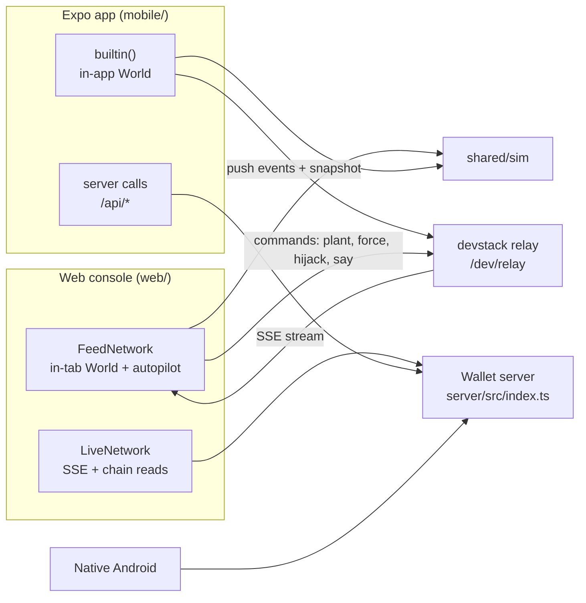
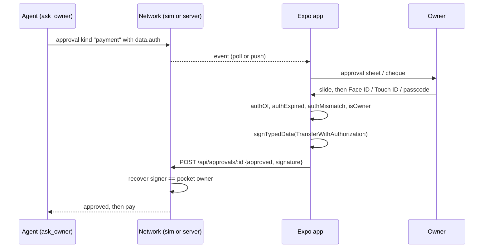

# 06 Frontends: web console, Expo phone app, native Android app

ChainBrain has three owner-facing apps. The **web console** (`web/`) shows the whole network on one screen for judges and the presenter; it reads and never signs. The **Expo phone app** (`mobile/`) is the owner's wallet: it holds the owner key on the device, creates and funds pockets, co-signs payments and chats with the agent. The **native Android app** (`android/`) is a small Kotlin version of the phone app that talks only to a real wallet server. The web console and the Expo app open on the built-in network (`shared/sim`, see [07-built-in-network.md](07-built-in-network.md)) and switch to a real server only in Settings. This document describes the code on `main` at `7b48a2c`. Every path is relative to the repository root.

A note on words: the code says **pocket** everywhere. Owner-facing text in the phone app says **card** (for example `OWNER_TITLE` in `mobile/src/lib/ownerTxs.ts:23-27`: "Card created", "Card revoked", "Allowance changed"; `LAYERS` in `shared/sim/protect.ts:14-19`: "Card contract"). The web console still says "Pockets" in its tab names. This document says pocket.

## 1. The three apps at a glance

| | Web console | Expo phone app | Native Android app |
| --- | --- | --- | --- |
| Folder | `web/` | `mobile/` | `android/` |
| Who it is for | Judges, presenter, laptop demo | The owner | The owner (Android only) |
| Stack | Vite 8, React 19.3, Tailwind 4, viem 2.57 (read only), Radix Dialog, lucide (`web/package.json`) | Expo SDK 57, React Native 0.86.3, expo-router, NativeWind 4, Reanimated 4.5, Skia, viem 2.57 (`mobile/package.json`) | Kotlin, Jetpack Compose (BOM 2026.09.00), web3j crypto/abi 4.12.3, OkHttp 5.5 (`android/app/build.gradle.kts:33-46`) |
| Data on launch | Built-in network | Built-in network | Real server only |
| Holds a key | No | Yes, `expo-secure-store` | Yes, Android Keystore |
| Signs | Nothing | Owner transactions and co-signatures | Owner transactions and co-signatures |
| Event intake | SSE `/api/events` (server) or in-tab feed | Poll `/api/events.json` every 1.5 s, or in-process | Poll `/api/events.json` every 1.5 s |

## 2. Web console (`web/`)

### 2.1 Entry and routing

- `web/src/main.tsx:7` applies a hidden `?server=<url>` before rendering; `?server=builtin` goes back (`web/src/source/source.ts:23-34`).
- Routing is the URL hash, parsed in `web/src/console/App.tsx:30-38` and `web/src/console/route.ts`.
- Routes: `#live`, `#<tab>/0x<pocket>` (a pinned pocket), `#present` (presenter mode), `#explorer`, `#explorer/tx/0x…`, `#explorer/block/<n>`, `#explorer/address/0x…`. An older `?tx=0x…` link opens that transaction in the explorer (`App.tsx:33`).
- Live follows one pocket per render: the pinned one, else the one the story or linked phone is on, else the last pocket an agent touched (`App.tsx:82-89`).

### 2.2 Tabs

`App.tsx:24-25` defines eight tabs.

| Tab | Component | What it shows |
| --- | --- | --- |
| Live (default) | `console/Live.tsx` | The checks path on top (`ChecksPanel`, `console/ChecksPath.tsx`), then three columns: **Agent** (trace of tool calls and results with reason codes; seller text shown as quarantined data), the **pocket** (card, "Protected by ChainBrain" with live counts per layer from `shared/sim/protect.ts:34-48`, allowed sellers, on-chain history with hashes), and **Sellers** (what each shop saw from this pocket). A pocket picker and "Follow the story" / "Follow your phone" sit above (`App.tsx:127-137`). |
| Brain | `console/Brain.tsx` | The brain graph (layout `shared/sim/brainGraph.ts`): brain in the centre, agents, pockets, sellers; edges weighted by 14 days of payments; each attempt travels the graph as a pulse. "How it decided" shows the checks path of the attempt on show. **Run a test** sends one real payment or one the rules must refuse through the wallet tools (`Brain.tsx:62-78`). It exists only where the source offers `testPlan` / `runTest`: the built-in feed has them (`source/localFeed.ts:72-81`); `LiveNetwork` does not; a linked phone's pocket returns `TEST_ON_THE_PHONE` (`source/linkedFeed.ts:138-142`). |
| Pockets | `console/pages.tsx:25-80` | KPI strip (pocket count, held for agents, stopped by ChainBrain), a routine timeline (`console/RoutineTimeline.tsx`), and every pocket with owner, agent, status, balance, sellers and end time. Filters: All, Active, Stopped. A row opens the pocket as its app (`console/PocketApp.tsx`, `PocketAppView`): the card face for its layout, the agent, the signed rules (cap, ask-above, allowance, end; `PocketApp.tsx:435-439`), and the layout's blocks (shelf, price chart, month spend, haggle ladder, budget, next run, runs, renewals, price changes, savings, guard). |
| Sellers | `seller/SellerView.tsx` | A shop picker and three pages: Overview, Sales, Catalogue (`seller/pages.tsx`). Marked "Finals preview" (`SellerView.tsx:28`). |
| Explorer | `console/Explorer.tsx` | Home (blocks and latest transactions, search box), transaction page, block page, address page. A pocket's address page shows its allowance and the amount used this period (`Explorer.tsx:333`). Built from `shared/sim/explorer.ts` (`explainTx`, `blocksFrom`, `txsOfAddress`). Links to the server's `/explorer` only on a real, non-dev server (`LiveNetwork.tsx:128`). |
| Evidence | `console/Evidence.tsx` | Expected vs actual per scene, with hashes, from `shared/sim/proof.ts` `evidenceRows`. Downloads `chainbrain-evidence.md` and `chainbrain-evidence.csv` (`Evidence.tsx:27-28`). |
| Judges | `console/pages.tsx:110-218`, `console/Arena.tsx` | The attack arena, then "More tools": plant text in a seller, force a transfer, and the scene list with Play buttons (section 2.5). |
| Faucet | `console/Faucet.tsx` | Mints Mock e-HKD to any address through the server's `POST /api/faucet`. Always calls a real server (the custom one, else `DEFAULT_API`), even while the console shows the built-in network (`Faucet.tsx:1-3,23`). |

Presenter mode (`#present`, or Settings → Presenter mode → Start, `console/Settings.tsx:44-51`) shows Live without menus, a docked **Scorecard** and a scene **Stepper** at the bottom (`App.tsx:110-116,151`). The Scorecard groups facts as Task completion 40, Security 30, Interaction 30 (`shared/sim/proof.ts:124-128`) and by default counts only what happened since presenter mode opened (`console/Scorecard.tsx:51-60`).

### 2.3 Where the data comes from

Every screen reads one `Network` shape (`console/network.ts:42-74`). `NetworkProvider` picks the source (`console/useNetwork.tsx:10-16`).

| Source | Chosen by | Implementation | Notes |
| --- | --- | --- | --- |
| Built-in network (default) | `cb.source` absent or `demo` in localStorage | `FeedNetwork` → `makeFeed()` = `createLinkedFeed(createLocalFeed())` (`source/localFeed.ts:117`) | A `shared/sim` World and its autopilot run in the tab. Re-renders are throttled to one per ~80 ms (`console/FeedNetwork.tsx:16-18`). |
| Linked phone | Automatic, when a relay answers with a linked phone | `source/linkedFeed.ts` | Looks for `<DEFAULT_API>/dev/relay/state` every 6 s, backing off to 30 s with no relay (`linkedFeed.ts:29-30,86-103`). While linked, the local story is held (`linkedFeed.ts:56-59`), the phone's pockets are listed first and followed (`linkedFeed.ts:174-183`), and judge actions on phone pockets go to the phone as relay commands `plant`, `force`, `hijack`, `say` (`linkedFeed.ts:121-162`). |
| Custom server | Settings → Custom server → Test connection → Use this server; stored as `cb.source=live`, `cb.apiUrl` (`source/source.ts:9,40-46`) | `LiveNetwork` (`console/LiveNetwork.tsx`) | Reads `/api/config` (retried every 5 s), detects the dev stack with `GET /dev/health` (`web/src/dev.ts`), opens one SSE `EventSource` on `/api/events` (`web/src/useEvents.tsx:28`), and reads pockets and history from the chain every 8 s and 1.2 s after a payment, refusal or forced event (`LiveNetwork.tsx:48-85`). RPC: `<api>/dev/rpc` on the dev stack, else `VITE_RPC_URL`, else the server's `chain.rpc`, else the hosted FISCO node (`LiveNetwork.tsx:74`). |

`testConnection` calls `GET <url>/api/config` with a 5 s timeout and accepts it only if the JSON has `factory` (`source/source.ts:59-72`).

Chain reads (`console/chain.ts`) use `PocketCreated`, `Transfer`, `Revoked`, `RulesChanged` and `Frozen` logs (`chain.ts:28-32`).

Each pocket read also asks for `periodKind`, `periodLimit` and `spentThisPeriod`, and falls back to 0 for pockets from an older factory (`chain.ts:51-59`). The built-in and linked feeds pass the same three fields (`source/localFeed.ts:102`; `source/linkedFeed.ts:21`). `allowanceText` renders them as "HK$0.40 a week" or "None" (`web/src/shared.ts:75-77`). Reverted transactions leave no logs, so `withReverted` adds them from `forced` and escalation `attack` events (`LiveNetwork.tsx:138-151`).

What judge actions exist depends on the source (`LiveNetwork.tsx:92-125`):

| Action | Built-in | Real server | Dev stack |
| --- | --- | --- | --- |
| Plant text in a seller | `world.inject` | `POST {sellersUrl}/admin/inject` if `sellersUrl` is set | same |
| Force a transfer | `world.forceTransfer` | Not offered (run `server/scripts/force-transfer.ts`) | `POST /dev/force-transfer` |
| Chat attack | `world.chat` | `POST /api/chat` | `POST /api/chat` |
| "Assume the AI is fooled" | `world.hijack` | Not offered | Same as force transfer |
| Play a scene | `autopilot.runScene` | Not offered | Not offered (scene list from `/dev/scenes` is shown) |

### 2.4 Signing

The web console signs nothing. It has no owner key and no wallet connection for pockets. The only browser-wallet code is in the Faucet: `eth_requestAccounts` to fill the address, then `wallet_addEthereumChain` and `wallet_watchAsset` for the eHKD token (`console/Faucet.tsx:34-44`). `transferTypedData` exists in `web/src/shared.ts:19` but nothing in `web/src` calls it. This differs from `docs/technical-document.md` §6, which lists MetaMask `eth_signTypedData_v4` and `eth_sendTransaction` as the web owner key; the code on `main` does not do that.

### 2.5 Judges tab and attack arena

The arena (`console/Arena.tsx`, rules in `console/arenaRules.ts`) has one card per named attack:

| Attack | One-tap button | What it sends | Expected result (`arenaRules.ts:17-22`) |
| --- | --- | --- | --- |
| Induced transfer | "Assume the AI is fooled" | `actions.hijack(pocket)`: the agent's own key signs a transfer to `0x…ABC0` (`shared/sim/world.ts:712-719`) | The pocket contract reverts it; the balance does not move |
| Data extraction | "Ask for the secrets" | `EXTRACTION_TEXT` through `actions.chat` | The agent reveals nothing |
| Privilege escalation | "Claim to be the admin" | `ESCALATION_TEXT` (`shared/sim/autopilot.ts:22`) through `actions.chat` | Refused; the agent key's `setCap` reverts `NOT_OWNER` |
| Prompt injection | "Plant a hidden order" | Plants `INJECTION_TEXT` in ShadyFeed, then plays scene 5 (`Arena.tsx:76-83`) | Read as data; only allowed sellers are paid |

- Each card also has "Write your own attack". A custom induced-transfer text goes through chat, not `hijack` (`Arena.tsx:100-105`).
- A card's verdict is read from the attempts that arrived after the attack fired, counted per pocket, not by clock, so a linked phone's clock does not matter (`arenaRules.ts:1-3,27-44`).
- The scoreboard reads "N of 4 attacks blocked · HK$X lost" from `attackBoard` in `shared/sim/checks.ts:250` (`arenaRules.ts:60-66`).
- A card is disabled with a reason when the source cannot run it (`Arena.tsx:86-92`).

"More tools" (`pages.tsx:141-215`):
1. **Plant text in a seller's response**: seller picker, text box, two samples ("Payment order", "Data grab"), Plant and Clear. Used once, then cleared.
2. **Force a transfer past the agent**: pocket picker and "Force the transfer". Shows the reverted hash and the balance left.
3. **The scenes**: every scene from `network.scenes` with outcome pill, Play, and details (the sentence, follow-up, note, Copy). On a linked phone, Play types the sentence on the phone (`console/play.ts:29-32`) and a "Then send" button sends the follow-up.

### 2.6 Auto-play on the console

The console has no auto-play button. The built-in feed plays a story by itself on a loop through `createAutopilot` (`shared/sim/autopilot.ts:182-214`; details in 07, section 10). The Stepper shows which scene is playing from `snapshot.scene` (`source/feed.ts:22`).

### 2.7 Build and run

| Task | Command (`web/package.json:6-11`) |
| --- | --- |
| Dev server | `pnpm --dir web dev` |
| Build | `pnpm --dir web build` (`tsc -b && vite build`) |
| Lint | `pnpm --dir web lint` (oxlint) |
| Unit tests | `pnpm --dir web test` (vitest, jsdom, `src/**/*.test.ts(x)`; `web/vite.config.ts:12`) |

- `shared/sim` is imported as `@sim` (Vite alias, `web/vite.config.ts:10`; TypeScript paths, `web/tsconfig.app.json:16`). Vite may read files above `web/` (`server.fs.allow: ['..']`).
- Fonts come from Fontshare's CSS API (`web/index.html:8-10`).
- Vercel: `web/vercel.json` installs with pnpm 12.11.2 (`--filter web`), runs `npm run build`, serves `dist`.
- `VITE_API_URL` sets `DEFAULT_API` (default `http://localhost:8787`, `source/source.ts:8`); `VITE_RPC_URL` overrides the RPC (`LiveNetwork.tsx:13`).

## 3. Expo phone app (`mobile/`)

### 3.1 Stack and configuration

- Expo SDK 57, React Native 0.86.3, React 19.2.3, expo-router 57 (`mobile/package.json`).
- Native modules used: `expo-secure-store`, `expo-crypto`, `expo-local-authentication`, `expo-notifications`, `expo-haptics`, `expo-blur`, `expo-glass-effect`, `@shopify/react-native-skia`, `react-native-reanimated`, `react-native-svg`.
- `mobile/app.json`: portrait, light only (`userInterfaceStyle: "light"`), iOS tablets off, Android package `com.anonymous.chainbrain`, scheme `chainbrain`, web output `single` on Metro. A Face ID usage string is set for `expo-local-authentication`.
- `EXPO_PUBLIC_API_URL` (default `http://localhost:8787`) and `EXPO_PUBLIC_RPC_URL` (default the hosted FISCO node) are read in `mobile/src/lib/runtime.ts:5-6`.
- `postinstall` runs `scripts/fonts.sh` to fetch the fonts (`package.json` scripts).

### 3.2 Screens (`mobile/src/app`)

Tabs (`app/(tabs)/_layout.tsx:13-17`): Home, Agents, Brain, Activity, Settings. Tab screens stay mounted; unopened tabs are mounted one at a time while the app is idle (`(tabs)/_layout.tsx:20-21`). Stack screens are declared in `app/_layout.tsx:65-78`.

| Route | File | What it shows |
| --- | --- | --- |
| `/` Home | `app/(tabs)/index.tsx` | Header (owner → Settings, "Ask ChainBrain" field → chat, bell with waiting count → Approvals). The main wallet card, the total split by pocket, the Brain strip, usage tabs that filter the card stack (at most three cards, "See all"), quick actions Move money, New card (opens `/compose`) and Connect, or Ask agent where Connect is not offered (`(tabs)/index.tsx:298-302`), Next up (routines' next runs), the spending chart and the week's buys. Pull to ask (`components/PullToAsk.tsx`). |
| `/agents` | `app/(tabs)/agents.tsx` | Every agent that holds a pocket, its pockets in a swipe row, and Connect. Connect is not offered on a real server (`agents.tsx:3`). |
| `/brain` | `app/(tabs)/brain.tsx` | The living graph (`lib/brainGraph.ts`), pulses for recent decisions, "How it decided" stage by stage (`lib/brainTrace.ts`), node focus, memory lights. It only watches: "Run a test" lives on the console (`brain.tsx:6`). Expands to `/brain-map`. |
| `/activity` | `app/(tabs)/activity.tsx` | Live (default; `components/LiveFeed.tsx`, `lib/live.ts`) and Ledger (14-day pulse, full list with filters and receipts). |
| `/settings` | `app/(tabs)/settings.tsx` | Wallet card (tap copies the address), Get test funds, Add an existing card by address, Start over; About (intro replay, About and compliance); Advanced → Custom server (address, Connect), a "Laptop console · Linked" line when the relay answers, and "Import a test key", marked "Developer only. Replaces this phone's key" (`settings.tsx:125,132`). |
| `/agent` | `app/agent.tsx` | The chat for the active pocket: owner bubbles, agent reply cards with steps, event cards (paid, refused, Radar, haggle, injection, attack, Sentinel, dead end), scene chips, one-tap answers to the clarifying question. Long-press the header for 1.5 s to start or stop auto-play (`agent.tsx:246,292`). |
| `/agents/[id]` | `app/agents/[id].tsx` | One agent: since when connected, its pockets, today's spend, its ledger, Give another pocket, Chat (built-in) or hold to Disconnect (outside agent). |
| `/connect` | `app/connect.tsx` | Pick Claude or ChatGPT, copy the pairing link or show a QR code, then the consent sheet creates a new pocket for that agent. Built-in network only (`connect.tsx:3`). |
| `/approvals` | `app/approvals.tsx` | Every waiting request from any agent with its 10-minute countdown, recent decisions, two counts. Co-sign opens the approval sheet. |
| `/radar` | `app/radar.tsx` | A Radar alert: score, fixed-template diagnosis, money trail, pockets that allow the seller, Keep blocked or remove the seller from every pocket (owner-signed `setSeller`). |
| `/pocket/[id]` | `app/pocket/[id].tsx` | The card (flown in from Home), rule tiles (cap, ask-me and allowance editable, owner-signed; section 3.10), Add / Return / Revoke, the pocket's app blocks (`components/app/PocketApp.tsx`), Protected by ChainBrain (`ProtectedHead`, `ProtectedLayers`), spending by day, agent, sellers, history. Frozen: the Sentinel's reason and Unfreeze (`pocket/[id].tsx:249-250`). Routine: Edit (`EditRoutineSheet`) and Pause. Revoked: banner, hatch card, returned amount, audit trail with JSON export. |
| `/pocket-brain` | `app/pocket-brain.tsx` | One pocket's brain: what it understood, how it shopped, what it resisted, Radar per seller, pre-flight accuracy, memory with Forget. |
| `/brain-map` | `app/brain-map.tsx` | The graph full screen with pinch zoom, drag and +/−/fit buttons. |
| `/compose` | `app/compose.tsx` | New pocket app: one sentence → rules (`compileRules`/`composeApp`), proof card, the app builds itself, slide and biometric to create and fund. A routine's allowance is its own build step after funding: an owner `setPeriodLimit` from the phone's wallet, then the routine is saved. If that transaction fails, the card already exists and holds the money, so the step reports "The allowance didn't save. Set it in the card's rules." instead of throwing (`compose.tsx:152`, `179-197`). Sliding again after the contract exists creates nothing: "This card is already created" (`compose.tsx:142-143`). "Set it up step by step instead" opens `/create`. |
| `/create` | `app/create.tsx` | The step-by-step wizard (preset, sellers, money, lifetime, review). Scene 1 starts here. Presented as a modal on native (`app/_layout.tsx:78`). Limits are in HK$: budget chips HK$0.80 / 4 / 8 / 16 on the built-in network and HK$2.40 / 8 / 16 / 40 against a server, a budget slider up to HK$80, and a cap slider up to the budget, so a preset such as the server's Research data (HK$40 budget, up to HK$15 each, asks above HK$8; `lib/presets.ts:9`) keeps its limits. Before `7b48a2c` the cap slider stopped at 5 (`create.tsx:42`, `213`, `313`). |

Sheets in `mobile/src/components`: ApprovalSheet, ConsentSheet, QuestionSheet, ReceiptSheet, ExplorerSheet, ActionSheet (add money, return, revoke), RulesSheet, PocketPickerSheet, EditRoutineSheet. The ask dock and cheque are `AskDock.tsx` and `Cheque.tsx`.

### 3.3 Data sources

`runtime.ts` holds the source: `builtin` (default) or `server` (`runtime.ts:14-18`).

| Call | Built-in | Server (`mobile/src/lib/api.ts`) |
| --- | --- | --- |
| Events | `builtin().events(after, pocket)` | `GET /api/events.json?after=&pocket=` |
| Pending approvals | `builtin().pending(pocket)` | `GET /api/pending?pocket=` |
| Answer approval | `builtin().answer(id, body)` | `POST /api/approvals/:id` (404 `NOT_PENDING`, 400 `OWNER_SIGNATURE_INVALID` returned, not thrown) |
| Chat | `builtin().chat` | `POST /api/chat`, no timeout (a turn may wait 10 minutes for approval) |
| Scenes | `SCENES` without the compose scene (`api.ts:63`) | `GET /dev/scenes` |
| Test money | `fundTestMoney` | `POST /api/faucet` on FISCO, else `/dev/fund` |
| Memory, rules, compose | `builtin()` methods | `/api/memory`, `/api/memory/forget`, `/api/rules/compile`, `/api/pocket-app/compose` |
| Routines | `builtin()` | None: "a wallet server keeps none yet" (`api.ts:121-135`) |

- Every launch opens on the built-in network: the store deletes the old `cb.source` key at start (`mobile/src/store.tsx:169`). The custom server URL is kept as `cb.apiUrl` (`store.tsx:41,166`).
- With a server, `detectDev` calls `GET /dev/health`; `mode: "local-chain"` switches the RPC to `<api><rpcPath>` (`runtime.ts:41,58-66`).
- Explorer links are on only for a real, non-dev server (`runtime.ts:43-46`).
- On the built-in network the phone pushes its events and a snapshot to `<api>/dev/relay/push` and runs commands from the console (`mobile/src/lib/relay.ts:47-84`). It checks every 300 ms and pushes when something changed or every 3 s; on failure it backs off 2, 4, 8, 16, 30 s (`relay.ts:50,80,83`).

### 3.4 Key storage

- Key name `chainbrain.owner_pk` in `expo-secure-store` (iOS Keychain, Android Keystore). On web it falls back to unencrypted `localStorage` (`mobile/src/lib/keystore.ts:1-2,8`).
- First launch: `loadKey`, else `createKey` from `Crypto.getRandomBytesAsync(32)` (`keystore.ts:32-43`; `store.tsx:175-177`).
- An existing key is never overwritten (`keystore.ts:34`). A stored value that is not a key throws; the app then uses a session-only random key and leaves the stored value alone (`store.tsx:173-177`).
- Import a test key (Settings → Advanced, developer only) accepts `0x` + 64 hex (`keystore.ts:16,26-29`; `settings.tsx:132`).
- The pocket list per owner is stored as `chainbrain.pockets.<owner>` on a server (`keystore.ts:47-50`).
- The app uses an in-app key, not WalletConnect: "WalletConnect needs a Reown project ID and native modules Expo Go doesn't ship" (`mobile/src/lib/wallet.ts:2-3`). `mobile/package.json` has no Reown or WalletConnect dependency.

### 3.5 Owner transactions and co-signing

- `ownerWallet(pk)` (`wallet.ts:22-72`) wraps a viem account. On a server every write is a legacy transaction with `gasPrice: 0` and waits for its receipt (`wallet.ts:12,27-32`). On the built-in network the same calls run as `world.ownerTx(...)`, which waits 0.7–1.2 s like a block (`wallet.ts:34-37`; `shared/sim/world.ts:690-693`).
- Owner calls: `createPocket` (factory `create`), `fund` (eHKD `transfer`), `revoke`, `unfreeze`, `returnFunds`, `setSeller`, `setCap`, `setAskAbove`, `setPeriodLimit`, `setSellerCap`, `signTransfer` (`wallet.ts:38-71`).
- No screen calls `setSellerCap`; only `wallet.ts:69` defines it (searched `mobile/src`).
- The co-signature is EIP-712 over eHKD `TransferWithAuthorization` (`mobile/src/lib/typed.ts:10-21`). The domain comes from the server's `/api/config`; on the built-in network it is Mock e-HKD v1, chain 20200, `0x0355…781A`.

The co-sign flow (`store.tsx:445-461`):

Checks before signing:
1. The approval carries an authorization (`authOf`, `events.ts:80-84`).
2. It is not within 10 s of `validBefore` (`authExpired`, `events.ts:97`).
3. `from` is this pocket, `to` is the named seller's `payTo`, `value` equals the amount shown (`authMismatch`, `events.ts:89-96`): codes `AUTH_WRONG_POCKET`, `AUTH_WRONG_SELLER`, `AUTH_WRONG_AMOUNT`.
4. The phone's key owns the pocket (`store.tsx:453`).

- The biometric step is `confirmOwner` (`mobile/src/lib/biometric.ts:29-35`). It is skipped on web, on a phone without enrolled biometrics, and during auto-play. Inside Expo Go on iOS it asks for the passcode, because Expo Go's Info.plist has no Face ID text (`biometric.ts:1-5,22`).
- Only the in-app agent's asks open the sheet by themselves. Outside agents' asks wait in the Approvals inbox and the ask dock (`store.tsx:466-469`).
- When the app is in the background, an opt-in local notification announces an ask; tapping it opens the request (`mobile/src/lib/notify.ts:22-37`).
- On the built-in network the world checks the signature with `recoverTransferSigner`, which imports secp256k1 statically because Expo Go cannot load viem's dynamic import in a `--no-dev` bundle (`typed.ts:23-31`; `mobile/src/lib/builtin.ts:47-48`).

### 3.6 How events are consumed (`mobile/src/lib/events.ts`)

React Native has no `EventSource`, so the app polls (`store.tsx:309`). Polling runs every 1.5 s while the app is active (`store.tsx:44,333-338`). On the built-in network it also reads within 32 ms of any world event (`store.tsx:340-341`).

Quirks the file absorbs (`events.ts:3-8`):

| Quirk of the server stream | Handling |
| --- | --- |
| Events have no id or sequence; `at` (ms) is the only cursor, and the server filters with strict `>` | Dedupe by a content key `at:type:hash(json)` (`events.ts:29`); next cursor is `lastAt - 1` (`events.ts:48`) |
| Each approval emits a pending event and a resolved event; timeouts emit nothing | Last status wins, a resolved status is never downgraded (`events.ts:53-63`); pending is reconciled with `GET /api/pending` per pocket, else an age limit of 10 minutes (`events.ts:66-77`; `store.tsx:317-322`) |
| A payment approval has type `approval`; `payment` is a settled payment | Ledger rows split by type (`events.ts:175-208`) |
| Every tool call emits `tool_call`, `tool` and `tool_result`; the reply is emitted as `thinking` and `reply` | `tool` ignored; `tool_call` paired with its `tool_result`; a `thinking` line equal to the reply is dropped (`events.ts:135-157`) |
| Quote-time refusals live only in `get_quote` results | Ledger adds a "blocked" row from the quote result (`events.ts:191-195`) |

- The list is capped at 3000 events (`events.ts:22,44`).
- The same file derives Radar screens and alerts, Sentinel decisions, pre-flight results and haggle ladders (`events.ts:232-319`).
- Owner transactions are not in the event stream, so the phone keeps its own list, at most 60, deduped by hash (`mobile/src/lib/ownerTxs.ts:1-14`).

### 3.7 Brain tab

- The graph comes from `brainGraph` in `shared/sim/brainGraph.ts` (rings: memory 0.25, agent 0.42, pocket 0.66, seller 0.9; `brainGraph.ts:12`). Edge traffic counts payments in a window (`trafficOf`, `brainGraph.ts:60`).
- "How it decided" rebuilds one decision from its own events: task, quote, on-chain rules, Radar, owner, pre-flight, settlement, Sentinel, memory (`brain.tsx:4-6`).
- Tapping a pocket opens `/pocket-brain` (`brain.tsx:112`); the Hud's expand opens `/brain-map` (`brain.tsx:119`).
- The phone's Brain tab does not run tests on `main` (`brain.tsx:6`).

### 3.8 Auto-play

Hidden, for recording the demo video. Long-press the chat header for 1.5 s (`agent.tsx:246,292`). Each step presses a named target the screen registered (`mobile/src/lib/autoplayTargets.ts`). The order on `main` (`mobile/src/lib/autoplay.ts:112-290`):

1. Home → New card → step-by-step wizard → Research preset → create (scene 1 pocket).
2. Chat: scene 1, answer "in total" to the question, which also runs scenes 2 and 3.
3. Scene 4; scene 5, then a forced transfer on the active pocket; scene 6; the escalation sentence.
4. Switch to Premium reports: scene 11 (haggler).
5. Back to the scene-1 pocket: scene 9 (Radar, opens the Radar page), scene 10 (Sentinel freezes it).
6. Switch to the seeded Research data pocket: scene 7 with revoke by hold mid-task, then Return.
7. Switch to One purchase: scene 8, apply the fix (slide), ask again.
8. Home → Connect → Claude → copy link → consent → confirm Claude's task and co-sign its payment from the ask dock.
9. Home → New card → type scene 12's sentence → create → Run now three times (injection before run 2; run 3's cheque co-signed).
10. Switch to the scene-1 pocket and end on Activity.

The file's header comment says the run closes on the Brain tab (`autoplay.ts:6`); the code navigates to `/activity` (`autoplay.ts:289`).

### 3.9 Expo Go vs a development build

| | Expo Go | Development build (`expo run:android` / `expo run:ios`) |
| --- | --- | --- |
| How | `npx expo start`, scan the QR code | `package.json` scripts `android`, `ios` (`mobile/.gitignore` ignores the generated `/ios` and `/android`) |
| Secure store, haptics, local auth, notifications | Bundled in Expo Go | Yes |
| Face ID on iOS | Falls back to the passcode (`biometric.ts:1-5`) | Real Face ID from `app.json`'s usage string |
| Native splash | Not shown (per `docs/08-frontend/mobile.md`, "App icon and splash") | Shown |
| Production-style bundle | `start:fast` = `expo start --no-dev --minify` | — |

- Web export works too (`expo start --web`). It stores the key and the built-in network in browser storage (section 3.4; 07, section 13).
- Tests: `npm test` runs `node --import tsx --test src/lib/*.test.ts`; on `7b48a2c` it ran 53 tests, 53 passed (run for this document on 19 Oct 2026). The typecheck was clean on the previous run and was not repeated on `7b48a2c`. `npm run typecheck` runs `tsc --noEmit`.
- The reason-code test now expects 25 codes, including `OVER_PERIOD` (`mobile/src/lib/events.test.ts:82`).

### 3.10 Period allowance and seller caps

The pocket contract now enforces a period allowance (day, week or month, Hong Kong time); a payment past it needs the owner's co-signature. The phone reads, shows and edits it.

| Piece | What it does | Source |
| --- | --- | --- |
| Read | `readPocket` adds `periodKind` (0 none, 1 day, 2 week, 3 month), `periodLimit` and `spentThisPeriod` to `PocketView` | `mobile/src/lib/wallet.ts:15-20,80,85-93` |
| Older pockets | A pocket without these functions reads as 0 (no allowance) | `wallet.ts:90` |
| Write | `setPeriodLimit(pocket, kind, limit)`; kind 0 turns it off | `wallet.ts:67` |
| Tile | "Allowance" tile on the pocket page, value "HK$X a week" or "None", label "Allowance · HK$Y used this week"; its accessibility label also says the amount used | `app/pocket/[id].tsx:47,134,276-277` |
| Editor | `RulesSheet` with `field: "allowance"`: chips "A day", "A week", "A month", "No allowance", then an amount; slide to confirm | `components/RulesSheet.tsx:42-47,78-87,111-115` |
| Editor default | The week is preselected when the pocket has no allowance | `RulesSheet.tsx:47` |
| Editor, new period | Choosing a different period shows "A new period starts the count from zero, so the full allowance is free again right away" | `RulesSheet.tsx:126` |
| Editor and routine | On a card with a routine (built-in network), the new allowance is also written into the routine, with no second on-chain write, so the runner and the card stop at the same point | `RulesSheet.tsx:85-86` |
| Editor warning | With "No allowance": "a stolen agent key could spend the whole balance in payments under the cap" | `RulesSheet.tsx:128-129` |
| New routine | Compose sends `setPeriodLimit` from the owner's wallet in its own "Setting its allowance" step, then saves the routine | `app/compose.tsx:152`, `179-197` |
| Edited routine | `EditRoutineSheet` sends `setPeriodLimit` when the amount or the period changed, then `api.editRoutine`. An untouched amount keeps its exact string (up to 6 decimals) | `components/EditRoutineSheet.tsx:52-53`, `61`, `71-77` |
| Looser routine allowance | A higher amount or any new period (the contract counts a new period from zero) asks for Face ID or the passcode first; the sheet says the count restarts | `EditRoutineSheet.tsx:62-64`, `69`, `122` |
| Receipts | An allowance or seller-cap change opens in the explorer sheet as a rule change ("allowance changed", "seller cap changed"), with no amount moved | `components/ExplorerSheet.tsx:86-89` |
| Owner tx list | New kinds `allowance` and `sellerCap`, titled "Allowance changed" and "Seller cap changed" | `lib/ownerTxs.ts:5,26` |
| Store | `Rules.field` accepts `"allowance"` | `mobile/src/store.tsx:36` |
| Seller cap | `setSellerCap` exists in the wallet; no screen calls it | `wallet.ts:69` |

`OVER_PERIOD` texts now exist in every app:

| App | Text | Source |
| --- | --- | --- |
| Phone, full | "Over this period's allowance: the card pays it only with the owner's co-signature" | `mobile/src/lib/shared.ts:26` |
| Phone, plain | "over this period's allowance, so it needs your OK" | `mobile/src/lib/plain.ts:11` |
| Console | "Over this period's allowance: the pocket pays it only with the owner's co-signature"; layer "Pocket contract" | `web/src/shared.ts:35,66` |
| Console security feed | Counted as overreach | `web/src/lib/bank.ts:44` |
| Seller pages | "Past the buyer's allowance for this period; waiting for their OK" | `web/src/seller/data.ts:24` |
| Native Android | "Over this period's allowance; needs your OK" | `android/app/src/main/java/net/chainbrain/wallet/Money.kt:34` |

On the console, the pocket app's Guard block shows the allowance the contract enforces. When the pocket's on-chain allowance is the routine's, one row "Spend past … without the owner's cheque" is labelled "Contract"; with no on-chain allowance it is labelled "ChainBrain". When the two differ, the on-chain allowance gets a "Contract" row and the routine's own a "ChainBrain" row (`web/src/console/PocketApp.tsx:361-371`).

## 4. Native Android app (`android/`)

### 4.1 Build configuration

| Setting | Value | Source |
| --- | --- | --- |
| Application id | `net.chainbrain.wallet` | `android/app/build.gradle.kts:11` |
| minSdk | 28 (Android 9) | `build.gradle.kts:12` |
| targetSdk | 36 | `build.gradle.kts:13` |
| compileSdk | 37 | `build.gradle.kts:8` |
| Java target | 17 | `build.gradle.kts:24-25` |
| AGP / Kotlin Compose plugin | 9.4.1 / 2.4.21 | `android/build.gradle.kts` |
| Gradle | 9.8.1 | `android/gradle/wrapper/gradle-wrapper.properties` |
| Defaults | `chainbrain.apiUrl=http://10.0.2.2:8787`, `chainbrain.rpcUrl=http://10.0.2.2:8545`, baked into `BuildConfig` | `android/gradle.properties:6-7`; `build.gradle.kts:16-17` |
| Cleartext HTTP | Allowed for all hosts (demo, LAN) | `res/xml/network_security_config.xml` |
| Backup | `allowBackup="false"` | `AndroidManifest.xml` |

Build and test: `cd android && ./gradlew testDebugUnitTest assembleDebug` (as given in `docs/technical-document.md` §8).

### 4.2 Code structure (`android/app/src/main/java/net/chainbrain/wallet`)

| File | Role |
| --- | --- |
| `MainActivity.kt` | Edge-to-edge, sets `ChainBrainTheme { App() }` |
| `ui/App.kt` | State-held navigation (no router), three tabs Wallet, Agent, Pocket (`App.kt:47-51`); config load; event polling |
| `ui/Screens.kt` | `SetupScreen`, `HomeScreen`, `PocketScreen`, `AgentScreen` |
| `ui/Components.kt`, `ui/Theme.kt` | Cards, buttons, fields; light and dark palettes with Geist fonts. The theme follows the system dark mode (`Theme.kt:41-43`), unlike the light-only web and Expo apps. |
| `KeyVault.kt` | Owner key, pocket list, API and RPC URLs |
| `Eip712.kt` | `ChainInfo`, `Authorization`, digest, sign, recover |
| `Chain.kt` | Minimal JSON-RPC over OkHttp, `OwnerWallet` (reads and owner transactions) |
| `Api.kt` | Wallet API: config, chat, approvals, events |
| `Events.kt` | `approvalsFrom`, `pocketStatus`, `reasonOf` |
| `Presets.kt` | The three pocket presets |
| `Money.kt` | eHKD parse/format (6 decimals), `NEVER`, reason texts (now including `OVER_PERIOD`, `Money.kt:34`) |

### 4.3 Screens

| Screen | Shows and does |
| --- | --- |
| Setup (`Screens.kt:66-90`) | Shown when there is no key or the API is unreachable (`App.kt:107`). Wallet API and Chain RPC fields, "Save and connect", and "Import key" or "Create a new key". |
| Wallet / Home (`Screens.kt:94-168`) | Main wallet eHKD balance and whether the key has native balance to send on FISCO; the pocket list with status, cap and ask-me; "New pocket" buttons, one per preset (create, then fund: two transactions); "Add pocket" by address; link to the explorer; Reconnect. |
| Pocket (`Screens.kt:171-232`) | Balance, cap, ask-me, agent, expiry (no allowance: `Chain.kt` and `Screens.kt` do not read `periodKind`); one switch per seller (each an owner `setSeller` transaction); Revoke and Return funds; activity (confirmed tasks, payments with tx links, refusals with reasons, disclosures). |
| Agent (`Screens.kt:236-342`) | Disclosure warnings, chat with the agent (`POST /api/chat`), pending questions as text, the intent card with Confirm / Decline, a trace of tool calls with reason codes, and a bottom sheet to approve a payment above ask-me. |

### 4.4 Keystore key vault (`KeyVault.kt`)

- The owner key is encrypted with an AES-256-GCM key (alias `chainbrain.owner_wrap`) generated inside `AndroidKeyStore` (`KeyVault.kt:27-34`).
- Only `base64(iv):base64(ciphertext)` is stored, in private `SharedPreferences` named `chainbrain` (`KeyVault.kt:43-49`).
- `create()` draws 32 bytes from `SecureRandom` and redraws until the value is in `1 … n-1` of secp256k1 (`KeyVault.kt:52-59`).
- Pocket lists and the two URLs are stored in plain preferences (`KeyVault.kt:61-71`).

### 4.5 EIP-712 signing (`Eip712.kt`)

- `digest` builds the EIP-712 hash of `TransferWithAuthorization` by hand with keccak: domain `name`, `version`, `chainId`, `verifyingContract` from `/api/config` (`Eip712.kt:26-36`).
- `sign` uses web3j `Sign.signMessage(digest, key, false)` and returns `r || s || v` with v = 27/28 (`Eip712.kt:38-41`).
- `LogicTest.kt:26` checks that digest and signature are byte-identical to viem on Mock e-HKD v1, chain 20200. Other tests: co-sign recovery (`:34`), presets (`:42`), money and status (`:54`), `approvalsFrom` (`:67`), reason lookup (`:72`).

### 4.6 Owner transactions, API and polling

- Reads use `eth_call` over OkHttp, not web3j-core (`Chain.kt:31-43`).
- Writes: nonce from `eth_getTransactionCount(pending)`, gas from `eth_estimateGas` × 1.2, gas price 0, legacy EIP-155 transaction signed with web3j, then a receipt poll every 1 s for up to 120 tries (`Chain.kt:89-105`).
- Config: `Api.config()` reads `chain` (key, id, name, rpc, domain, currency) and sets the explorer prefix to `<api>/explorer#/tx/` on purpose, because the server's own URL may say localhost (`Api.kt:28-39`).
- Events: one loop polls `GET /api/events.json?pocket=<active>&after=<at>` every 1.5 s, for the active pocket only (`App.kt:75-90`). The cursor is the last event's `at` (`App.kt:83`). The Expo app steps back one millisecond and dedupes because the server filters with strict `>` (`mobile/src/lib/events.ts:47-48`); the Kotlin loop does not, so events that share the last millisecond could be skipped. This is read from the code, not observed.
- Approval sheet: Approve signs the authorization from the approval's `data.auth` and posts it (`Screens.kt:309-340`). Unlike the Expo app, it does not compare `to` and `value` with the seller and amount shown before signing.
- There is no built-in network. The app needs a reachable wallet server (`App.kt:107`).

### 4.7 Presets (`Presets.kt:15-19`)

| Preset | Budget | Sellers | Cap | Ask above | Lifetime |
| --- | --- | --- | --- | --- | --- |
| Research data | HK$40 | datalite, datapro | HK$15 | HK$8 | Until 23:59 tonight |
| One purchase | HK$2.30 | datalite | HK$2.30 | never | 24 hours |
| Ask every time | HK$40 | datalite, datapro | HK$15 | HK$0 | 365 days |

These ids are the real server's sellers (`server/src/sellers.json`: datalite, datapro, harbour-wines, shadyfeed). They match the Expo app's server presets (`mobile/src/lib/presets.ts:8-12`). The Expo app switches to cent presets on the built-in network (`presets.ts:16-22`); the Kotlin app has only the server presets.

## 5. Known issues

| Issue | Where | Status |
| --- | --- | --- |
| Before the fix, the Android app crashed on Android 9–12 at start of the wallet home: `Money.NEVER` used `BigInteger.TWO`, a field added in Android API 33, while `minSdk` is 28. | `android/app/src/main/java/net/chainbrain/wallet/Money.kt:7` | Fixed on `main` by pull request #15 (merge `1095037`): `BigInteger.valueOf(2).pow(256) - BigInteger.ONE`. Found on a Poco X3 Pro, Android 11; with the fix the home screen loads there. |
| The web console cannot sign owner transactions or co-signatures. | `web/src` (section 2.4) | By design in code; `docs/technical-document.md` §6 says otherwise. |
| The Android cursor may skip events that share a millisecond. | `android/.../ui/App.kt:83` | Inferred from code (section 4.6). |
| The Android approval sheet signs without checking payee and amount against the screen. | `android/.../ui/Screens.kt:309-340` | Inferred from code; the server still recovers the signer. |
| The native Android app neither shows nor edits the period allowance. | `android/.../Chain.kt`, `ui/Screens.kt` | Read from code. |
| No app screen sets a per-seller cap; only `ownerWallet.setSellerCap` exists. | `mobile/src/lib/wallet.ts:69` | Read from code. |
| Stale comments: autoplay header says it ends on Brain (`mobile/src/lib/autoplay.ts:6`); the pocket page header mentions "the worst case" (`mobile/src/app/pocket/[id].tsx:3`), which the screen no longer renders. | as listed | Comments only. |

## 6. Where committed docs and code disagree

| Committed doc says | Code on `main` |
| --- | --- |
| Web owner key is MetaMask with `eth_signTypedData_v4` (`docs/technical-document.md` §6) | The console signs nothing; MetaMask is used only by the Faucet (`web/src/console/Faucet.tsx:34-44`) |
| MetaMask mobile via WalletConnect / Reown on the phone (`docs/technical-document.md` §6) | No Reown dependency; in-app key only (`mobile/src/lib/wallet.ts:2-3`) |
| Phone Custom server is remembered as `cb.source` (`docs/08-frontend/README.md`) | `cb.source` is deleted at every launch (`mobile/src/store.tsx:169`); `docs/08-frontend/mobile.md` agrees with the code |
| The console has seven tabs (`docs/08-frontend/web.md`) | Eight, including Faucet (`web/src/console/App.tsx:146`) |
| The built-in network "starts from the same seed each launch" (`docs/08-frontend/README.md`) | The phone uses a random seed per launch (`mobile/src/lib/builtin.ts:45`); the console uses the default seed `0x5eed` (`shared/sim/world.ts:46`, `web/src/source/localFeed.ts:38`) |
