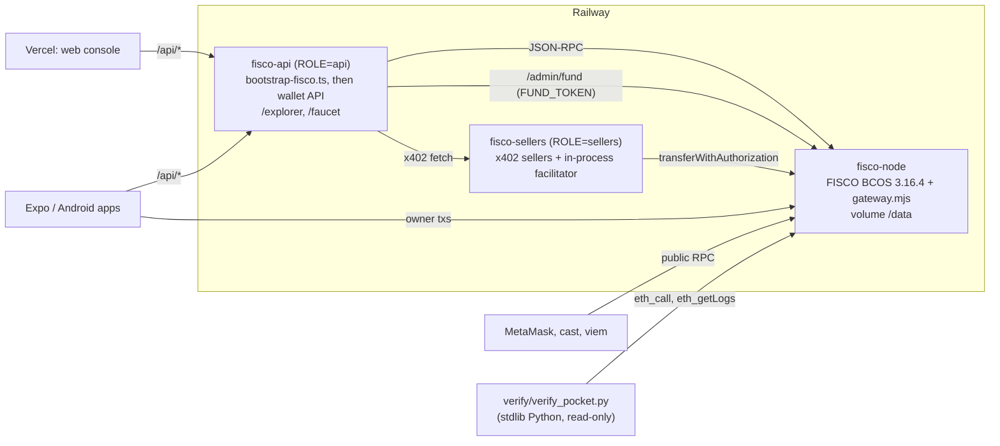

# 08 Chain and Deployment

ChainBrain runs on its own FISCO BCOS 3.16.4 chain: one node, the web3 JSON-RPC, chain id 20200 and gas price 0. The payment token is Mock e-HKD (`eHKD`), a demo ERC-20 with EIP-3009 that the team deploys. This document covers how the chain is built and run locally (`scripts/fisco/`), the FISCO behaviours the code works around (zero-balance senders, no fee history, a millisecond clock, nonce ordering, pseudo-code accounts, lossy `eth_getLogs`), how senders get native balance and eHKD (`server/src/fund.ts`, the node gateway, the faucet), the in-process x402 facilitator, the hosted deployment on Railway and Vercel (`deploy/`, `web/vercel.json`), the dev stack (`devstack/`), how to run each environment end to end, the on-chain evidence files and scripts, and the independent Python verifier (`verify/`). The owner-facing apps call a pocket a "card"; the code and this document say "pocket". Contract internals are in [02-smart-contracts.md](02-smart-contracts.md).

## 1. Environments at a glance

| Environment | Chain | Server | Agent | Contracts | Used for |
| --- | --- | --- | --- | --- | --- |
| Built-in network (`shared/sim`) | Virtual, in the app | None | Scripted | Pocket rules simulated in-app | Offline demo; both apps open on it (`README.md:31-33`) |
| Local real stack | Local FISCO node, `127.0.0.1:8545` | `server/` on :8787, sellers on :4021 | Claude (`ANTHROPIC_API_KEY`) | Committed addresses | Development, evidence (`README.md:50-64`, `:100-107`) |
| Dev stack (`devstack/`) | Local FISCO node, or `FISCO_RPC` | Real `server/src` on :8787, sellers on :4021 | Scripted keyword router | Fresh token and factory per run | App testing with no API key (`devstack/README.md`) |
| Hosted (Railway + Vercel) | `fisco-node` service | `fisco-api`, `fisco-sellers` | Claude | Committed addresses | Public demo for judges (`README.md:67-79`) |

The built-in network has no chain and is out of scope here beyond this row.



## 2. The FISCO BCOS chain

### 2.1 Facts

| Item | Value | Source |
| --- | --- | --- |
| Node | FISCO BCOS `v3.16.4`, Air, 1 node | `scripts/fisco/env.sh:4`, `deploy/fisco-node/Dockerfile:1` |
| Console | `v3.7.0` (Java; needs JDK 17) | `scripts/fisco/env.sh:5`, `README.md:46` |
| Chain id | `20200` (`0x4ee8`) | `server/src/chains.ts:15`, `devstack/src/stack.ts:65` |
| RPC | web3 JSON-RPC on `127.0.0.1:8545` | `scripts/fisco/setup.sh:2`, `:19` |
| Native currency | `FISCO`, 18 decimals; only needed so an address may send | `server/src/chains.ts:15`, `docs/fisco-ehkd-chain.md:15` |
| Gas price | 0 | `docs/fisco-ehkd-chain.md:16` |
| Keys | ECDSA secp256k1 (not SM2) | `docs/technical-document.md:89` |
| Supported hosts | macOS arm64, Linux x86_64, Linux aarch64 | `scripts/fisco/env.sh:8-13` |
| x402 network id | `eip155:20200` | `server/src/chains.ts:31` |

The scripts never set the chain id explicitly. `build_chain.sh -p 30300,20200` sets the P2P and RPC port bases (`scripts/fisco/setup.sh:18`). The repo does not show where 20200 as the web3 chain id comes from; the code only checks that the node reports it (`devstack/src/stack.ts:65`, `server/scripts/bootstrap-fisco.ts:20`).

### 2.2 Scripts (`scripts/fisco/`)

| Script | What it does |
| --- | --- |
| `env.sh` | Sets `ROOT`, `F` (`FISCO_HOME` or `.fisco/`), versions, the platform asset, and helpers `console()` and `governor()` (the console account's address) (`env.sh:1-15`) |
| `setup.sh` | One time. Downloads the node binary, `build_chain.sh` and the console. Builds a 1-node chain. Enables the web3 RPC on `127.0.0.1`. Appends `feature_balance=1` and `feature_balance_precompiled=1` to `config.genesis`. Builds twice: first to let the console create its account, then with `-a <governor>` (auth mode). Registers that account as balance governor (`setup.sh:10-30`) |
| `start.sh` | Starts the existing node, keeping its data (`start.sh:3`) |
| `stop.sh` | Stops the node (`stop.sh:2`) |
| `fund.sh ADDR...` | Credits native balance 1000000 to each address with the console's `addBalance`; fails unless the console prints `success` (`fund.sh:6-10`) |
| `deploy.sh` | Loads `server/.env`; funds `OWNER_PK`, `FACILITATOR_PK`, `FORCE_PK`; backs up `deployments/20200.json`; runs `forge script script/DeployFisco.s.sol --broadcast --slow --legacy --with-gas-price 0`; restores the backup if the broadcast fails or either address has under 1000 characters of code; runs `server/scripts/record-deploy.ts`; prints the file (`deploy.sh:5-22`) |

`setup.sh` explains why the governor exists: the web3 `eth_sendRawTransaction` rejects any sender with zero native balance (`bcos-rpc/validator/TxValidator.cpp checkSenderBalance`), even at gas price 0, and genesis `alloc` is not parsed in 3.16.4 (`setup.sh:5-7`).

### 2.3 FISCO behaviours and how the code handles them

| # | Behaviour | Handling | Where |
| --- | --- | --- | --- |
| 1 | The web3 RPC refuses senders with zero native balance, even at gas price 0 | Credit balance after start: `fund.sh`, gateway `/admin/fund`, faucet, `/dev/fund` | Section 3 |
| 2 | Genesis `alloc` is not parsed; `executor.version=2` crashes the node | Balances added after start | `setup.sh:6-7`, `docs/technical-document.md:97` |
| 3 | No `eth_feeHistory` | forge uses `--legacy --with-gas-price 0`; Expo and Kotlin send legacy txs at gas price 0 | `deploy.sh:15`, `mobile/src/lib/wallet.ts:10-12`, `android/.../Chain.kt:54`, `:93` |
| 4 | Blocks carry `baseFeePerGas: 0x0`, so wallets choose EIP-1559 and fail without fee history | The hosted gateway answers `eth_feeHistory` with all-zero history | `deploy/fisco-node/gateway.mjs:34-45` |
| 5 | Contracts see `block.timestamp` in milliseconds; the RPC reports seconds | `Clock.nowSec()` divides by 1000; contract tests also run on a ms clock | `contracts/src/Clock.sol:8-10`, `contracts/test/Pocket.ehkd.t.sol:15-20` |
| 6 | A sender's transactions are not ordered by nonce inside a block | `forge --slow`; every client waits for each receipt; the faucet queues mints | `deploy.sh:15`, `server/src/faucet.ts:18`, `server/scripts/bootstrap-fisco.ts:36`, `devstack/src/stack.ts:83` |
| 7 | Tracked accounts report pseudo-code `[PRECOMPILED],…,/usr/<address>`, so funded EOAs have code | `MockEHKD` checks ECDSA first; the explorer and the verifier treat the pseudo-code as an account | `contracts/src/MockEHKD.sol:86-93`, `server/src/explorer.ts:95-96`, `verify/verify_pocket.py:169-176` |
| 8 | `transactionIndex` is returned as the hex of its ASCII text (`"0x307830"` for `"0x0"`) | The hosted gateway rewrites it in responses | `deploy/fisco-node/gateway.mjs:46-59` |
| 9 | Console balance credits carry a 128-bit random nonce and chain id 0, so `getBlock({ includeTransactions: true })` cannot parse those blocks | Wallets read only their own txs; the explorer reads raw blocks | `docs/technical-document.md:104` |
| 10 | `eth_getLogs` rejects a filter without `toBlock`, `address` or `topics`, and silently drops logs from wide block ranges | `deploy/fisco-node/logs.mjs`, shared by the hosted gateway and the dev stack's `/dev/rpc`, fills the defaults and scans in 5-block windows (section 6.2); the verifier scans in 5-block windows itself | `deploy/fisco-node/logs.mjs:1-5`, `:27-51`; `gateway.mjs:61`; `devstack/src/stack.ts:105-107`; `verify/verify_pocket.py:247-257`; `docs/fisco-ehkd-chain.md:147` |
| 11 | A one-element JSON-RPC batch is answered with a bare object, which breaks batching clients such as viem; a batch of more than 8 calls is refused ("The requested array size exceeds the limit size: 8") | The gateway and `/dev/rpc` wrap the bare answer back into an array and split larger batches into chunks of 8 | `logs.mjs:57-84`; `gateway.mjs:68-75`, `:105`; `stack.ts:113-119` |

Items 4 and 8 are fixed only behind the hosted gateway. Items 10 and 11 are fixed behind the gateway and behind the dev stack's `/dev/rpc`, which import the same `logs.mjs` (`gateway.mjs:15`; `devstack/src/stack.ts:1`). `/dev/rpc` does not answer `eth_feeHistory` or repair `transactionIndex`. The local node at `127.0.0.1:8545` itself has no fix; the dev stack sets `PUBLIC_RPC_URL` to its `/dev/rpc`, so `/api/config` hands the apps the proxy, not the bare node (`stack.ts:70-71`).

The web console calls viem `getLogs` with a `fromBlock` and no `toBlock` (`web/src/console/chain.ts:45`, `:72-77`). Through the gateway or `/dev/rpc` that works. Against the bare local node, for example the real server run alone with `PUBLIC_RPC_URL` unset, it meets item 10 without a workaround. The repo has no test of that path on a local node.

Server-side senders built with viem (`faucet.ts:50-52`, `bootstrap-fisco.ts:35-42`, `devstack/src/stack.ts:78-90`) pass no `type` or `gasPrice`. Which transaction type viem chooses there is not visible in the repo code; `devstack/src/seed.ts:28` and the Expo app set `type: "legacy", gasPrice: 0` explicitly.

### 2.4 The millisecond clock

- FISCO 3.x gives contracts `block.timestamp` in milliseconds (`contracts/src/Clock.sol:4`).
- `Clock.nowSec()` returns `block.timestamp / 1000` above `1e11`, else the value unchanged (`Clock.sol:9`).
- Pocket expiry (`Pocket.sol:80`), the pocket's allowance period (`Pocket.sol:102`, `:146`) and the EIP-3009 window (`MockEHKD.sol:61-62`) use it, so all signed times and period boundaries stay in seconds.
- Off-chain code builds `validBefore` from `Date.now() / 1000` (`server/src/wallet/scheme.ts:27`) and pocket expiry the same way (`devstack/src/seed.ts:34`).
- Off-chain code that reads block times must divide by 1000 (`docs/fisco-ehkd-chain.md:146`).

### 2.5 Mock e-HKD on the chain

| Item | Value |
| --- | --- |
| Token | `0x0355c0c5Afe2A35369056FBB854903A4aF07781A` (`contracts/deployments/20200.json`) |
| Pocket factory | `0x03aB4C311eeE7C3295c63F910D79a07Ffa7A097A` |
| Symbol, decimals | `eHKD`, 6; prices in HK$, 1 eHKD = HK$1 (`docs/fisco-ehkd-chain.md:17-19`) |
| EIP-712 domain | name `Mock e-HKD`, version `1`, chainId 20200, verifyingContract = token (`server/src/chains.ts:32`, `docs/fisco-ehkd-chain.md:149`) |
| Initial supply | 10,000 eHKD to OWNER on deploy (`DeployFisco.s.sol:17`, `bootstrap-fisco.ts:42`) |
| Spend hook | After each authorized transfer from a contract payer, the token calls `onSpend(to, value)` on it with 100,000 gas; this counts a pocket's period allowance (`contracts/src/MockEHKD.sol:71-78`, `docs/fisco-ehkd-chain.md:135`) |
| Status | Demo token, not the HKMA e-HKD, not money (`docs/fisco-ehkd-chain.md:7`) |

The chain guide lists the rules each pocket enforces on-chain, including the period allowance and per-seller caps (`docs/fisco-ehkd-chain.md:125-137`). Contract details are in [02-smart-contracts.md](02-smart-contracts.md) sections 3.7, 3.8 and 5.4.

The two addresses are OWNER's nonce-0 and nonce-1 deployments, so they repeat on any fresh chain deployed with the same OWNER key (`docs/fisco-ehkd-chain.md:21`).

`server/src/chains.ts` is the single chain config (`ChainCfg`, `chains.ts:19-35`): chain, RPC (`FISCO_RPC`, default `http://127.0.0.1:8545`), x402 network, token (`TOKEN_ADDRESS` or the deployments file), domain, currency `HK$`, and `txUrl` (`PUBLIC_API_URL` + `/explorer#/tx/<hash>`). The deployments file is cached per chain id, so a redeploy needs a server restart or the env overrides (`chains.ts:4`). The apps read RPC, explorer prefix, token, factory and ABIs from `GET /api/config` (`server/src/index.ts:57-61`).

## 3. Funding senders

### 3.1 Mechanisms

| Mechanism | Where | Auth | Native balance | eHKD |
| --- | --- | --- | --- | --- |
| `scripts/fisco/fund.sh` | Local machine running the node | Shell access | `addBalance` 1000000 per address | none |
| Gateway `POST /admin/fund` | Hosted node (`gateway.mjs:92-99`) | `Authorization: Bearer FUND_TOKEN` (24+ chars) | Runs `fund.sh` for 1-20 addresses, one call at a time | none |
| `fundIfEmpty(pc, addresses)` | `server/src/fund.ts:9-22` | Uses `FUND_URL` + `FUND_TOKEN` if set | Funds only addresses with balance 0; local `fund.sh` without `FUND_URL`, gateway with it | none |
| Faucet `POST /api/faucet` | Wallet API (`server/src/faucet.ts:33-64`) | Rate limits | `fundIfEmpty` | OWNER mints `FAUCET_AMOUNT` (default 100) |
| Dev stack `POST /dev/fund` | `devstack/src/stack.ts:121-128` | None | `fundIfEmpty` | Mints 160 eHKD |

`fundIfEmpty` throws if the gateway answers non-2xx (`fund.ts:20`). It returns the addresses it funded.

### 3.2 Who funds which key

| Key | `deploy.sh` | `bootstrap-fisco.ts` | Dev stack start |
| --- | --- | --- | --- |
| `OWNER_PK` | yes | yes | yes |
| `FACILITATOR_PK` | yes | yes | yes |
| `FORCE_PK` | yes | yes | yes |
| `SENTINEL_PK` | no | if set | yes |
| `AGENT_PK` | no | no | yes (escalation scene) |

Sources: `scripts/fisco/deploy.sh:9-10`, `server/scripts/bootstrap-fisco.ts:25-26`, `devstack/src/stack.ts:75-77`.

`pnpm wallets` (`server/scripts/create-wallets.ts`) creates OWNER, AGENT, FORCE, FACILITATOR and four seller keys in `server/.env` and never overwrites existing ones (`create-wallets.ts:5`, `:11-15`). It does not create `SENTINEL_PK`.

### 3.3 Faucet

| Route | Returns |
| --- | --- |
| `GET /faucet` | HTML page: claim form, "Use MetaMask" (`wallet_addEthereumChain`), "Add eHKD to MetaMask" (`wallet_watchAsset`) (`faucet.ts:66`, `:103-112`) |
| `GET /api/faucet/info` | `chainId`, `chainName`, `rpc` (`PUBLIC_RPC_URL` or the chain default), `explorer`, `token`, `symbol`, `decimals`, `amount`, `enabled` (`faucet.ts:28-31`) |
| `POST /api/faucet` `{address}` | `{ok, tx, minted, nativeFunded, explorer}` (`faucet.ts:55`, `:59`) |

| Rule | Code |
| --- | --- |
| FISCO only, else 400 `FAUCET_ONLY_ON_FISCO` | `faucet.ts:34` |
| Bad address: 400 `BAD_ADDRESS` | `faucet.ts:36` |
| One claim per address per 24 h: 429 `ALREADY_CLAIMED` with `retryAfterSec` | `faucet.ts:41` |
| 10 claims per IP per hour: 429 `TOO_MANY_REQUESTS`; IP from `x-real-ip` or the first `x-forwarded-for` | `faucet.ts:38`, `:42-43` |
| Limits are in memory and reset on restart | `faucet.ts:15-17` |
| Mints run one at a time through a promise queue | `faucet.ts:18`, `:47-57` |
| A reverted mint fails the claim: 500 `FAUCET_FAILED` with the first error line | `faucet.ts:54`, `:62` |
| A failed claim does not use up the address's allowance | `faucet.ts:61` |

## 4. The x402 facilitator

`server/src/facilitator.ts` builds x402's own facilitator in-process, because no hosted facilitator serves the FISCO chain (`facilitator.ts:8`).

| Item | Detail |
| --- | --- |
| Library | `@x402/core/facilitator` `x402Facilitator`, `@x402/evm` `registerExactEvmScheme`, `toFacilitatorEvmSigner`, version 2.28.0 (`facilitator.ts:1-3`, `server/package.json`) |
| Signer | viem wallet client for `FACILITATOR_PK` on `cfg().rpc` (`facilitator.ts:10-12`) |
| Network | `eip155:20200` (`facilitator.ts:15`) |
| Interface | `verify`, `settle`, `getSupported` (`facilitator.ts:17`) |
| Cost | Gas is free; the key still needs native balance (section 3.2) |
| Who uses it | The sellers: `new x402ResourceServer(facilitatorClient())` inside `paymentMiddleware` (`server/src/sellers.ts:12`, `:91`) |

The payment path:

1. The wallet API's `settle()` checks the pocket (`canPay`, `needsOwner`, approval expiry) and builds the authorization itself (`server/src/wallet/pay.ts:47-65`).
2. `OVER_PERIOD` from `canPay` passes only with an owner signature; every other non-`OK` code is refused (`pay.ts:60-62`).
3. It calls the seller through `@x402/fetch` with `PocketScheme` and `spendControls.allowedAssets` limited to the eHKD token, capped at the seller's own cap on the pocket, or the pocket's cap if the seller has none (`pay.ts:67-71`, `server/src/wallet/chain.ts:51-52`).
4. `PocketScheme` refuses a 402 that asks for Permit2, another asset or network, or a different `payTo` or amount (`server/src/wallet/scheme.ts:56-58`).
5. The seller's x402 middleware passes the payload to the in-process facilitator, which submits `transferWithAuthorization` to the token as `FACILITATOR_PK`.
6. The token pays and then calls the pocket's `onSpend`, which counts the allowance (`contracts/src/MockEHKD.sol:71-78`).
7. A non-200 reply becomes `SETTLEMENT_FAILED` with the facilitator's error (`pay.ts:82-84`).

Sellers price as an explicit asset amount `{amount, asset: token, extra: {name, version}}`, because x402's "$" prices mean USDC (`sellers.ts:57`, `:87-89`).

`docs/technical-document.md:65` says the facilitator runs "in the server and in the sellers". In the code on main, only `server/src/sellers.ts` imports it.

## 5. Explorer and receipts

FISCO has no public explorer, so the wallet API serves a read-only one (`server/src/index.ts:70`).

| Route | Returns |
| --- | --- |
| `/explorer` | Explorer page; hash routes `#/tx/<hash>`, `#/address/<addr>`, `#/block/<n>`; MetaMask-style paths redirect (`docs/fisco-ehkd-chain.md:107-111`) |
| `GET /api/explorer/summary`, `/blocks`, `/block/<n>`, `/tx/<hash>`, `/address/<addr>` | JSON (`docs/fisco-ehkd-chain.md:117-123`) |
| `GET /api/tx/:hash` | `{chain, chainId, hash, status, blockNumber, from, to, logs}`; 400 `BAD_HASH`, 404 `NOT_FOUND` (`server/src/index.ts:63-69`) |

## 6. Hosted deployment

### 6.1 Services

| Service | URL | Image | Command |
| --- | --- | --- | --- |
| `fisco-node` | https://fisco-node-production.up.railway.app | `deploy/fisco-node/Dockerfile` | `entrypoint.sh`, then `gateway.mjs` |
| `fisco-api` | https://fisco-api-production-85c5.up.railway.app | `deploy/server/Dockerfile` | `start.sh` with `ROLE=api` |
| `fisco-sellers` | https://fisco-sellers-production.up.railway.app | `deploy/server/Dockerfile` | `start.sh` with `ROLE=sellers` |
| Web console | https://fintechathon-lian-ai-nao.vercel.app | `web/vercel.json` | Vite build |

URLs: `README.md:69-73`, `docs/fisco-ehkd-chain.md:27-34`.

There is no `railway.json` or `railway.toml` in the repo. Which Dockerfile each Railway service uses, its env vars, its volume and its private-network URL are set in Railway, not in code, so they cannot be checked from the repo. The service-to-image mapping above follows `README.md:79` and the `ROLE` switch in `deploy/server/start.sh:6-10`.

### 6.2 `fisco-node`

Image (`deploy/fisco-node/Dockerfile`):

- Base `node:24-bookworm-slim` with OpenJDK 17, curl, openssl, procps, uuid-runtime (`Dockerfile:2-4`).
- Bakes the FISCO `v3.16.4` Linux x86_64 binary, `build_chain.sh` and console `v3.7.0` into `/opt/fisco` (`Dockerfile:5-11`).
- Copies `scripts/fisco` and `deploy/fisco-node` (`Dockerfile:13-14`).
- `FISCO_HOME=/data/fisco`, `PORT=8080`, exposes 8080 (`Dockerfile:15-16`).

Boot (`deploy/fisco-node/entrypoint.sh`):

1. Copies the baked files into `$FISCO_HOME` without overwriting (`entrypoint.sh:7`).
2. If `$FISCO_HOME/.ready` is missing, deletes any half-built `nodes/`, runs `setup.sh`, then writes `.ready` (`entrypoint.sh:9-13`).
3. Otherwise starts the existing node (`entrypoint.sh:15`).
4. Waits up to 60 s for `eth_chainId` (`entrypoint.sh:17`).
5. Runs the gateway in the foreground (`entrypoint.sh:18`).

Gateway (`deploy/fisco-node/gateway.mjs` with `logs.mjs`, no dependencies):

| Route | Behaviour |
| --- | --- |
| `POST /` | Forwards JSON-RPC to `127.0.0.1:8545`. Answers `eth_feeHistory` itself with zero base fees, zero gas ratios and zero rewards, up to 1024 blocks (`gateway.mjs:34-45`). Answers `eth_getLogs` itself through `logs.mjs` (below) (`gateway.mjs:61`, `:66-67`). Answers a batch itself when it holds `eth_feeHistory` or `eth_getLogs` or has more than 8 calls; the other calls go to the node in chunks of 8, and the answers come back in request order (`gateway.mjs:68-75`; `logs.mjs:68-84`). Wraps a bare answer to a one-element batch back into an array (`gateway.mjs:105`; `logs.mjs:57-59`). Repairs `transactionIndex` (`gateway.mjs:46-59`, `:105`) |
| `GET /health` | 200 `{ok, block}` when `eth_blockNumber` answers, else 503 (`gateway.mjs:88-91`) |
| `POST /admin/fund` | Bearer `FUND_TOKEN`; 1-20 hex addresses; runs `fund.sh` serially with a 120 s timeout (`gateway.mjs:80-83`, `:92-99`) |
| `OPTIONS` | 204 with open CORS (`gateway.mjs:23`, `:87`) |
| Other | 404 |

The gateway refuses to start unless `FUND_TOKEN` has 24 or more characters (`gateway.mjs:21`). Request bodies are capped at 1,000,000 bytes (`gateway.mjs:20`, `:27`). Any thrown error becomes 400 `{error}` (`gateway.mjs:108-110`). It listens on `[::]:$PORT` (`gateway.mjs:111`).

`eth_getLogs` in `logs.mjs` (`makeGetLogs`, `logs.mjs:27-51`), used by the gateway and by the dev stack's `/dev/rpc`:

| Step | Behaviour | Code |
| --- | --- | --- |
| 1 | `address` and `topics` default to `[]` | `logs.mjs:31` |
| 2 | A filter with `blockHash` is sent to the node as one call, with those defaults | `logs.mjs:32` |
| 3 | `toBlock` defaults to the latest block and is clamped to it; `latest`, `pending`, `safe` and `finalized` mean latest; `earliest` means 0 | `logs.mjs:21`, `:33-38` |
| 4 | `fromBlock` defaults to the latest block | `logs.mjs:37` |
| 5 | A range over 5,000 blocks (`MAX_LOG_BLOCKS`) returns JSON-RPC error `-32005` ("block range too large"); a client pages with `fromBlock` | `logs.mjs:7`, `:39` |
| 6 | The range is split into 5-block windows (`LOG_WINDOW = 5n`) | `logs.mjs:6`, `:40-41` |
| 7 | At most 16 node calls are in flight at once, across all requests (`MAX_INFLIGHT`); results are concatenated in block order | `logs.mjs:9`, `:11-17`, `:42-46` |
| 8 | A batch carries at most 5 `eth_getLogs` calls (`MAX_LOGS_PER_BATCH`); each one beyond that gets error `-32005` | `logs.mjs:8`, `:53-55`; `gateway.mjs:72`; `devstack/src/stack.ts:115` |
| 9 | A node error in any window, or on `eth_blockNumber`, is returned as that JSON-RPC error with the request's id; an exception becomes `-32603`. `getLogs` never throws | `logs.mjs:34`, `:44-48` |
| 10 | `transactionIndex` is repaired in the returned logs (gateway only; `/dev/rpc` passes no repair function) | `gateway.mjs:61`; `stack.ts:107` |

The 5-block window size comes from observation, per the comment at `logs.mjs:2-3`. The repo has no test that measures which range sizes lose logs, and no unit test of `logs.mjs`; the dev stack suite reaches it only through `/dev/rpc`.

### 6.3 `fisco-api` and `fisco-sellers`

Image (`deploy/server/Dockerfile`):

1. Stage `ghcr.io/foundry-rs/foundry:v1.8.5` runs `forge build` for the ABIs and bytecode (`Dockerfile:2-6`).
2. Stage `node:24-bookworm-slim` installs `pnpm@12.11.2` and `chainbrain-server` dependencies with `--frozen-lockfile` (`Dockerfile:8-14`).
3. Copies `server/`, `shared/`, `contracts/deployments` and the built `contracts/out` (`Dockerfile:15-19`).
4. `NODE_ENV=production`; runs `deploy/server/start.sh` (`Dockerfile:20-21`).

`start.sh` (`deploy/server/start.sh:6-10`):

| `ROLE` | Runs |
| --- | --- |
| `api` (default) | `scripts/bootstrap-fisco.ts`, then `src/index.ts` on `$PORT` (default 8787) |
| `sellers` | `src/sellers.ts` on `SELLERS_PORT=$PORT` (default 4021) |
| other | exits with an error |

`bootstrap-fisco.ts` makes the chain usable, idempotently (`server/scripts/bootstrap-fisco.ts:1-4`):

1. Waits up to about 4 minutes (121 tries, 2 s apart) for chain id 20200 (`:19-23`).
2. Funds OWNER, FACILITATOR, FORCE and SENTINEL (if set) through `fundIfEmpty` (`:25-27`).
3. If both committed addresses have code, stops (`:29-32`).
4. If OWNER has already sent transactions but the contracts are missing, throws: the chain does not match the file (`:33-34`).
5. Otherwise deploys `MockEHKD(owner)` and `PocketFactory(token, guardian)`, mints 10,000 eHKD to OWNER, and throws unless the addresses match the file (`:37-45`).

`.railwayignore` keeps `android/`, `mobile/`, `web/` (except `web/package.json`), `docs/`, `.claude/` and `node_modules/` out of `railway up` uploads (`.railwayignore:1-9`).

Redeploy: `RAILWAY_TOKEN=<project token> railway up --service fisco-node|fisco-api|fisco-sellers` from the repo root (`README.md:79`).

### 6.4 Web console on Vercel

`web/vercel.json`: framework `vite`, install `npx pnpm@12.11.2 install --frozen-lockfile --filter web`, build `npm run build`, output `dist`. The console opens on the built-in network; `?server=https://fisco-api-production-85c5.up.railway.app` points it at the hosted API (`README.md:77`).

### 6.5 Environment variables

| Variable | Read by | Purpose |
| --- | --- | --- |
| `FISCO_HOME` | `scripts/fisco/env.sh:3`, `entrypoint.sh:5` | Chain data directory |
| `FUND_TOKEN` | `gateway.mjs:19`, `fund.ts:18` | Bearer secret for `/admin/fund` |
| `FUND_URL` | `fund.ts:13`, `:17` | Gateway base URL; unset = local `fund.sh` |
| `FISCO_RPC` | `chains.ts:31`, `bootstrap-fisco.ts:12`, `devstack/src/stack.ts:63` | Node RPC |
| `TOKEN_ADDRESS`, `FACTORY_ADDRESS` | `chains.ts:28`, `wallet/chain.ts:19` | Override the deployments file |
| `PUBLIC_API_URL` | `chains.ts:33`, `faucet.ts:23` | Base of explorer links |
| `PUBLIC_RPC_URL` | `index.ts:35`, `faucet.ts:22`; set by the dev stack to its `/dev/rpc` (`devstack/src/stack.ts:71`) | RPC the apps are told to use |
| `FAUCET_AMOUNT` | `faucet.ts:21` | eHKD per claim (default 100) |
| `OWNER_PK` | `DeployFisco.s.sol:12`, `bootstrap-fisco.ts:24`, `faucet.ts:49` | Issuer and deployer |
| `FACILITATOR_PK` | `facilitator.ts:10` | Submits settlements |
| `FORCE_PK` | `deploy.sh:9`, `bootstrap-fisco.ts:25` | Scene 5 forced-transfer sender |
| `SENTINEL_PK` | `bootstrap-fisco.ts:40`, `sentinel/index.ts:16` | Guardian key; becomes the factory guardian on bootstrap |
| `SENTINEL_ADDRESS` | `DeployFisco.s.sol:16` | Guardian for the forge deploy |
| `ROLE` | `deploy/server/start.sh:6` | `api` or `sellers` |
| `PORT`, `SELLERS_PORT`, `SELLERS_URL` | `start.sh:7-8`, `index.ts:127`, `server/.env.example` | Ports and the sellers' URL |
| `EVIDENCE_FILE` | `record-deploy.ts:4`, `server/scripts/evidence.ts:7-8` | Records deploy and evidence hashes when set |
| `SPIKE_SELLERS_URL` | `server/scripts/allowance.ts:18` | Remote sellers for the allowance script; unset = in-process sellers on :4599 |

Two inconsistencies in the repo:

- The forge path takes the guardian from `SENTINEL_ADDRESS`, the bootstrap path from `SENTINEL_PK`. `server/.env.example` lists only `SENTINEL_PK` and says to deploy the factory with `SENTINEL_ADDRESS` set to its address. `deploy.sh` exports `server/.env` before running forge (`deploy.sh:6`), so a local factory gets a guardian only if `SENTINEL_ADDRESS` is in that file.
- `server/.env.example` says tx links point at `/api/tx/:hash`; `chains.ts:33` builds `/explorer#/tx/<hash>`.

## 7. Dev stack (`devstack/`)

### 7.1 What it is

One command boots the real `server/src` and sellers against a FISCO node with a scripted model instead of Claude (`devstack/README.md:3`, `:11-17`). Nothing in `server/`, `contracts/`, `web/`, `mobile/` or `android/` is changed (`devstack/README.md:19`).

| File | Role |
| --- | --- |
| `src/stack.ts` | `startDevStack()`: checks the node, funds senders, deploys a fresh token and factory, mints 8,000 eHKD to the owner, starts sellers, wallet API, Sentinel and the `/dev/*` routes (`stack.ts:59-216`) |
| `src/main.ts` | `pnpm --dir devstack start`; prints the banner with URLs, addresses and app commands (`main.ts:1-32`) |
| `src/model.ts` | Scripted keyword router implementing the server's model function; re-runs a scene generator on each call (`model.ts:1-8`) |
| `src/scenes.ts` | The demo sentences for scenes 1-8, served at `/dev/scenes` (`scenes.ts:1`) |
| `src/relay.ts`, `src/relay-main.ts` | Phone-to-console relay; `pnpm --dir devstack relay` runs it alone (`relay-main.ts:1-2`) |
| `src/seed.ts` | `pnpm --dir devstack seed`: creates and funds pockets over HTTP and runs real purchases (`seed.ts:1-2`) |
| `src/force-transfer.ts` | `pnpm --dir devstack force-transfer <pocket>`: runs `server/scripts/force-transfer.ts` with the dev keys and the stack's token (`force-transfer.ts:1-2`) |

Keys are Foundry's published dev keys, for local test chains only (`stack.ts:15-25`, `devstack/README.md:119`).

### 7.2 Boot sequence

1. Reject the node unless `eth_chainId` is `0x4ee8` (`stack.ts:64-65`).
2. Set dev keys, `FISCO_RPC`, `SELLERS_URL` (LAN IP) and `PUBLIC_RPC_URL` (`http://<LAN IP>:<apiPort>/dev/rpc`) in `process.env` (`stack.ts:70-71`).
3. Fund owner, facilitator, force, Sentinel and agent keys (`stack.ts:77`).
4. Deploy `MockEHKD(owner)` then `PocketFactory(token, sentinel)`, one receipt at a time; set `TOKEN_ADDRESS` and `FACTORY_ADDRESS` (`stack.ts:84-86`).
5. Mint 8,000 eHKD to the owner (`stack.ts:92`).
6. Start sellers on 0.0.0.0:4021, the wallet API with `scriptedModel`, and the Sentinel (`stack.ts:94-99`).
7. Mount `/dev/*`, `/dev/relay`, a wrapped `/api/chat`, and forward everything else to the real API on 0.0.0.0:8787 (`stack.ts:102-206`).

### 7.3 Routes added by the dev stack

| Route | Behaviour |
| --- | --- |
| `GET /dev/health` | `{mode: "local-chain", chainId: 20200, rpcPath: "/dev/rpc", startedAt, owner}`; apps use it to detect dev mode (`stack.ts:104`) |
| `POST /dev/rpc` | JSON-RPC proxy to the node; CORS `*`. `eth_getLogs` goes through `logs.mjs` as on the gateway (section 6.2); every batch is answered through `answerBatch`, so batches over 8 calls are split and at most 5 `eth_getLogs` run per batch; a bare answer to a one-element batch is wrapped back into an array (`stack.ts:103`, `:105-120`) |
| `POST /dev/fund` `{address}` | Native balance if empty, plus 160 eHKD (`stack.ts:121-128`) |
| `GET /dev/scenes` | `SCENES` (`stack.ts:129`) |
| `POST /dev/force-transfer` `{pocket, attacker?}` | Agent key signs a 50 eHKD transfer to the attacker; `FORCE_PK` submits it with fixed gas 200,000 so the revert lands on-chain; returns `{tx, reverted, balanceBefore, balanceAfter, reason?}` and publishes a `forced` event (`stack.ts:179-201`) |
| `POST /api/chat` (wrapped) | After the real handler, a typed attack becomes an `attack` event; for escalation the agent key really calls `setCap` / `setSeller` and the chain reverts with `NOT_OWNER` (`stack.ts:143-175`) |
| `/dev/relay/push`, `/stream`, `/state`, `/command` | Phone-to-console relay (`relay.ts:6-14`) |

`relay.ts:10-13` lists four command types (`plant`, `force`, `hijack`, `say`); `devstack/README.md:64` documents two (`plant`, `force`).

### 7.4 Tests

| Command | Count | Covers |
| --- | --- | --- |
| `pnpm --dir devstack test` | 21 (`devstack.test.ts` 18, `relay.test.ts` 3, by reading) | `/dev/*` routes, pocket create and fund over `/dev/rpc`, scenes 1-8, adaptation, fallback, escalation revert, extraction event, force-transfer reason, relay (`devstack/test/*.ts`) |
| `node devstack/e2e/builtin.cjs --url http://localhost:8091` | 48 checks (README) | Phone on the built-in network, no stack (`devstack/README.md:110`) |
| `node devstack/e2e/e2e.cjs` | 57 checks on 16 Oct (README); the commit message of `7b48a2c` reports 60 of 60 | Phone and console against a running stack (`devstack/README.md:110`). On `7b48a2c` it drives the card UI: "New card", the step-by-step wizard's Research data preset (HK$40 budget, up to HK$15, asks above HK$8), HK$100 from the faucet, and the Ledger tab for receipts (`devstack/e2e/e2e.cjs:319-358`, `:394`) |

The vitest suite boots its own stack on ports 18787 and 14021, runs files serially, and allows 120 s per test and 180 s per hook (`devstack/README.md:108`, `devstack/vitest.config.ts`).

## 8. Running each environment end to end

Common prerequisites: Node 24, pnpm, Foundry; for a local node, macOS arm64 or Linux, JDK 17 and curl (`README.md:46`). Once: `git submodule update --init`, `pnpm i`, `cd contracts && forge build` (`devstack/README.md:26`).

### 8.1 Local real stack

```bash
cp server/.env.example server/.env          # add ANTHROPIC_API_KEY
cd server && pnpm wallets && cd ..          # demo keys into server/.env
bash scripts/fisco/setup.sh                 # first time: node on :8545, chain id 20200
bash scripts/fisco/deploy.sh                # fund senders, deploy, mint HK$10,000 to OWNER
bash scripts/fisco/fund.sh 0xYOUR_APP_KEY   # any other sender (MetaMask, phone key)
cd server && pnpm spike                     # live gate: DataLite HK$2.30, DataPro HK$11.70 co-signed
cd server && pnpm tsx scripts/allowance.ts  # weekly allowance proof on the chain (section 9.2)
cd server && pnpm sellers                   # :4021
cd server && pnpm dev                       # :8787, /explorer, /faucet
pnpm --dir web dev                          # :5173, then Settings, Custom server
```

Sources: `README.md:50-64`, `:100-104`. Later sessions: `bash scripts/fisco/start.sh` / `stop.sh`. Set `EVIDENCE_FILE=../docs/evidence-fisco.json` on `deploy.sh`, `pnpm spike` and `scripts/allowance.ts` to record hashes (`README.md:103`, `server/scripts/record-deploy.ts:1`, `server/scripts/evidence.ts:1`).

Phone: `cd mobile && EXPO_PUBLIC_API_URL=http://<laptop LAN IP>:8787 npx expo start`, then Settings, Advanced, Custom server (`README.md:105`). Native Android uses `http://10.0.2.2:8787` from the emulator (`README.md:106`).

### 8.2 Dev stack

```bash
bash scripts/fisco/start.sh                                  # node running
pnpm --dir devstack start                                    # banner prints URLs and commands
VITE_API_URL=http://localhost:8787 pnpm --dir web dev        # web; owner signs locally
EXPO_PUBLIC_API_URL=http://<LAN IP>:8787 EXPO_PUBLIC_RPC_URL=http://<LAN IP>:8787/dev/rpc npx expo start   # phone
pnpm --dir devstack seed                                     # optional: real purchases for the dashboards
```

Sources: `devstack/README.md:30-46`, `devstack/src/main.ts:23-24`. A second stack runs beside the first with `API_PORT=28787 SELLERS_PORT=24021` (`devstack/README.md:30`). Each start deploys a fresh token and factory, so pockets from an earlier run no longer show (`devstack/README.md:38`).

### 8.3 Hosted

1. `railway up --service fisco-node`: on an empty volume it builds the chain; afterwards it restarts it (`entrypoint.sh:9-16`).
2. `railway up --service fisco-api` with `ROLE=api`, `FISCO_RPC`, `FUND_URL`, `FUND_TOKEN` and the keys: bootstrap funds senders and deploys at the committed addresses, then the API starts (`start.sh:7`, `bootstrap-fisco.ts`).
3. `railway up --service fisco-sellers` with `ROLE=sellers` and the seller and facilitator keys (`start.sh:8`).
4. Deploy `web/` to Vercel with `web/vercel.json`.
5. Users: open `/faucet`, press Use MetaMask, claim HK$100 (`docs/fisco-ehkd-chain.md:58`, `:74`).
6. Clients: `FISCO_RPC=https://fisco-node-production.up.railway.app` points the server, devstack or a script at the hosted chain (`docs/fisco-ehkd-chain.md:54`).
7. Anyone: `python3 verify/verify_pocket.py --rpc https://fisco-node-production.up.railway.app --pocket 0x...` reads a pocket's rules from the hosted chain (section 10; `README.md:98`).

The env var names in steps 2-3 come from the code that reads them (section 6.5). Their values on Railway are not in the repo.

## 9. Evidence

### 9.1 Evidence files

| File | Chain | Entries | Content |
| --- | --- | --- | --- |
| `docs/evidence-fisco.json` | fisco / 20200 (local) | 17 | 3 deploy txs, spike create, fund and two payments, `new-pocket` creates and funds, scene payments, one expected revert (scene 5 forced transfer) |
| `docs/evidence-fisco-railway.json` | fisco / 20200 (hosted) | 11 | Spike create, fund, DataLite payment, DataPro co-signed payment, scene 5 forced transfer (reverted), then the six allowance entries of section 9.2 |

- The hosted file was regenerated on a fresh hosted chain at commit 3e75c4a (commit message); it has not changed since.
- Six entries are new (`docs/evidence-fisco-railway.json:39-79`).
- The token and factory addresses in it are unchanged, because they are OWNER's nonce-0 and nonce-1 deployments (`docs/evidence-fisco-railway.json:10`, `:17`; section 2.5).
- The allowance pocket in it is `0x91019dDCD226aA00D3e76CD79C5bCFF9973D5374` (`docs/evidence-fisco-railway.json:58`).
- The commit message reports 11 of 11 verified; I did not re-run the check.
- Entry counts above are from reading the files.

`cd server && pnpm tsx scripts/verify-evidence.ts [file]` re-fetches each hash and checks that the tx and receipt exist, the status matches, the block lists the tx, the tx calls the recorded contract and the expected event came from it; it first checks the file's chain and chain id against the RPC (`server/scripts/verify-evidence.ts:1-30`). Without an argument it reads `docs/evidence-fisco.json` (`verify-evidence.ts:11`). For the hosted file, pass the file and set `FISCO_RPC` to the hosted node.

### 9.2 Allowance evidence script (`server/scripts/allowance.ts`)

The script proves on the live chain that the pocket, not the server, holds the weekly allowance (`allowance.ts:1-5`).

| Step | Action | Expected | Evidence label |
| --- | --- | --- | --- |
| 1 | OWNER creates a pocket: cap HK$15, never asks, expiry 24 h, DataLite only (`allowance.ts:35-37`) | success | `allowance: create pocket (DataLite only, never asks)` |
| 2 | OWNER funds it with HK$10 (`allowance.ts:38`) | success | `allowance: fund pocket HK$10` |
| 3 | OWNER sets a weekly allowance of HK$3.00 with `setPeriodLimit(2, 3.00)` (`allowance.ts:39`) | success, `RulesChanged()` | `allowance: owner sets at most HK$3.00 a week (Hong Kong time)` |
| 4 | The server's `settle()` buys a DataLite durian report (HK$2.30) with the agent key alone (`allowance.ts:45-50`) | success | `allowance: first report HK$2.30, agent key alone (counted on-chain)` |
| 5 | A second report, agent key alone, sent straight to the token by `FORCE_PK` with fixed gas 300,000, no server checks (`allowance.ts:52-67`) | reverted | `allowance: second report, agent key alone straight to the token: over the week's allowance` |
| 6 | The same report through `settle()` with the owner's co-signature (`allowance.ts:69-73`) | success | `allowance: second report with the owner's co-signature (the cheque)` |

| Item | Detail |
| --- | --- |
| Requires | Factory deployed; OWNER and FORCE funded (`allowance.ts:6`) |
| Keys | `OWNER_PK`, `FORCE_PK`, and the agent key used by `pay.ts` (`allowance.ts:21`, `:24-26`) |
| Sellers | In-process on port 4599, or `SPIKE_SELLERS_URL` (`allowance.ts:18-20`) |
| Fixed gas in step 5 | Skips `estimateGas`, so the revert lands on-chain as a transaction (`allowance.ts:63`) |
| Recording | `record()` appends to `EVIDENCE_FILE` only when it is set (`server/scripts/evidence.ts:6-12`) |
| Exit code | 0 only if steps 4 and 6 settled and step 5 reverted (`allowance.ts:76`) |
| Step 5 nonce | A random intent hash, not the task's intent (`allowance.ts:56`) |
| Not recorded | Step 4 and step 6 are recorded only if they settled (`allowance.ts:50`, `:73`); step 5 is recorded either way (`allowance.ts:67`) |

The same flow runs as a vitest test on the local FISCO node through the agent tools, with a HK$3.00 weekly allowance and an automatic owner (`server/test/allowance-chain.test.ts:13-44`). A second case in that file checks a per-seller cap with `canPay` (`allowance-chain.test.ts:46-52`).

## 10. Independent pocket verifier (`verify/`)

### 10.1 What it is

| Item | Detail |
| --- | --- |
| Files | `verify/verify_pocket.py` (467 lines), `verify/test_verify.py` (231 lines), `verify/README.md`. Python bytecode caches are not committed; `.gitignore` ignores `__pycache__/` (`.gitignore:20`) |
| Language | Python 3, standard library only; JSON-RPC over `urllib` (`verify_pocket.py:16-20`, `verify/README.md:6`) |
| Shared code | None with the TypeScript stack; its own Keccak-256 and ABI handling (`verify_pocket.py:5`, `:22-78`) |
| Keccak self-check | Asserts the empty-string hash and the `transfer(address,uint256)` selector at import (`verify_pocket.py:77-78`) |
| Access | Read-only: `eth_getCode`, `eth_call`, `eth_blockNumber`, `eth_getLogs`; never sends a transaction (`verify_pocket.py:6`, `:181`, `:116`, `:252`, `:256`) |
| Trust | Reads only the chain, never the wallet API (`verify/README.md:7`) |
| Purpose | Checks that the pocket came from the ChainBrain factory, says its on-chain rules in plain English, then compares them with what the owner approved (`verify/README.md:3`, `:21-25`) |

`verify/README.md:8` lists the RPC methods as `eth_getCode`, `eth_call` and `eth_getLogs`; the code also calls `eth_blockNumber` (`verify_pocket.py:252`).

### 10.2 Provenance

A lookalike contract could return the approved values from its getters while its `isValidSignature` does something else (`verify/README.md:21`). So every run on an address with code checks two things, with or without `--approved` (`provenance`, `verify_pocket.py:260-276`; called at `:430-433`):

| Check | How | Failure text |
| --- | --- | --- |
| Created by the factory | The pocket's address is topic 1 of a `PocketCreated(address,address,address)` log of the factory, scanned from block 0 in 5-block windows | "not created by the ChainBrain factory …", or "cannot read the factory's logs (…)" |
| Same token | The pocket's `token()` equals the factory's `token()` | "token … is not the factory's token …", or "factory … has no token()" |

- The factory is `--factory`, by default `0x03aB4C311eeE7C3295c63F910D79a07Ffa7A097A`, the committed address on every fresh chain (`verify_pocket.py:147`, `:423`; `contracts/deployments/20200.json`).
- A failure is a `MISMATCH provenance` row and exit code 1 (`verify/README.md:25`).
- On a dev stack, which deploys a fresh factory per run (section 7.1), pass that run's factory with `--factory`.

### 10.3 What it reads

| Rule | Read with | Code |
| --- | --- | --- |
| Contract present | `eth_getCode`; FISCO's `[PRECOMPILED]` pseudo-code counts as no contract | `verify_pocket.py:169-183` |
| Token, owner, agent, guardian | `token()`, `owner()`, `agent()`, `guardian()` | `verify_pocket.py:192-195` |
| Cap, ask threshold, expiry | `perPaymentCap()`, `askAbove()`, `expiresAt()` | `verify_pocket.py:196-198` |
| Revoked, frozen | `revoked()`, `frozen()` | `verify_pocket.py:199-200` |
| Period allowance | `periodKind()`, `periodLimit()`, `spentThisPeriod()` | `verify_pocket.py:201-203` |
| Balance, symbol, decimals | The token's `balanceOf(pocket)`, `symbol()`, `decimals()`; defaults `eHKD` and 6 | `verify_pocket.py:205-215` |
| Contract version | `sellerCap(address)` answers: the version that emits `SellerSet` from its constructor on | `verify_pocket.py:217-222` |
| Seller candidates | Every `SellerSet(address,bool)` and `SellerCapSet(address,uint256)` log of the pocket from block 0 | `verify_pocket.py:224-242` |
| Allowed sellers | Each candidate confirmed with `sellerAllowed(address)` on current state | `verify_pocket.py:279-286` |
| Seller caps | `sellerCap(address)` for each candidate; non-zero values only | `verify_pocket.py:287-293` |

Log scanning (`logs_of`, `verify_pocket.py:247-257`):

- It reads the latest block number, then calls `eth_getLogs` once per 5-block window from block 0 to the latest, for the pocket and, in the provenance check, for the factory with the `PocketCreated` topic.
- Each call passes `address`, `fromBlock`, `toBlock` and `topics`, which FISCO requires (`docs/fisco-ehkd-chain.md:147`).
- The windows are queried one after another, so the number of RPC calls grows with the chain's height divided by 5.

When the seller logs cannot be read:

| Pocket | No seller logs, or `eth_getLogs` fails | Code |
| --- | --- | --- |
| Current version (has `sellerCap`) | `sellersError` "cannot list from logs (…)": the rule line says so, and a `sellers: cannot list from logs` row is a MISMATCH, with or without `--approved` | `verify_pocket.py:234-241`, `:335-336`, `:388-389`, `:434-435` |
| Older version | `sellersFromLogs` is false; the comparison confirms the approved sellers one by one and flags that extra sellers cannot be ruled out | `verify_pocket.py:238-239`, `:383-392` |

A view that reverts or returns no data is recorded as missing and shown as "not available on this pocket's contract version" (`verify_pocket.py:185-190`, `:144`). `explain` reads every field with defaults, so a missing getter (owner, agent, cap, ask, guardian) is reported, not a crash (`verify_pocket.py:313-354`).

### 10.4 What it outputs

Plain-English lines (`explain`, `verify_pocket.py:321-354`):

| Line | Condition |
| --- | --- |
| `REVOKED` / `FROZEN` warnings | `revoked` / `frozen` true |
| Agent and per-payment cap | Always; adds "(sellers with their own cap below use it instead, higher or lower)" when a seller has its own cap (`verify_pocket.py:330-331`) |
| `Only to: …` with any seller caps | Sellers found |
| "Allowed sellers: cannot list from logs …" | Current-version pocket without readable seller logs |
| "No seller is allowed" | Logs read but no seller allowed now |
| Ask threshold | "Never asks", "Every payment also needs the owner's signature", the HK$ threshold, or not available |
| Period allowance | Limit, kind in Hong Kong time, spend this period; "No period allowance"; or not available (`verify_pocket.py:303-310`) |
| Expiry | HKT date, or "Never expires" at or above `2^63` |
| Guardian | Freeze-only, "No guardian", or not available |
| Owner | Sole rule editor |
| Balance | HK$ and symbol |

Amounts are shown as HK$ with at least 2 decimals (`verify_pocket.py:150-154`).

Comparison against `--approved` (`compare`, `verify_pocket.py:360-411`):

| Field in `approved.json` | Compared as |
| --- | --- |
| `pocket`, `owner`, `agent`, `guardian`, `token` | Lower-case address; a null guardian means the zero address |
| `cap`, `askAbove` | HK$ strings; `askAbove: "never"` matches max uint |
| `expiresAt` | Unix seconds, exact |
| `sellers` | Every approved seller allowed on chain, and no extra seller allowed |
| `period` | `{kind, limit}`, or `null` for none |
| `sellerCaps` | Map of seller to HK$ cap, exact |
| `revoked`, `frozen` | Booleans |

- Only fields present in the file are compared (`verify/README.md:53`).
- It does not compare the contract's bytecode with `Pocket.sol`. Provenance ties the address to the ChainBrain factory and token; the rules are then read from the pocket's own view functions.

| Output mode | Content |
| --- | --- |
| Text (default) | The rule lines, any missing fields, then `MATCH` / `MISMATCH` for provenance and each approved field, and a verdict (`verify_pocket.py:451-462`) |
| `--json` | `{state, rules, compare: [{field, match, approved, onChain}], ok}`; `state.provenance` holds the provenance detail (`verify_pocket.py:432`, `:446-450`) |

| Exit code | Meaning | Code |
| --- | --- | --- |
| 0 | Provenance holds and every approved field matches (or no `--approved` given) | `verify_pocket.py:445`, `:463` |
| 1 | A mismatch, including provenance and unreadable seller logs on a current pocket; also an address with no contract code | `verify_pocket.py:445`, `:463` |
| 2 | Network or HTTP error, unreadable file, bad amount or JSON, or any unexpected error, printed as `error: unexpected <type>: …` instead of a traceback | `verify_pocket.py:439-444` |

- A JSON-RPC `error` answer raises `Reverted`, not `RpcError` (`verify_pocket.py:105-106`). For a view call that is the intended "not on this version" path (`verify_pocket.py:188-190`). Anywhere else, for example on `eth_getCode`, `main`'s catch-all turns it into exit 2 (`verify_pocket.py:442-444`).
- The module docstring still describes the exit codes without provenance (`verify_pocket.py:14`); `verify/README.md:19` has the current wording.

### 10.5 How to run

```bash
python3 verify/verify_pocket.py --rpc https://fisco-node-production.up.railway.app --pocket 0xPOCKET
python3 verify/verify_pocket.py --rpc http://127.0.0.1:8545 --pocket 0xPOCKET --approved approved.json
python3 verify/verify_pocket.py --rpc ... --pocket ... --approved approved.json --json
python3 -m unittest verify/test_verify.py
```

Source: `verify/README.md:12-17`; `--factory 0x…` overrides the factory (`verify_pocket.py:9`, `:423`). The example output in `verify/README.md:84-100` is from an older-version pocket on the hosted chain, so it shows the allowance and seller list as not available. It also predates the provenance check: its heading reads "Against what the owner approved:" and it has no provenance row; the code now prints "Provenance and what the owner approved:" (`verify_pocket.py:458`).

### 10.6 Tests (`verify/test_verify.py`)

The tests use a `FakeRpc` that answers like a current pocket (cap HK$2, ask HK$1, weekly HK$0.40 with HK$0.10 spent, DataLite and DataPro with a HK$3 cap, balance HK$5), or like an older pocket with `old=True`. It also answers as the factory: a `PocketCreated` log for the pocket in the first window and the factory's `token()`. Options make it a lookalike (no `PocketCreated` log), give the factory another token, fail `eth_getLogs` on the pocket, or drop getters (`test_verify.py:20-69`). The fake places the seller logs in the second 5-block window, so the window scan is exercised (`test_verify.py:51-54`).

| Class | Test | Checks |
| --- | --- | --- |
| `Keccak` | `test_vectors` | Empty and `abc` hashes, two selectors, the `Transfer` topic, a multi-block input |
| `Amounts` | `test_format_and_parse` | HK$ formatting and parsing; more than 6 decimals is rejected |
| `Amounts` | `test_period_text` | Week, day, none and not-available texts |
| `Amounts` | `test_precompiled_pseudo_code_is_not_a_contract` | `[PRECOMPILED]` and `0x` are not contracts; real bytecode is |
| `ReadAndCompare` | `test_reads_and_explains` | Sellers and caps from logs; the rule lines |
| `ReadAndCompare` | `test_everything_matches` | 9 compared fields, all match |
| `ReadAndCompare` | `test_mismatches` | Wrong cap, ask, sellers and period are each flagged; an extra on-chain seller is a mismatch |
| `ReadAndCompare` | `test_old_contract_degrades` | Missing fields reported; approved sellers confirmed one by one; an approved period fails on an older pocket |
| `ReadAndCompare` | `test_main_exit_codes` | Exit 0 on match, 1 on mismatch |
| `Provenance` | `test_real_pocket_passes` | Provenance holds; exit 0 |
| `Provenance` | `test_lookalike_contract_fails_even_when_every_rule_matches` | "not created by the ChainBrain factory"; exit 1 without `--approved` and with a fully matching `approved.json` |
| `Provenance` | `test_token_mismatch` | The factory's token differs: provenance fails; an approved `token` field that differs is a mismatch |
| `Provenance` | `test_logs_error_on_a_new_pocket_is_a_mismatch` | Failed `eth_getLogs` on a current pocket: `sellersError`, a `sellers: cannot list from logs` mismatch, exit 1 |
| `Provenance` | `test_missing_getter_does_not_crash` | Five getters dropped: the text says "not available", and `main` exits 0 or 1, not with a traceback |
| `Provenance` | `test_unexpected_error_exits_2` | A `KeyError` inside the RPC gives exit 2 |
| `Provenance` | `test_headline_mentions_seller_caps` | The cap line mentions sellers with their own cap |

Measured on `7b48a2c` (19 Oct 2026): 16 passed. The repo README still says 9 (`README.md:93`). No test runs against a real chain.

## 11. Not verified

- Where the web3 chain id 20200 is configured (section 2.1).
- Railway service settings: Dockerfile per service, env values, volume mount, private-network `FUND_URL` (section 6.1).
- Which guardian the hosted and local factories hold (section 6.5); read `PocketFactory.guardian()` on-chain.
- Which transaction type viem sends from the server-side senders that set no fee fields (section 2.3).
- Item 9 of section 2.3 (console transactions with random nonces) is documented in `docs/technical-document.md:104` only; there is no code that reproduces it.
- Item 10 of section 2.3 (lossy `eth_getLogs` on wide ranges): the 5-block window size is stated in code comments and docs only; no test in the repo measures it.
- Whether the web console's log queries work against a bare local node (section 2.3).
- That all 11 hashes in `docs/evidence-fisco-railway.json` verify on the hosted chain today: `verify-evidence.ts` and `verify_pocket.py` were not run against it for this document.
- Test and check counts that come from the README rather than from reading test files (devstack e2e checks).
