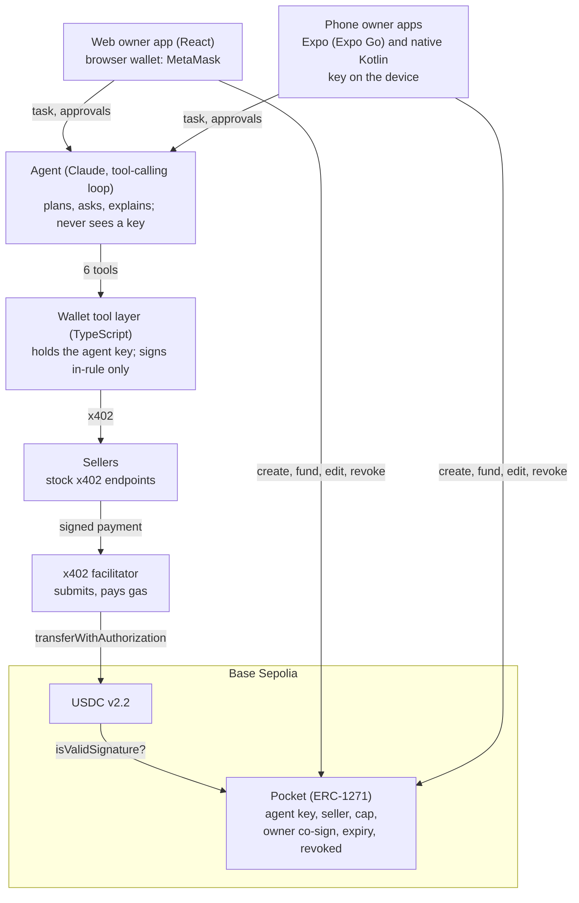

# 链AI脑 ChainBrain: Technical Document

FinTechathon 2026, International AI Track, Topic F (Agent Wallet). Prelim entry.

**Give your AI a pocket, not your wallet.** ChainBrain is a consumer wallet where the owner opens *pockets* for an AI agent. Each pocket holds its own USDC and rules. The agent spends from it on-chain by itself over x402, and the pocket contract enforces the rules at settlement. A hijacked agent can lose at most the pocket's balance, and only to sellers the owner approved.

## 1. Architecture

| Component | Path | Stack |
| --- | --- | --- |
| Pocket + factory | `contracts/` | Solidity 0.8.24, Foundry, OpenZeppelin 5.4 (ECDSA) |
| Wallet tool layer + agent API | `server/src/wallet`, `server/src/agent`, `server/src/index.ts` | Node 24, TypeScript, Hono, viem, `@x402/*` 2.28.0, Anthropic SDK |
| Test sellers | `server/src/sellers.ts` | Stock `@x402/hono` middleware, one template, four configurations |
| Web owner app | `web/` | Vite + React 19, browser wallet (EIP-1193) |
| Phone owner app (Expo) | `mobile/` | Expo SDK 57, React Native 0.86, viem, `expo-secure-store` |
| Phone owner app (native) | `android/` | Kotlin, Jetpack Compose, web3j crypto/abi 4.12.3, OkHttp, Android Keystore |

The three owner apps share one wallet API (`/api/config`, `/api/chat`, `/api/approvals/:id`, `/api/events` as SSE and `/api/events.json` for polling) and the same design tokens.

## 2. The pocket check

USDC v2.2 calls `isValidSignature(hash, signature)` on a contract payer before any `transferWithAuthorization` moves money. ERC-1271 passes only a hash and is `view`, so the pocket cannot see the recipient or amount and cannot keep counters. Two design choices follow:

1. **The signature is an envelope**: `abi.encode(to, value, validAfter, validBefore, nonce, agentSig, ownerSig)`. The pocket rebuilds the USDC EIP-712 digest for a transfer *from itself* with those fields and rejects the call unless it equals `hash`. A permit, a Permit2 message or any other digest fails this first check.
2. **Budget = balance.** Funding the pocket sets the budget; USDC cannot move more than the balance, so no spend counter is needed.

Then, in order: the agent key signed the digest; `canPay(to, value)` is `OK` (not revoked, not expired, seller allowlisted, value ≤ cap, value ≤ balance); above `askAbove`, the owner also signed the same digest. `askAbove = 0` asks every time; `askAbove = 2^256 - 1` never asks. Owner-only functions: `revoke`, `returnFunds`, `setSeller`, `setCap`, `setAskAbove`, `setExpiresAt`.

Tests: `contracts/test/Pocket.fork.t.sol`, 20 tests on a Base Sepolia fork against the real USDC v2.2 bytecode.

## 3. The tool layer's signing rule

The LLM never holds a key and has six tools: `search_sellers`, `get_quote`, `draft_intent`, `pay`, `ask_owner`, `get_pocket`. No tool takes a recipient address, edits or opens a pocket, or reads the main wallet or other pockets.

`pay` signs only a USDC `TransferWithAuthorization` that the tool layer built itself: from = pocket, to = the quoted `payTo`, value = the quoted amount. Anything else returns `SIGNATURE_TYPE_NOT_ALLOWED`. Before signing it checks the quote against the confirmed intent (price per item, total, item count, deadline) and against `canPay` on-chain, and returns a reason code on refusal (`server/src/wallet/reasons.ts`) so the model can re-plan. Seller content reaches the model only inside `<untrusted_content source="…">`.

## 4. x402 integration notes

- A custom client scheme must expose `findDefaultAsset`, or `@x402/fetch` rejects every requirement. We borrow it from the stock `ExactEvmScheme`, which also keeps the client USDC-only.
- `@x402/fetch` caps each payment at US$1 by default; `spendControls.maxAmountPerPayment` is set to the pocket's cap.
- A refused payment comes back as HTTP 402, not an exception; `settle()` maps it to `SETTLEMENT_FAILED` with the facilitator's reason.
- Facilitator: the public testnet facilitator by default; `FACILITATOR=local` runs x402's facilitator code in-process (same verification code, used by every fork test).

## 5. Intent to nonce traceability

The owner confirms a structured intent rendered from a **fixed template** (deadline in HKT), never from the model's words. Every payment's EIP-3009 nonce is `keccak256(abi.encode(intentHash, seq))`, so each on-chain transfer maps back to the task it served. Owner co-signatures above the ask-me threshold are over the exact USDC digest, and expire with its 10-minute `validBefore`.

## 6. Owner keys

| App | Owner key | Signs with |
| --- | --- | --- |
| Web | The browser wallet (MetaMask), never seen by the app | `eth_signTypedData_v4`, `eth_sendTransaction` |
| Expo | Generated (`getRandomBytesAsync`) or imported; stored in Keychain / Keystore via `expo-secure-store` | viem `signTypedData` |
| Native Android | Generated (`SecureRandom`, range-checked) or imported; encrypted with an AES-GCM key held in the Android Keystore | web3j `Sign.signMessage` over the EIP-712 digest |

The Kotlin signer is tested to be byte-identical to viem (`android/app/src/test/.../LogicTest.kt`). Testnet keys only. MetaMask mobile via WalletConnect (Reown AppKit) needs a Reown project ID; its native dependencies are bundled in Expo Go, so a development build is not strictly required (see [MetaMask on the phone](04-build/metamask-expo-go.md)).

## 7. Deployment and evidence

- Factory: `contracts/deployments/84532.json` after `forge script script/Deploy.s.sol --broadcast` (see README).
- Evidence: `docs/evidence.md`, one Basescan link per scene.

## 8. Test summary

| Suite | Command | Result (local) |
| --- | --- | --- |
| Contracts (Base Sepolia fork) | `cd contracts && forge test` | 20 passed |
| Server (sellers, intent, pay, tools, agent, API) | `cd server && pnpm test` | 37 passed |
| Scenes 1–8 through the agent loop | `cd server && SCENE_REPLAY=1 pnpm test:scenes` | 6 passed (replay); real model needs `ANTHROPIC_API_KEY` |
| Web | `cd web && pnpm test && pnpm build` | 9 passed, build clean |
| Expo | `cd mobile && npm test && npm run typecheck && npx expo-doctor` | 4 passed, 21/22 checks |
| Native Android | `cd android && ./gradlew testDebugUnitTest assembleDebug` | 6 passed, APK built |

## 9. Finals roadmap

**Roadmap, not in prelim demo.** Seller trust layer (agent identity, owner backing, serve / ask / refuse verdicts); attested seller categories enforced by pockets; reputation; bring-your-own-agent via a public MCP server; the pocket on FISCO BCOS settling a tokenized deposit; Hong Kong licensed stablecoins or bank deposit tokens; zero-knowledge privacy for pocket checks.
