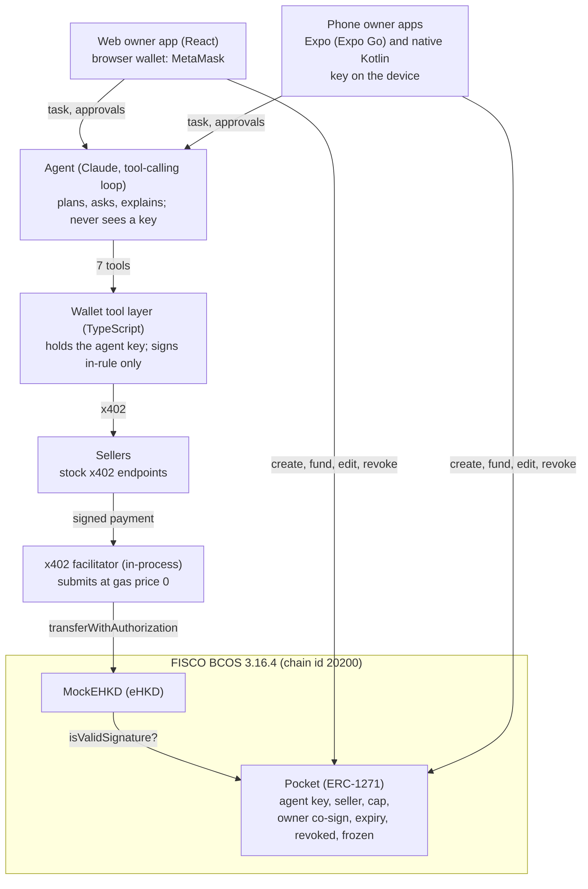

# 链AI脑 ChainBrain: Technical Document

FinTechathon 2026, International AI Track, Topic F (Agent Wallet). Prelim entry.

**Give your AI a pocket, not your wallet.** ChainBrain is a consumer wallet where the owner opens *pockets* for an AI agent. Each pocket holds its own Mock e-HKD (eHKD) and rules, on FISCO BCOS. The agent spends from it on-chain by itself over x402, and the pocket contract enforces the rules at settlement. A hijacked agent can lose at most the pocket's balance, and only to sellers the owner approved.

## 1. Architecture

| Component | Path | Stack |
| --- | --- | --- |
| Pocket + factory | `contracts/` | Solidity 0.8.24, Foundry, OpenZeppelin 5.4 (ECDSA) |
| Wallet tool layer + agent API | `server/src/wallet`, `server/src/agent`, `server/src/index.ts` | Node 24, TypeScript, Hono, viem, `@x402/*` 2.28.0, Anthropic SDK |
| Test sellers | `server/src/sellers.ts` | Stock `@x402/hono` middleware, one template, four configurations |
| Web owner app | `web/` | Vite + React 19, browser wallet (EIP-1193) |
| Phone owner app (Expo) | `mobile/` | Expo SDK 57, React Native 0.86, viem, `expo-secure-store` |
| Phone owner app (native) | `android/` | Kotlin, Jetpack Compose, web3j crypto/abi 4.12.3, OkHttp, Android Keystore |

The three owner apps share one wallet API (`/api/config`, `/api/chat`, `/api/approvals/:id`, `/api/events` as SSE and `/api/events.json` for polling) and the same design tokens.

## 2. The pocket check

`MockEHKD` calls `isValidSignature(hash, signature)` on a contract payer before any `transferWithAuthorization` moves money. ERC-1271 passes only a hash and is `view`, so the pocket cannot see the recipient or amount and cannot keep counters. Two design choices follow:

1. **The signature is an envelope**: `abi.encode(to, value, validAfter, validBefore, nonce, agentSig, ownerSig)`. The pocket rebuilds the token's EIP-712 digest for a transfer *from itself* with those fields and rejects the call unless it equals `hash`. A permit, a Permit2 message or any other digest fails this first check.
2. **Budget = balance.** Funding the pocket sets the budget; the token cannot move more than the balance, so no spend counter is needed.

Then, in order: the agent key signed the digest; `canPay(to, value)` is `OK` (not revoked, not frozen, not expired, seller allowlisted, value ≤ cap, value ≤ balance); above `askAbove`, the owner also signed the same digest. `askAbove = 0` asks every time; `askAbove = 2^256 - 1` never asks. Owner-only functions: `revoke`, `returnFunds`, `setSeller`, `setCap`, `setAskAbove`, `setExpiresAt`, `unfreeze`. `freeze(reason)` may also be called by the pocket's immutable **guardian** key (the Sentinel's), which can do nothing else: it cannot move money, unfreeze or change a rule.

Tests: `contracts/test/PocketCases.sol` holds 24 pocket cases (including the guardian freeze); `contracts/test/Pocket.ehkd.t.sol` runs them on Mock e-HKD with a seconds clock and again on a millisecond clock (FISCO's), plus 7 MockEHKD tests in `MockEHKD.t.sol`.

## 3. The tool layer's signing rule

The LLM never holds a key and has seven tools: `search_sellers`, `get_quote`, `counter_offer`, `draft_intent`, `pay`, `ask_owner`, `get_pocket`. No tool takes a recipient address, edits or opens a pocket, or reads the main wallet or other pockets.

`pay` signs only an eHKD `TransferWithAuthorization` that the tool layer built itself: from = pocket, to = the quoted `payTo`, value = the quoted amount. Anything else returns `SIGNATURE_TYPE_NOT_ALLOWED`. Before signing it checks the quote against the confirmed intent (price per item, total, item count, deadline) and against `canPay` on-chain, and returns a reason code on refusal (`server/src/wallet/reasons.ts`) so the model can re-plan. Seller content reaches the model only inside `<untrusted_content source="…">`.

## 4. x402 integration notes

- x402 has no default asset for eip155:20200, so sellers price as an explicit asset amount `{amount, asset, extra: {name, version}}` and the client allows only the Mock e-HKD token through `spendControls.allowedAssets`.
- `spendControls` caps each payment at the pocket's cap (an atomic eHKD amount).
- A refused payment comes back as HTTP 402, not an exception; `settle()` maps it to `SETTLEMENT_FAILED` with the facilitator's reason.
- Facilitator: x402's own facilitator code always runs in-process (in the server and in the sellers); there is no hosted facilitator for FISCO.

## 5. Intent to nonce traceability

The owner confirms a structured intent rendered from a **fixed template** (deadline in HKT), never from the model's words. Every payment's EIP-3009 nonce is `keccak256(abi.encode(intentHash, seq))`, so each on-chain transfer maps back to the task it served. Owner co-signatures above the ask-me threshold are over the exact eHKD digest, and expire with its 10-minute `validBefore`.

## 6. Owner keys

| App | Owner key | Signs with |
| --- | --- | --- |
| Web | The browser wallet (MetaMask), never seen by the app | `eth_signTypedData_v4`, `eth_sendTransaction` |
| Expo | Generated (`getRandomBytesAsync`) or imported; stored in Keychain / Keystore via `expo-secure-store` | viem `signTypedData` |
| Native Android | Generated (`SecureRandom`, range-checked) or imported; encrypted with an AES-GCM key held in the Android Keystore | web3j `Sign.signMessage` over the EIP-712 digest |

The Kotlin signer is tested to be byte-identical to viem (`android/app/src/test/.../LogicTest.kt`). Demo keys only. The phone apps send owner transactions as legacy transactions with gas price 0. MetaMask mobile via WalletConnect (Reown AppKit) needs a Reown project ID; its native dependencies are bundled in Expo Go, so a development build is not strictly required (see [MetaMask on the phone](04-build/metamask-expo-go.md)).

## 7. Deployment and evidence

- `scripts/fisco/deploy.sh` runs `contracts/script/DeployFisco.s.sol` and writes `contracts/deployments/20200.json` (MockEHKD `0x0355c0c5Afe2A35369056FBB854903A4aF07781A`, PocketFactory `0x03aB4C311eeE7C3295c63F910D79a07Ffa7A097A`; the same on every fresh chain). The factory constructor is `(token, guardian)`.
- Evidence: `docs/evidence-fisco.md` / `.json` (local chain) and `docs/evidence-fisco-railway.json` (hosted chain). `cd server && pnpm tsx scripts/verify-evidence.ts` re-fetches every hash and checks status, block and event.
- Hosted on Railway: `fisco-node` (JSON-RPC, chain 20200), `fisco-api` (wallet API, `/explorer`, `/faucet`) and `fisco-sellers`. URLs in the README.

## 7a. FISCO BCOS and the Mock e-HKD

`server/src/chains.ts` holds the one chain: FISCO BCOS (chain id 20200), RPC, token, EIP-712 domain, currency (HK$), tx link and x402 network. The web and Expo apps read the RPC, explorer link prefix and signing domain from `/api/config`, so they sign the Mock e-HKD v1 domain. Keys are ECDSA secp256k1 (not SM2), so viem, web3j, MetaMask and the pocket's ecrecover work as on any EVM chain. The pocket and factory hold the token as `token`.

`MockEHKD` ("Mock e-HKD", symbol eHKD, 6 decimals) is a demo token, not the HKMA e-HKD and not money. It implements EIP-3009 `transferWithAuthorization`, including the `bytes signature` overload that asks a contract payer through ERC-1271. The pocket reads the domain from the token's `DOMAIN_SEPARATOR()`.

FISCO has no public explorer, so the wallet API serves a read-only explorer at `/explorer` and receipts at `/api/tx/:hash`. The faucet (`POST /api/faucet`) credits native balance plus HK$100 eHKD, once per address per day.

What FISCO BCOS 3.16.4 needed:
1. The web3 RPC refuses any sender with zero native balance, even at gas price 0. The chain is built in auth mode with balance features on. Senders are credited by `scripts/fisco/fund.sh` locally, by the node gateway's `/admin/fund` on Railway, or by the faucet.
2. Genesis `alloc` is not parsed, and `executor.version=2` crashes the node, so balances are added after start.
3. No `eth_feeHistory`: forge uses `--legacy --with-gas-price 0`; the Expo and Kotlin apps send legacy zero-price transactions.
4. Contracts see `block.timestamp` in **milliseconds** (the RPC header says seconds). `contracts/src/Clock.sol` normalises it (`nowSec()`), so pocket expiry and EIP-3009 windows stay in seconds; 24 pocket tests run on a millisecond clock.
5. A sender's transactions are not ordered by nonce inside a block, so deploys use `forge --slow` and every client waits for each receipt.
6. FISCO reports any account it tracks (native balance, nonce) with pseudo-code `[PRECOMPILED],…,/usr/<address>`, so a funded EOA has a non-zero code size. OpenZeppelin's `SignatureChecker` then takes the ERC-1271 path and rejects the EOA's own EIP-3009 signature (reproduced on the local chain). `MockEHKD` checks ECDSA by the signer first and asks ERC-1271 only otherwise; pockets still go through ERC-1271. The explorer treats that pseudo-code as an account, not a contract.
7. No `eth_feeHistory`, but blocks carry `baseFeePerGas: 0x0`, so wallets (MetaMask, ethers, forge without `--legacy`) take the EIP-1559 path and fail. The hosted node's gateway (`deploy/fisco-node/gateway.mjs`) answers `eth_feeHistory` with the chain's real history: all zeros. With it, an EIP-1559 (type 2) transaction from `cast` succeeds against the public RPC.
8. `transactionIndex` comes back as the hex of its ASCII text (`"0x307830"` for `"0x0"`), which overflows client number parsers. The gateway repairs it in responses.
9. The FISCO console's own transactions (balance credits to precompile `0x1011`) carry FISCO's 128-bit random nonce and chain id 0, so Ethereum clients cannot parse a full block that contains one (viem `getBlock({ includeTransactions: true })`). Wallets only read their own transactions, so they are unaffected; the explorer reads raw blocks.

## 8. Test summary

| Suite | Command | Result (local) |
| --- | --- | --- |
| Contracts | `cd contracts && forge test` | 55 passed: MockEHKD 7, pockets on eHKD 24, on a millisecond clock 24 (17 Oct) |
| Server (sellers, intent, pay, tools, agent, API, Radar, Sentinel, memory, rules, Pre-flight, haggler) | `cd server && pnpm test` | 82 passed, 6 skipped without `ANTHROPIC_API_KEY`, on the local FISCO node (17 Oct; needs `forge build`) |
| Scenes 1–8 through the agent loop | `cd server && SCENE_REPLAY=1 pnpm test:scenes` | 6 passed (replay); real model needs `ANTHROPIC_API_KEY` |
| Evidence | `cd server && pnpm tsx scripts/verify-evidence.ts` | 17/17 hashes valid |
| Web | `cd web && pnpm test && pnpm build` | 82 passed (17 Oct) |
| Built-in network (`shared/sim`, scenes 1-11) | `cd mobile && node --import tsx --test ../shared/sim/*.test.ts` | 57 of 58 passed (17 Oct); the one failure is a time-of-day test that also fails on older code |
| Expo | `cd mobile && npm test && npm run typecheck && npx expo-doctor` | 46 passed (17 Oct), including a full auto-play run of scenes 1-11 |
| Native Android | `cd android && ./gradlew testDebugUnitTest assembleDebug` | 6 passed, APK built |

## 9. The AI brain

Ten features sit on top of the agent loop, all following one rule: **AI only tightens**. Full description, guards and models: [ai-brain.md](ai-brain.md).

| Feature | Server | Shared with the built-in network |
| --- | --- | --- |
| Understands, plans and buys, adapts | `server/src/agent/`, `server/src/wallet/tools.ts`, reason codes in `reasons.ts` | `shared/sim/script.ts`, `intent.ts` |
| Resists manipulation | `<untrusted_content>` wrapping, `scan.ts`, signing rule above | `shared/sim/checks.ts` |
| Radar (counterparty screening and monitoring) | `server/src/radar/`, `/api/radar/*`; `COUNTERPARTY_HIGH_RISK`, `COUNTERPARTY_REVIEW` | `shared/sim/radar.ts` |
| Sentinel (freeze-only second layer) | `server/src/sentinel/` (guardian key `SENTINEL_PK`; typed AI via TypeSafe Jev or Claude Haiku); `/api/sentinel` | `shared/sim/sentinel.ts` |
| Brain memory | `server/src/brain/`, `/api/memory`, `/api/memory/forget` | `shared/sim/reflect.ts` |
| Speak your rules | `server/src/rules/compile.ts`, `/api/rules/compile` | `shared/sim/speak.ts`, `proof.ts` |
| Pre-flight | `server/src/wallet/preflight.ts` (`eth_call` of the exact `transferWithAuthorization`) | dry run in `shared/sim/world.ts` |
| Haggler | `counter_offer` tool; sellers `POST /<seller>/<sku>/offer` and the 402 for `?deal=<id>` | `shared/sim/haggle.ts` |

## 10. Finals roadmap

**Roadmap, not in prelim demo.** Seller trust layer (agent identity, owner backing, serve / ask / refuse verdicts); attested seller categories enforced by pockets; reputation; bring-your-own-agent via a public MCP server; a pocket settling a real tokenized deposit (today we use Mock e-HKD); Hong Kong licensed stablecoins or bank deposit tokens; zero-knowledge privacy for pocket checks.
